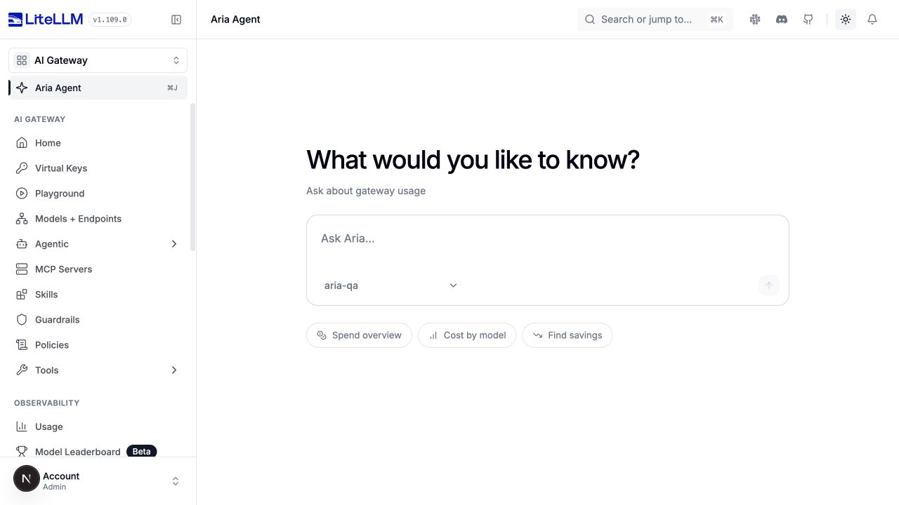
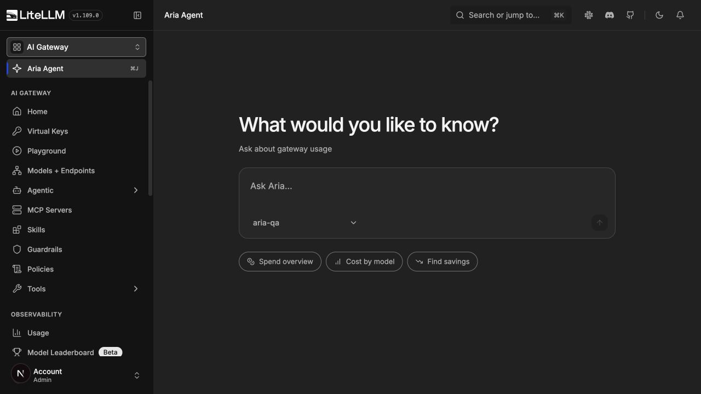
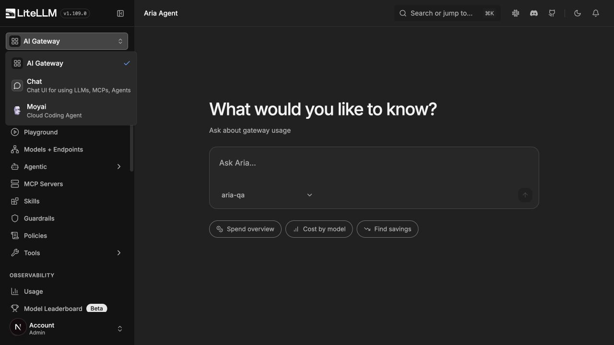
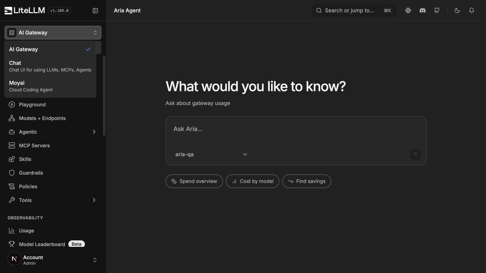
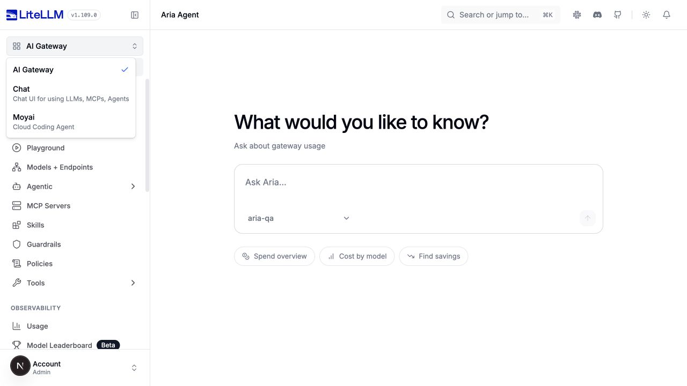

# Dashboard rebuild evidence

Before: main at 527d882508beecd140baa52a812ab8909f2095fa
After: 52510b798eb0f2ed1e4e6a51f34cc1a1f1cdc39a

Both frontends use the same disposable local proxy and PostgreSQL database. Home screenshots show the same nine real QA requests and $0.11 total spend. No production account data is used

The annotated header images are browser screenshots of the original screenshots with red CSS outlines. The original JPG files are retained unchanged

The main branch only has the Aria quick panel. The rebuild adds the Aria page. The live chart is an actual model answer using local usage reads through the internal gateway. Page-to-panel-to-page navigation preserved the answer, draft and selected model

Desktop light screenshots are 1280 by 720. Desktop dark screenshots are 1728 by 824. Mobile was checked at 390 by 844, laptop at 1024 by 800, and collapsed navigation at 1280 by 720

The environment-login banner is an actual warning from the disposable proxy. The Next development issues badge includes warnings also observed on main; it is not production UI

## Home

- light: [before](main-home-light.jpg), [after](rebuilt-home-light.jpg)
- dark: [before](main-home-dark.jpg), [after](rebuilt-home-dark.jpg)

## Search

- light: [before](main-search-light.jpg), [after](rebuilt-search-light.jpg)
- dark: [before](main-search-dark.jpg), [after](rebuilt-search-dark.jpg)

## Bell

- light: [before](main-bell-light.jpg), [after](rebuilt-bell-light.jpg)
- dark: [before](main-bell-dark.jpg), [after](rebuilt-bell-dark.jpg)

## Account

- light: [before](main-account-light.jpg), [after](rebuilt-account-light.jpg)
- dark: [before](main-account-dark.jpg), [after](rebuilt-account-dark.jpg)

## Aria

- light: [before](main-aria-light.jpg), [after](rebuilt-aria-light.jpg)
- dark: [before](main-aria-dark.jpg), [after](rebuilt-aria-dark.jpg)

## Additional proof

- [Live model-cost chart](rebuilt-aria-live-dark.jpg)
- [Quick panel, dark](rebuilt-panel-dark.jpg)
- [Quick panel, light](rebuilt-panel-light.jpg)
- [Mobile](rebuilt-aria-dark-mobile.jpg)
- [Collapsed navigation](rebuilt-collapsed-light.jpg)

## Selected Aria design and final navigation

Source: db4ec9832df2b11cf0d72a3d51288a2b3e1931c1

Aria has one dedicated page; Home remains the default. Usage links to Aria instead of embedding another composer. Suggestions fill an editable draft. The access description follows the account permissions. Theme remains in the header; the shield appears only for active warnings, with deployment health still reachable under the bell.

The personal-spend screenshot is a real model response using the signed-in disposable QA user without requesting an ID. This uses synthetic test activity in the isolated local database. Admin write approvals are covered by integration tests, not this live run.

Notification before/after captures show the intermediate layout immediately before and after grouping content above the utility footer. Original main screenshots remain above.

- [aria-focused-light.jpg](aria-focused-light.jpg)
- [aria-focused-dark.jpg](aria-focused-dark.jpg)
- [aria-focused-laptop-dark.jpg](aria-focused-laptop-dark.jpg)
- [aria-focused-mobile-dark.jpg](aria-focused-mobile-dark.jpg)
- [aria-personal-spend-live.jpg](aria-personal-spend-live.jpg)
- [usage-page-only-entry.jpg](usage-page-only-entry.jpg)
- [notifications-before-hierarchy.jpg](notifications-before-hierarchy.jpg)
- [notifications-after-hierarchy.jpg](notifications-after-hierarchy.jpg)

## Selected Sparkle icon

Source 007a2569b273e6be8d22cc318327581645206cce. The shared Aria icon now uses Lucide Sparkle. Earlier screenshots above predate this icon-only change

## Workspace menu without icon column

Source 58120baf64cc37e45e36696dbdf77a8a989e7e1f. Menu rows share one text edge and retain descriptions and the selection check. The collapsed trigger and navigation behavior are unchanged. Before was captured at 007a2569b2

