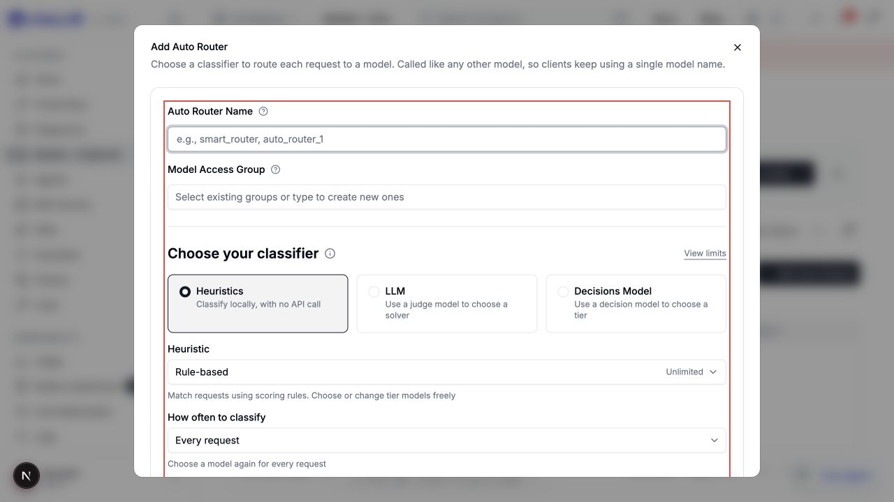
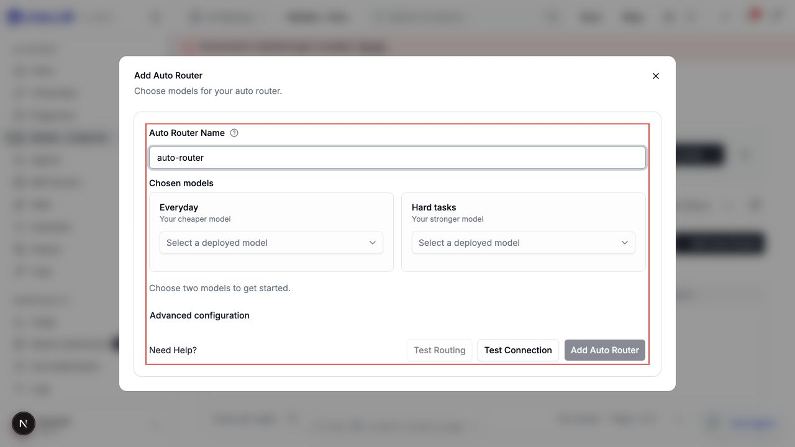
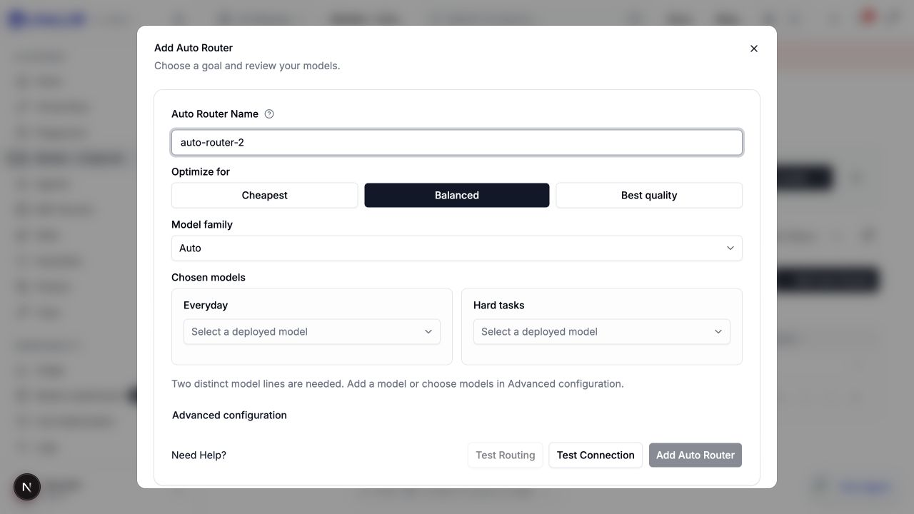
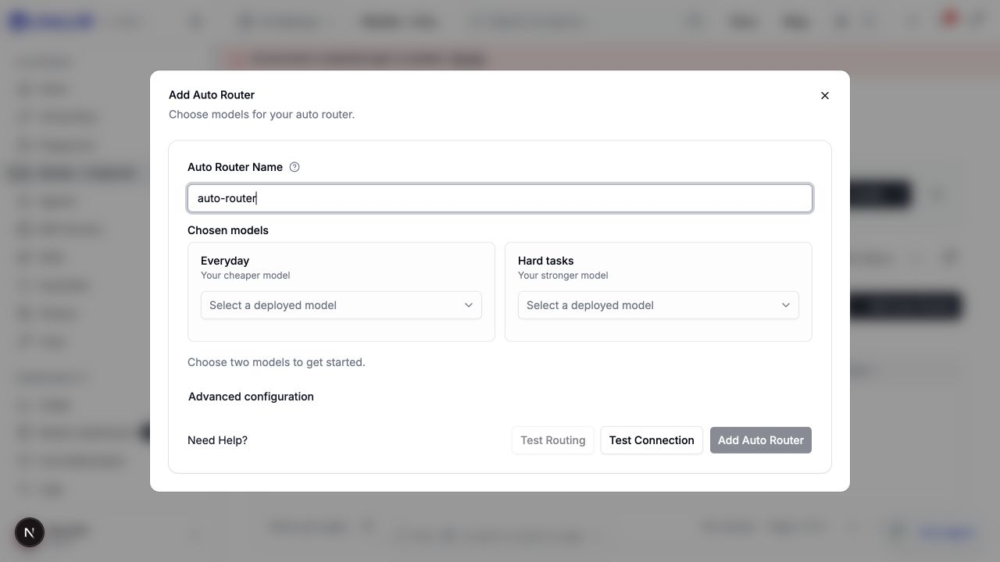
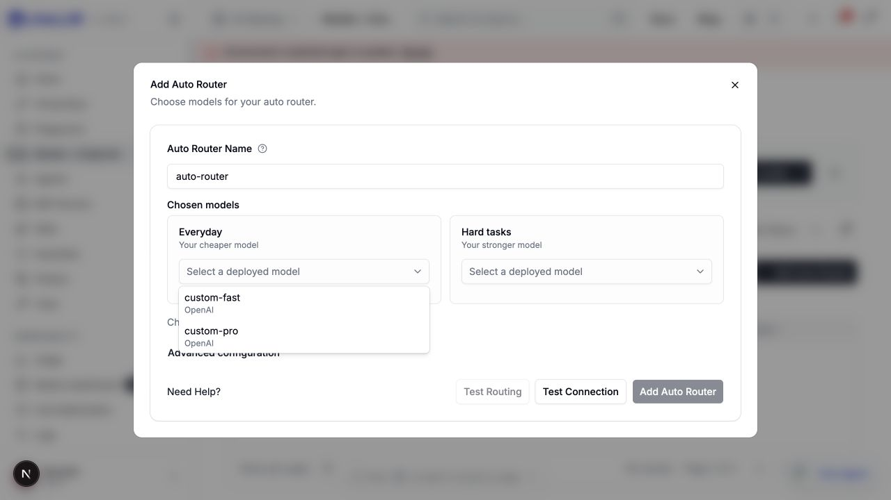
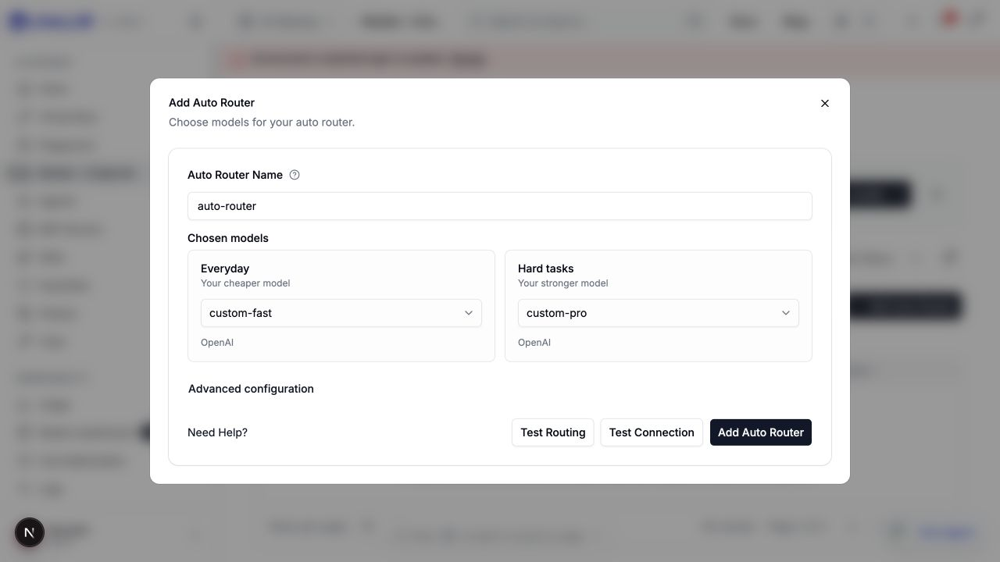
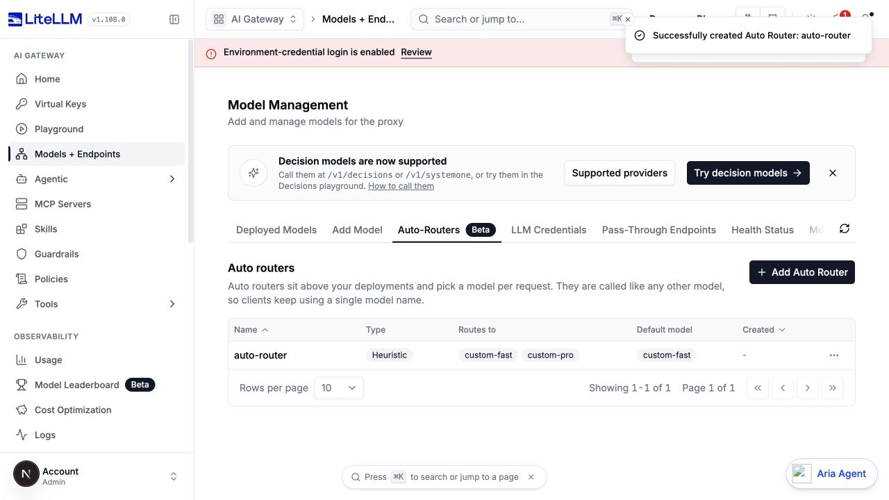

# Auto Router custom-model setup

PR [#48451](https://github.com/BerriAI/litellm/pull/48451), source `daf79031e6dfc6ead6527db2059e8e3c61de8191`

Captured from the actual dashboard and proxy with disposable PostgreSQL storage. Two synthetic chat deployments, `custom-fast` and `custom-pro`, use the OpenAI adapter. No inference calls or real provider credentials were used

## Before and after

The comparison uses the same page, viewport, and two custom deployments. Red outlines are temporary capture annotations and are absent from the committed code

Base `b7a2226f438499509730c9fe649beb026b7cb4fe` exposes classifier, frequency, and four tier controls

Current tip `daf79031e6d` asks for only Everyday and Hard-task models when it cannot recommend a pair

The prior PR tip `ffb9cfd5d37` could not select unknown custom models in the simple flow. This supplemental capture had other blocked fixtures and an earlier saved router

## Custom fallback

## Verification

1. Open `/models-and-endpoints?tab=auto-routers` and click Add Auto Router
2. With only these two custom chat deployments, observe no goal or family decision
3. Choose `custom-fast` for Everyday and `custom-pro` for Hard tasks. The other role excludes the already chosen model
4. Click Add Auto Router and observe the saved router in the table
5. Read `/v2/model/info`. The [sanitized saved configuration](custom-saved-config.json) confirms Heuristic v1, every-user-turn classification, SIMPLE/MEDIUM using custom-fast and COMPLEX/REASONING using custom-pro

Advanced also received all four custom-model tier assignments and retained Every new user message in a live UI check before commit, with identical product source

245 focused resolver/form tests pass. `make check` and production build pass. An initial test run hit a dropdown-animation race; the new case now uses the existing select helper and the final full focused run passes

[Historical goal/family, provider, wildcard, and license screenshots](https://github.com/BerriAI/litellm/blob/e370ee816d4bee324136b9df68b1ad65662331ea/README.md) retain their original revision labels
