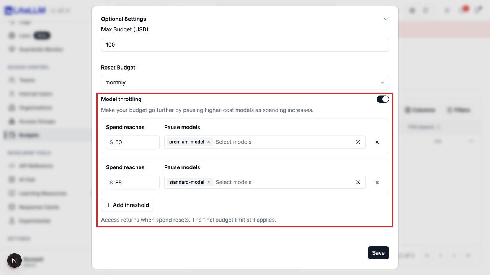

# Make a budget go further with model throttling

Model throttling pauses selected models at intermediate spending thresholds. Callers can continue using other allowed models until they reach the final budget. Choosing lower-cost models can leave room for more tokens within the same budget.

## Set up in the Admin UI

As a proxy admin, open the budget settings when creating or editing a virtual key or team, editing an internal user, or creating or editing a reusable budget. On the Budgets page, expand **Optional Settings**.

Set **Max Budget (USD)**, then turn on **Model throttling**. Enter an amount under **Spend reaches** and select **Pause models**. Use **Add threshold** for another spending level, then save.

For a $100 budget, you could pause a premium model at $60 and a standard model at $85. From $85 onward, both remain paused. Other allowed models remain available until the $100 cap. The model picker uses the entity's allowed models, including models granted through access groups.

Each amount must be greater than zero and below the final budget. Select each model at only one threshold. Removing a threshold or turning throttling off restores the access that rule paused, subject to any other applicable budgets.



## Configure through the API

Set `LITELLM_BASE_URL` to your gateway URL and `LITELLM_MASTER_KEY` to its admin key. Replace the example model names below with models configured on your gateway.

```bash
curl "$LITELLM_BASE_URL/key/generate" \
  -H "Authorization: Bearer $LITELLM_MASTER_KEY" \
  -H 'Content-Type: application/json' \
  -d '{
    "key_alias": "application-budget",
    "models": ["premium-model", "standard-model", "economy-model"],
    "max_budget": 100,
    "budget_duration": "30d",
    "model_throttling": {
      "thresholds": [
        {"spend": 60, "models": ["premium-model"]},
        {"spend": 85, "models": ["standard-model"]}
      ]
    }
  }'
```

The response includes the key and its `model_throttling` configuration. The same configuration is accepted by user, team, and reusable budget creation and update endpoints. Budgets attached to projects, organizations, end users, team members, tags, or model access groups apply to the corresponding spend scope.

To disable a key's rules, set `LITELLM_KEY` to the virtual key and send an explicit `null`.

```bash
curl "$LITELLM_BASE_URL/key/update" \
  -H "Authorization: Bearer $LITELLM_MASTER_KEY" \
  -H 'Content-Type: application/json' \
  -d "{\"key\": \"$LITELLM_KEY\", \"model_throttling\": null}"
```

## What callers see

A request to a paused model returns HTTP 429 with `error.type` set to `model_throttled`. Its message identifies the spending threshold and asks the caller to choose another available model or wait for the budget reset. Requests to other allowed models continue normally. The gateway does not silently substitute a different model.

Thresholds use the budget's total spend for its current period. Pauses accumulate, and access returns when that spend resets. Applicable key and parent budgets all apply. Aliases, deployment IDs, and fallback routing cannot bypass a paused model. At the final cap, the existing budget-exceeded response applies.

Spend tracking follows the gateway's existing accounting behavior. A request already in progress can finish after a threshold is crossed. Configuration edits follow the existing authentication-cache propagation behavior for their scope.

Model throttling is separate from `throttle_on_budget_exceeded`, which reduces key rate limits after a budget is exceeded. A key with model throttling keeps its final budget as a hard cap even if that older option is enabled.
