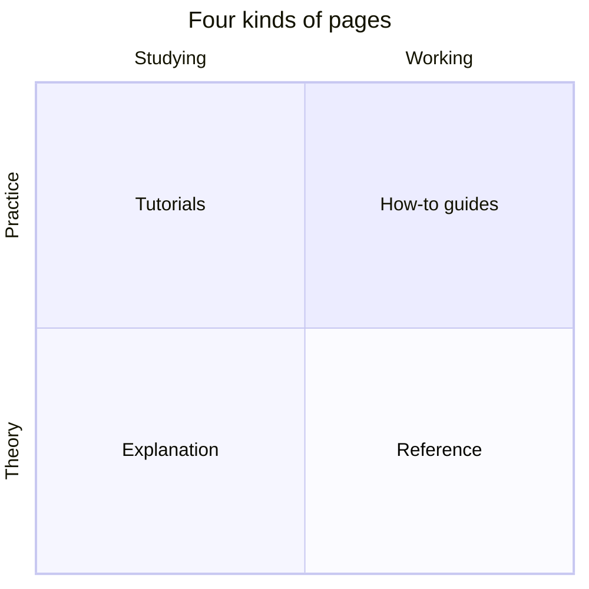

# Architecture

This folder explains how the parts of LiteLLM work inside, for people who change them. It covers one component so far, the router, and more will follow as the Rust migration moves each module behind a public interface and into Rust

Each component's docs follow the [Diataxis](https://diataxis.fr/) layout, so you can pick the kind of page that fits what you need right now

| Kind | Read it when | Router |
| --- | --- | --- |
| Tutorial | you are new to the component and want to see it work | [Route your first requests](router/tutorial/route-your-first-requests.md) |
| How-to guide | you have a specific task to get done | [router/how-to](router/how-to/) |
| Reference | you need an exact name, default, key or signature | [router/reference](router/reference/) |
| Explanation | you want to know why it works the way it does | [router/explanation](router/explanation/) |

Decisions that are hard to reverse are recorded separately as ADRs in [`docs/adrs/`](../adrs/AGENTS.md)

## Which state these pages describe

Each component's pages describe the component once its migration is finished, which means its Rust core is the default and its old Python implementation is deleted. The landing page of each component says how far the code is from that state and how to run the examples on the new core until it is the default. When the code and a page disagree after the migration is finished, the code is right and the page needs a fix in the same PR that changed the behavior
