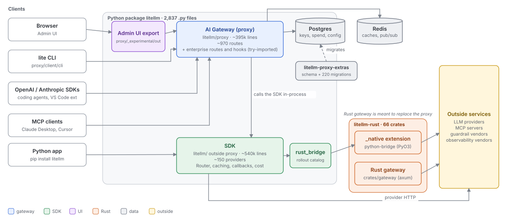

# System overview: what litellm is made of, and what it's trying to be

Quadrant: explanation. Verified on `main` at `13118948` (2026-10-15). Start here, then follow the links

## The pieces

litellm ships as one Python package with two personalities and a few satellites around it

| Piece | What it does | Entry point |
|---|---|---|
| SDK | One function per API shape (`completion`, `responses`, `anthropic_messages`, `embedding`, ...) that translates to about 150 providers, plus a `Router` for load balancing and fallbacks | `litellm/__init__.py`, `main.py`, `router.py` |
| AI Gateway | An HTTP server that puts identity (virtual keys, teams, orgs, SSO), policy (budgets, rate limits, guardrails, model access) and accounting (spend logs, analytics) in front of the SDK. About 970 routes | `litellm/proxy/proxy_server.py`, started by `litellm` CLI |
| Admin UI | Next.js dashboard over the gateway's management API | `ui/litellm-dashboard`, served at `/ui` |
| Rust workspace | Execution core shared by a PyO3 extension under the SDK and a standalone gateway meant to replace the Python one | `litellm-rust/` |
| Enterprise | Extra routes, auth hooks and loggers, loaded when importable | `enterprise/litellm_enterprise` |
| Proxy extras | The Postgres schema and migrations as a separate package | `litellm-proxy-extras` |

Exact product surfaces and their code are in [surface-map.md](../reference/surface-map.md)

## The intent, as the code expresses it

No document states the design in one place. Reading `ARCHITECTURE.md`, the root and crate `AGENTS.md` files, the lint configuration and the shape of the code itself, these are the principles it's trying to follow. Each links to the page that explains it and measures the gap

| Principle | Where it shows up | How it holds today | Page |
|---|---|---|---|
| The gateway is a thin policy layer over the SDK. The SDK never depends on the gateway | `ARCHITECTURE.md:9`, layer rules L1 to L3 | Much better since the October cleanup. `import litellm` loads no proxy module now, but 11 module-level edges and many function-local ones remain, and nothing in CI stops new ones | [02](02-layers-and-dependency-direction.md) |
| Every request goes through one pipeline of auth, pre-call, route, translate, log, post-call | `common_request_processing.py`, `ARCHITECTURE.md` section 1 | True for chat, Responses and Messages. Pass-through and MCP build their own variants, and three API surfaces bridge into each other | [03](03-data-plane-request-pipeline.md) |
| Providers are pure translation configs behind one HTTP handler | `BaseConfig`, `BaseLLMHTTPHandler`, `ARCHITECTURE.md` section 3 | 47 provider paths do this. OpenAI, Anthropic chat and Azure still use legacy handlers | [03](03-data-plane-request-pipeline.md) |
| Configuration and state are explicit | Typed settings stores, repositories, DI rule in root `AGENTS.md` | State lives in package-root and `proxy_server` globals reached by service-locator imports. YAML keys are `setattr`'d without validation | [04](04-control-plane-config-and-state.md) |
| Behavior is extended through plugins, not edits | `CustomLogger`, `CustomGuardrail`, `PROXY_HOOKS`, `get_instance_fn` | Mostly true, but the plugin registry is an if/elif, the base class has about 60 hooks, and core imports every integration | [05](05-extension-points.md) |
| Core execution moves to Rust behind a Python-owned rollout switch | `rust_bridge/catalog.py`, crate `AGENTS.md` files | The switch works and is clean. Only OCR and Bedrock transcription run in Rust by default, and Messages is opt-in | [06](06-python-and-rust.md) |
| Data plane and control plane can be deployed and scaled apart | `gateway/`, `backend/`, `helm/litellm` | The split trims routes once at startup, but lazy routes register later and bypass it on both pods | [07](07-deployment-shapes.md) |

## How to read the rest of the series

The series follows the [Diataxis](https://diataxis.fr/) framework. Explanation pages (like this one) say why things are shaped the way they are and where the shape breaks. Reference pages are lookup tables and diagrams: the [surface map](../reference/surface-map.md), the [data-plane](../reference/user-flows-data-plane.md) and [control-plane](../reference/user-flows-control-plane.md) user flows, the [flow and subsystem matrix](../reference/flow-subsystem-matrix.md) and the [gap register](../reference/gap-register.md). How-to pages solve one task, like [tracing a surface to code](../how-to/trace-a-surface-to-code.md). The [tutorial](../tutorials/follow-one-request.md) walks one request through a local proxy

Every page says which commit it was checked against. Line numbers drift weekly, structure drifts slowly. [refresh-these-docs.md](../how-to/refresh-these-docs.md) has the commands to regenerate every number
