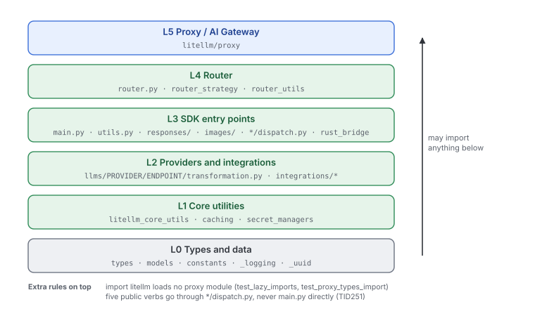
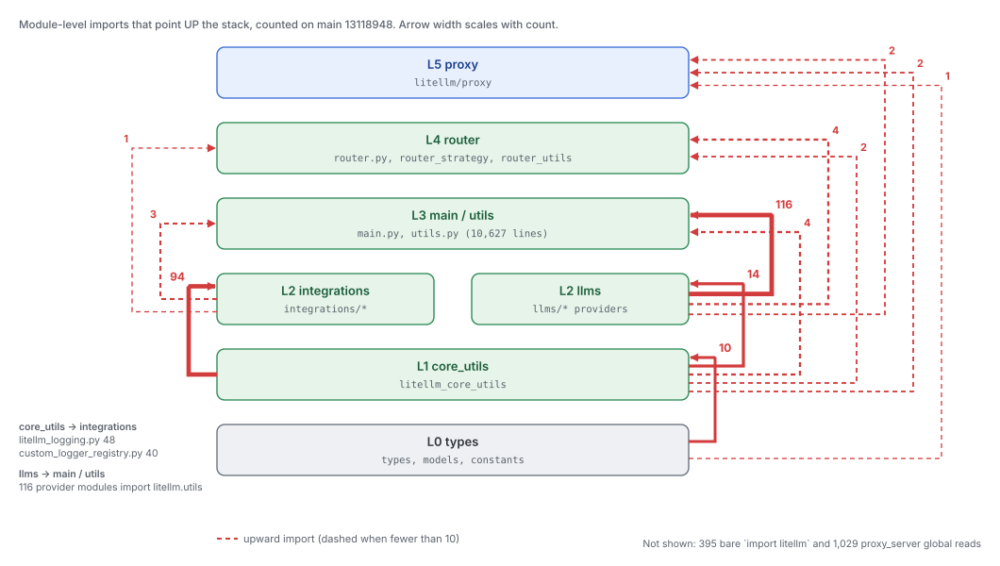

# Layers and dependency direction

Quadrant: explanation. Verified on `main` at `13118948` (2026-10-15) with the scan scripts in [/mnt/project-files/invariants/tools/](/mnt/project-files/invariants/tools/)

The Python package is organized as if it were a stack of layers, where each layer may only import from the layers below it. Nothing in CI enforces that stack yet, so this page describes the stack the code implies, then measures how far the imports actually follow it

## The stack the code implies

Nobody wrote this stack down in one place. It comes from `ARCHITECTURE.md` (the proxy calls the SDK, never the other way), `ARCHITECTURE.md:242-258` (models and repositories sit at the package root so the SDK can use them without proxy internals), the `TID251` dispatch bans in `ruff-strict.toml`, and the rules the earlier invariants work called L1 to L4 ([litellm-invariants-handoff.md](/mnt/project-files/invariants/litellm-invariants-handoff.md))

The arrows mean "is imported by". In words, the proxy may use anything, the Router may use the SDK but not the proxy, provider code may use core utilities and types but not `main`, the Router or the proxy, and `litellm/types` may use nothing but other types

Two more rules ride on top of this stack. `import litellm` must not load any proxy module or any server dependency (`tests/unit/test_lazy_imports.py`, `tests/code_coverage_tests/test_proxy_types_import.py`). And the five public verbs that might run in Rust must be called through their dispatch modules, never through `main.py` directly (see [06-python-and-rust.md](06-python-and-rust.md))

## What the imports actually do

The earlier layer cleanup (Linear LIT-9423, 34 PRs merged on 2026-10-10) cut most of the module-level inversions. These are the numbers today

| Rule | Module-level | Under `TYPE_CHECKING` | Function-local | On 2026-10-09 (module-level) |
|---|---|---|---|---|
| L1 SDK never imports `litellm.proxy` | 11 in 7 files | 29 in 23 files | 170 in 65 files | 40 in 31 files |
| L2 `litellm/llms/**` never imports proxy, main or router | 2 in 2 files | 20 in 16 files | 30 in 13 files | 14 in 11 files |
| L3 `litellm/types/**` imports only types and data | 5 in 3 files (4 are sanctioned leaves) | 13 in 8 files | 6 in 3 files | 13 in 10 files |

The headline result is that `import litellm` in a venv without proxy extras now loads zero `litellm.proxy.*` modules. It still loads 1,124 `litellm.*` modules and takes about 6 seconds, because `main` and `router` load eagerly

The 11 module-level L1 edges left are all MCP, pass-through logging, skills search and the rate-limiter registry

| SDK file | Proxy module it imports |
|---|---|
| `experimental_mcp_client/client.py:100-102` | `proxy._experimental.mcp_server.mcp_context`, `mcp_debug`, `result_conversion` |
| `responses/mcp/litellm_proxy_mcp_handler.py:13-14` | `proxy._experimental.mcp_server.catalog`, `utils` |
| `google_genai/streaming_iterator.py:7` | `proxy.pass_through_endpoints.success_handler` |
| `llms/anthropic/pass_through/messages/streaming_iterator.py:23` | same |
| `litellm_core_utils/custom_logger_registry.py:57,61` | `proxy.hooks.dynamic_rate_limiter`, `dynamic_rate_limiter_v3` |
| `llms/litellm_proxy/skills/skill_search.py:13` | `proxy.common_utils.semantic_text_index` |
| `types/proxy/management_endpoints/team_endpoints.py:8` | `proxy.common_utils.timezone_utils` |

Three of those had open PRs at last check (D1 #45773, D2 #45778, D4 #45788 in [layer-prs-status.md](/mnt/project-files/invariants/layer-prs-status.md))

## The edges the L1 to L3 rules don't look at

The L-rules only check the edges people complained about first. Counting every module-level import between the layers in the stack above shows the upward edges that remain

Dotted red edges point up the stack. Three of them matter more than the rest

The first is that the logging core knows every integration. `litellm_core_utils/litellm_logging.py` and `custom_logger_registry.py` import 88 integration modules between them at module level, so the "core" layer depends on Langfuse, Datadog, Prometheus and the rest. The intent visible in `CustomLogger` (`integrations/custom_logger.py`) is a plugin interface that core calls without knowing who implements it. In practice the registry is a hand-maintained map from callback strings to classes

The second is that providers depend on `utils.py`. 116 provider modules import `litellm.utils` at module level, while `main.py` and `utils.py` import providers to dispatch to them. `utils.py` is 10,627 lines and mixes provider lookup (`get_llm_provider`), the `client` wrapper that every SDK call passes through, response types helpers and model info lookups. That makes L2 and L3 one cycle in practice

The third is that the package root is a global namespace every layer reaches into. 395 modules outside the proxy do a bare `import litellm` at module level, 223 of them in `litellm/llms`. `litellm/__init__.py` declares 419 module-level names, many of them mutable settings (`litellm.callbacks`, `litellm.drop_params`, `litellm.request_timeout`, ...) that the proxy writes at startup with `setattr(litellm, key, value)` (`proxy/proxy_server.py:6830-6864`). A provider reading `litellm.drop_params` has a dependency on the whole package root that no import scan by package path will ever flag. See [04-control-plane-config-and-state.md](04-control-plane-config-and-state.md)

## Inside the proxy

The proxy has its own version of the same problem. `proxy_server.py` (20,830 lines) holds the process-wide state in module globals and 230 other files read it with function-local imports such as `from litellm.proxy.proxy_server import prisma_client`. There are 1,029 such import statements. The most-read names are

| Global in `proxy_server.py` | Import sites elsewhere |
|---|---|
| `prisma_client` | 364 |
| `user_api_key_cache` | 102 |
| `proxy_logging_obj` | 87 |
| `llm_router` | 84 |
| `general_settings` | 77 |
| `proxy_config` | 44 |
| `premium_user` | 28 |
| `master_key` | 16 |

The imports are function-local because a module-level import of `proxy_server` from anywhere it imports would be a cycle. In effect `proxy_server` is a service locator, and the layering inside `litellm/proxy` (auth, management endpoints, hooks, db) is only a folder layout

## The gap

| Intent | What's in place | Evidence |
|---|---|---|
| The SDK never depends on the proxy | Zero proxy modules load on `import litellm`, but 11 module-level, 29 type-only and 170 function-local imports remain | scan above |
| A CI check keeps the stack from regressing | No layer checker on `main`. Z1 (#45798, AST checker with a shrink-only allowlist) was open at last check. The only CI job named for circular imports cannot fail | `tests/documentation_tests/test_circular_imports.py`, invariant L7 |
| Core utilities are below providers and integrations | Core imports integrations 94 times and providers 14 times | scan above |
| Providers are below `utils.py` and `main.py` | 116 provider imports of `litellm.utils` | scan above |
| Settings flow down explicitly | 419 package-root names written by `setattr` from YAML, read by bare `import litellm` from 395 modules | `litellm/__init__.py`, `proxy_server.py:6830-6864` |
| The proxy is made of separable parts | 1,029 function-local imports of `proxy_server` globals from 230 files | `rg "from litellm.proxy.proxy_server import" litellm` |
| `litellm/repositories` is SDK-level and proxy-free (`ARCHITECTURE.md:244`) | No module-level proxy imports left, but function-local ones remain in repositories and `models/mcp_server.py:132` | scan, `func` context |

The fix direction the earlier threads agreed on is in [layer-inversion-plan.md](/mnt/project-files/invariants/layer-inversion-plan.md): move leaf types down, re-export at the old path, then guard with a shrink-only checker. The remaining edges past that plan (the global settings namespace, the `proxy_server` service locator, the logging registry) need dependency injection rather than moves
