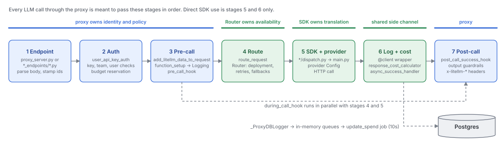
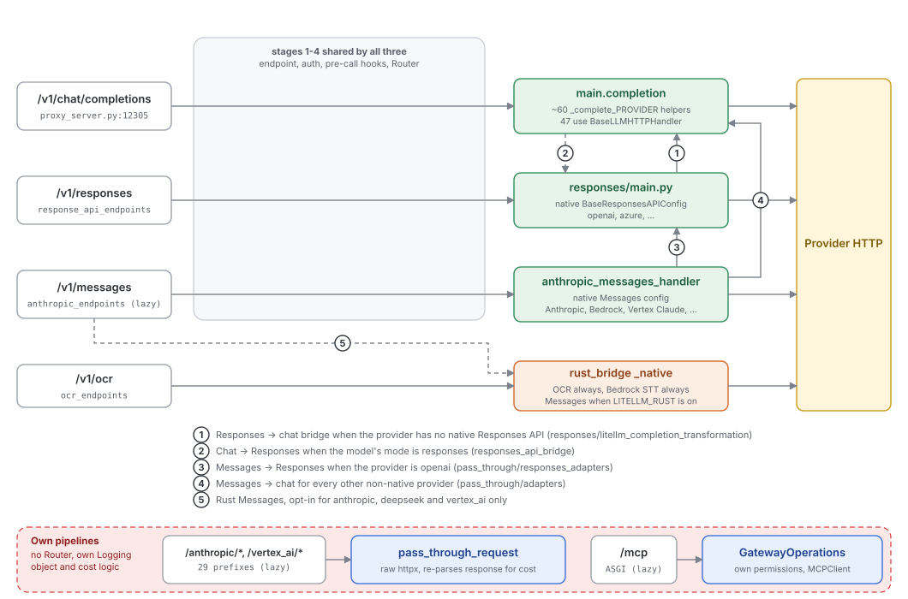

# The data-plane request pipeline

Quadrant: explanation. Verified on `main` at `13118948` (2026-10-15). Step-by-step sequence diagrams for each flow are in [reference/user-flows-data-plane.md](../reference/user-flows-data-plane.md)

Every LLM call through the proxy, whatever its API shape, is meant to pass through the same seven stages. Knowing the stages, and where each API surface deviates from them, is most of what you need to find where a behavior lives

## The seven stages

| Stage | Main code | What it owns |
|---|---|---|
| 1 Endpoint | `proxy_server.py:12305` (chat), `response_api_endpoints/endpoints.py:216`, `anthropic_endpoints/endpoints.py:128`, ... | Parse the body, stamp key/team ids into metadata, hand off to `ProxyBaseLLMRequestProcessing.base_process_llm_request` (`common_request_processing.py:2620`) |
| 2 Auth | `auth/user_api_key_auth.py:4184`, `auth/resolvers/store.py`, `auth/auth_checks.py:1061` | Resolve the key (cache, then DB), run key, team, user, org and end-user checks, reserve budget. Detail in [permission-checks.md](/mnt/project-files/invariants/permission-checks.md) |
| 3 Pre-call | `litellm_pre_call_utils.py:2132`, `utils.py:1001` `function_setup`, `proxy/utils.py:2449` `pre_call_hook` | Enrich the request with key/team controls, aliases, credentials and tags. Create the `Logging` object early so rejected requests still log. Run guardrails, rate limiters and other `async_pre_call_hook`s |
| 4 Route | `route_llm_request.py:599`, `router.py:3016` and `:13920` | Pick a deployment from the model group, apply cooldowns and RPM/TPM checks, retry and fall back |
| 5 SDK + provider | `chat_completions/dispatch.py`, `main.py:425` / `:5124`, `llms/custom_httpx/llm_http_handler.py:683`, `llms/PROVIDER/*/transformation.py` | Resolve the provider (`litellm_core_utils/get_llm_provider_logic.py:161`), translate the request, make the HTTP call, translate the response |
| 6 Log + cost | `utils.py:1712` `client`, `llm_response_utils/response_metadata.py:237`, `litellm_logging.py:1842`, `:3258` | Compute cost into `_hidden_params`, schedule success logging on `GLOBAL_LOGGING_WORKER`, fan out to callbacks including `_ProxyDBLogger` |
| 7 Post-call | `proxy/utils.py:3599`, `common_request_processing.py:3019-3093` | Output guardrails, response model name override, `x-litellm-*` headers |

The idea behind this shape is that the proxy owns identity, policy and accounting (stages 1 to 3 and 7), the Router owns availability (stage 4), the SDK owns translation (stage 5), and logging is a side channel both layers share (stage 6). The SDK used directly, with no proxy, is stages 5 and 6 alone, with the Router optional

## How each API surface maps onto the stages

Most surfaces reuse stages 1 to 4 and 6 to 7 and differ only in what stage 5 calls. Pass-through and MCP are the exceptions, and Responses and Messages chain into each other through bridges

| Surface | Stages it uses | Notable difference |
|---|---|---|
| Chat completions | all seven | The reference path |
| Responses | all seven | Ids are encrypted per key (`hooks/responses_id_security.py`) and carry the model id so the Router can pin the deployment. Providers without a native Responses API are bridged to chat, and that bridge rebuilds history for `previous_response_id` from `LiteLLM_SpendLogs` with raw SQL, so it needs the DB |
| Messages (Anthropic) | all seven | Native for Anthropic-format providers. OpenAI models go Messages -> Responses by default, others go Messages -> chat. One request can pass through three `@client` wrappers sharing one `Logging` object |
| Pass-through (`/anthropic/*`, ...) | 1, 2, 3, 7 and its own 5 and 6 | No Router (credentials come from `passthrough_endpoint_router`), its own `Logging(...)`, per-provider logging handlers that re-parse the raw response to compute cost |
| MCP (`/mcp`) | 2, guardrails from 3, own 5, 6 | ASGI sub-app, calls `user_api_key_auth` by hand, its own permission layer (server, tool, params), no Router |
| OCR, Bedrock transcription | 1 to 4, 6, 7 | Stage 5 is Rust only |

## The gap

| Intent | What's in place | Evidence |
|---|---|---|
| Providers plug into one HTTP handler (`ARCHITECTURE.md`: "you never need to modify the handler") | 47 `_complete_*` helpers use `BaseLLMHTTPHandler`, but OpenAI (the most used provider) goes through the legacy `OpenAIChatCompletion` on the openai SDK unless `EXPERIMENTAL_OPENAI_BASE_LLM_HTTP_HANDLER` is set, and Anthropic chat and Azure use their own handlers. 90 `handler.py` files across 37 providers | `main.py:2577`, `:2811`, `:1220`, invariant P3 |
| Async all the way down | `main.acompletion` runs the sync `completion` in a thread executor, which returns a coroutine that is then awaited | `main.py:680-686` |
| Provider dispatch is data-driven | `main.completion` picks the helper through a long if/elif chain over about 60 providers | `main.py:5864-6072` |
| One routing decision | `route_request` has its own ladder (explicit api_base, comma lists, user_config, router override, team mapping, Router, wildcards, pass-through-all) before the Router's own selection, plus a pre-call fallback loop `_pre_call_with_fallbacks` | `route_llm_request.py:599-826`, `common_request_processing.py:2377` |
| Logging is one side channel | The `Logging` object can be created by `function_setup` in the proxy, by the `@client` wrapper, by `pass_through_request` directly, or by MCP's `call_mcp_tool`. Nested wrappers "claim" the success log to avoid double counting | `utils.py:1398`, `pass_through_endpoints.py:1234` |
| Spend recording can't be skipped | It is a callback. Any path that skips `async_success_handler` skips spend, and post-call guardrails change the order by deferring logging | `common_request_processing.py:2757`, `:3546` |
| Responses sessions are a feature of the Responses layer | Bridged sessions read spend logs, which is accounting data, and force an immediate spend-log flush | `session_handler.py:275`, `db_spend_update_writer.py:1533` |
| Every route is mounted at startup | Messages, pass-through, MCP and about 30 more families mount lazily on the first matching request | `_lazy_features.py:68-326` |
| `ARCHITECTURE.md` describes the pipeline | It misses the Rust dispatch layer, lazy routes, budget reservation, the legacy handlers and the Messages -> Responses route, names `get_llm_provider` in the wrong file and the cost method with a leading underscore, and says spend goes to Redis | `ARCHITECTURE.md:24-90`, [gap-register.md](../reference/gap-register.md) |
