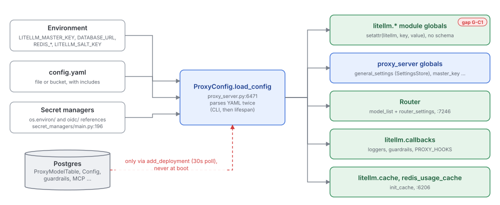
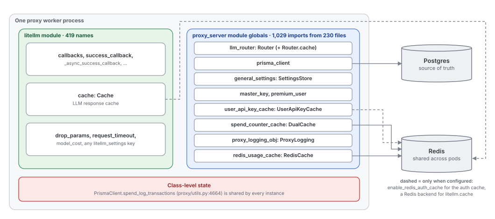
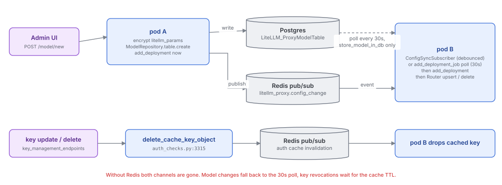

# Control plane: configuration, state and multi-pod sync

Quadrant: explanation. Verified on `main` at `13118948` (2026-10-15)

The data plane is what a request passes through. The control plane is everything that decides how that pipeline behaves: which models exist, which keys are valid, what budgets apply, which callbacks and guardrails run. This page explains where that state comes from, where it lives in a running process, and how a change made on one pod reaches the others

## Where configuration comes from

There are four sources, and they meet in one function, `ProxyConfig.load_config` (`proxy/proxy_server.py:6471`)

The YAML has four top-level sections that land in very different places. `model_list` and `router_settings` build a `Router`. `general_settings` becomes the `general_settings` global, which is a `SettingsStore` object rather than the dict most readers expect (`_bind_general_settings_store`, `:5534`). `guardrails` and the newer typed sections (MCP, vector stores, prompts, policies) go to their own registries. `litellm_settings` is the interesting one. About a dozen keys get special handling, and then every other key is written straight onto the `litellm` module with `setattr(litellm, key, value)` (`:6864`). No schema, no allowlist. A typo in `litellm_settings` silently creates a new module attribute that nothing reads

Secrets are resolved by walking the whole config and calling `get_secret` on every `os.environ/...` string (`_check_for_os_environ_vars`, `:5979`). Two behaviors there surprise people. The strings `"true"` and `"false"` come back as booleans, and `default_value` is only used when an exception is raised, not when the variable is missing

## The startup sequence

Two things in that sequence don't match how the code reads at first glance. Schema migrations run in the CLI before uvicorn starts, so any other entry point (`uvicorn gateway.main:app`, the backend image) has to run them some other way, which is what the separate `litellm-migrations` job image is for. And `load_config` runs before `setup_prisma_client`, so the `_update_config_from_db` branch inside `get_config` never fires at boot. Models, settings and guardrails stored in the DB only arrive on the first `add_deployment` tick

`migrate_if_requested` (`:1462`) sounds like a schema migration but is master-key re-encryption (`proxy/db/master_key_migration.py:185`)

## Where state lives in a running pod

Which cache does what is a frequent source of confusion, so here it is in one table

| Cache | Owner | Shared across pods? | Used for |
|---|---|---|---|
| `litellm.cache` (`caching/caching.py:95`) | `litellm` module, set by `init_cache` (`proxy_server.py:6206`) | If its backend is Redis, S3, GCS or Qdrant | LLM response caching through `LLMCachingHandler` |
| `user_api_key_cache` (`proxy/common_utils/user_api_key_cache.py:37`) | `proxy_server` global | Only if `litellm_settings.enable_redis_auth_cache: true` | Key, team, user, org and end-user auth objects |
| `spend_counter_cache` | `proxy_server` global | Yes, when Redis exists | Cross-pod `spend:*` counters for budget checks |
| `proxy_logging_obj.internal_usage_cache` (`proxy/utils.py:403`) | `ProxyLogging` | Yes, when Redis exists | Rate limiter counters, alerting, invalidation |
| `Router.cache` | the Router | If the Router has Redis, or borrows `redis_usage_cache` (`:7262`) | TPM/RPM, cooldowns, client cache |
| `redis_usage_cache` | `proxy_server` global | It is the Redis | Backing store for most of the above, plus config-sync and auth-invalidation pub/sub |

## How a change reaches other pods

A write from the Admin UI lands on whichever pod served the request. Three mechanisms carry it to the rest

Model, credential, guardrail, policy, vector-store, MCP, agent, prompt and search-tool tables are wrapped so every write publishes a change event (`_CONFIG_SYNCED_TABLE_NAMES`, `config_sync_pubsub.py:45`). Key changes use a separate invalidation channel. Without Redis both channels are gone and only polling remains

## The gap

| Intent | What's in place | Evidence |
|---|---|---|
| Config is validated | Unknown `litellm_settings` keys become module globals through `setattr`, unknown `general_settings` keys are kept silently | `proxy_server.py:6864` |
| State is owned and injected | State sits in 419 `litellm` module names and about 30 `proxy_server` globals, read through 1,029 function-local imports from 230 files | [02-layers-and-dependency-direction.md](02-layers-and-dependency-direction.md) |
| DB config is loaded at boot | DB models, settings and guardrails only load on the first `add_deployment`, because `load_config` runs before Prisma connects | `proxy_server.py:1401-1455` |
| UI-created guardrails apply everywhere | DB guardrails only sync inside `add_deployment`, which only runs with `store_model_in_db`. Without it a guardrail made in the UI lives only on the pod that handled the POST | `proxy_server.py:8456,8531`, `guardrails/guardrail_endpoints.py:447` |
| `/model/new` works out of the box | It returns 500 unless `store_model_in_db` is true | `model_management_endpoints.py:2648` |
| The repository layer owns data access (`ARCHITECTURE.md:247`) | Endpoints use repositories only as raw table handles (`.table`). Key creation goes through `PrismaClient.insert_data`, model creation encrypts by hand next to an unused `ModelRepository._encrypt_litellm_params`, and the domain methods (`create_token`, `update_token`, `delete_token`) have no callers outside `litellm/repositories/` | `proxy/utils.py:5558-5592`, `repositories/model_repository.py:41` |
| Spend increments are queued in Redis (`ARCHITECTURE.md:239`) | They queue in memory by default. Redis is used only with `general_settings.use_redis_transaction_buffer` | `proxy/db/redis_update_buffer.py:150` |
| Background job intervals per `ARCHITECTURE.md:221-223` (60s spend, 10s add_deployment) | Defaults are 10s and 30s | `constants.py:1883-1884` |
| Auth cache is shared | In memory per worker unless `enable_redis_auth_cache` is set, so a revoked key can keep working on other workers until the TTL unless the invalidation pub/sub reaches them | `proxy_server.py:5157` |
| One auth lookup path | `IdentityStore._resolve_key` (`auth/resolvers/store.py:108`) is the live path, and `get_key_object` (`auth_checks.py:4185`) duplicates it for about 11 other callers | |
| Per-request state is per request | `PrismaClient.spend_log_transactions` is a class-level list shared by every instance | `proxy/utils.py:4664` |
