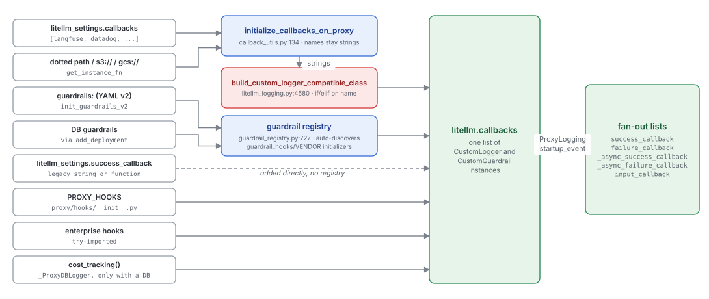
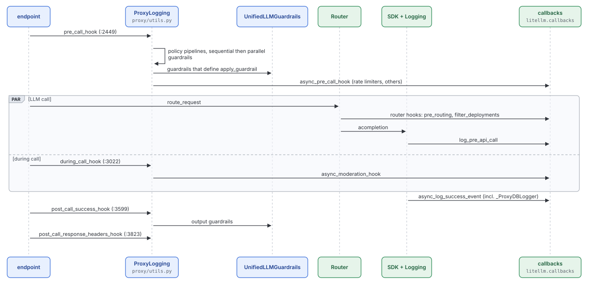

# Extension points: callbacks, guardrails and hooks

Quadrant: explanation. Verified on `main` at `13118948` (2026-10-15). Docs coverage for each extension point is in [extension-points-docs.md](/mnt/project-files/invariants/extension-points-docs.md)

Most of what makes the proxy more than a router is plugged in rather than hard-wired. Observability vendors, guardrail vendors, rate limiters, budget tracking and even spend logging are all objects in one list, `litellm.callbacks`, and the pipeline calls them at fixed points. This page explains that model and where it bends

## One interface, one list

Everything plugs in through `CustomLogger` (`integrations/custom_logger.py:65`) or its subclass `CustomGuardrail` (`integrations/custom_guardrail.py:217`). `CustomLogger` has grown into about 60 overridable methods in five families

| Family | Hooks | Called by |
|---|---|---|
| Logging | `log_pre_api_call`, `log_success_event`, `log_failure_event`, `log_stream_event` and their `async_` twins, `async_log_audit_log_event`, `logging_hook` | `Logging` object in `litellm_core_utils/litellm_logging.py`, SDK and proxy alike |
| Router | `async_pre_routing_hook`, `async_filter_deployments`, `async_pre_call_deployment_hook`, `async_pre_call_check`, `async_post_call_*_deployment_hook`, fallback events | `router.py` |
| Prompt and translation | `get_chat_completion_prompt`, `translate_completion_input_params`, `translate_completion_output_params*`, `async_dataset_hook` | `main.py`, `litellm_logging.py` |
| Proxy | `async_pre_call_hook`, `async_moderation_hook` (during call), `async_post_call_success_hook`, `async_post_call_failure_hook`, `async_post_call_streaming_hook`, `async_post_call_streaming_iterator_hook`, `async_post_call_response_headers_hook`, `async_filter_listed_models`, `async_post_mcp_tool_call_hook` | `ProxyLogging` in `proxy/utils.py` |
| Agentic loop | `async_should_run_agentic_loop`, `async_run_agentic_loop`, `async_build_agentic_loop_plan`, cleanup and chat-completion variants | `litellm_core_utils/chat_completion_agentic_loop.py`, Messages handler |

## Where the hooks fire in a proxy request

## Guardrails, two ways

A guardrail can be implemented two ways, and `_execute_guardrail_hook` (`proxy/utils.py:1882-1915`) picks between them per class. If the class defines `apply_guardrail` and doesn't set `use_native_lifecycle_hooks`, the call goes through the singleton `UnifiedLLMGuardrails` (`utils.py:356`). That picks a translation handler for the request's API shape by scanning `litellm/llms/*/**/guardrail_translation/` (`litellm/llms/__init__.py:92,174`), extracts the text, hands it to `apply_guardrail` and writes the result back. Otherwise the vendor's own `async_pre_call_hook` / `async_moderation_hook` / `async_post_call_success_hook` run directly on the raw request

The unified path is the intended one. It means a vendor writes one `apply_guardrail(text)` and gets every API surface for free, as long as a translation handler exists for that surface. Handlers exist for OpenAI chat, completion, embeddings, images, responses, speech, transcription and videos, Anthropic chat, Gemini, Bedrock pass-through, Cohere rerank, Mistral OCR, A2A and generic pass-through

## The gap

| Intent | What's in place | Evidence |
|---|---|---|
| A registry maps callback names to classes | `CustomLoggerRegistry` exists but is only used for reverse lookups (class to name for health and listing). Construction is a long if/elif in `build_custom_logger_compatible_class` | `custom_logger_registry.py:67`, `litellm_logging.py:4580-5300` |
| Core doesn't know about integrations | `litellm_logging.py` and `custom_logger_registry.py` import 88 integration modules at module level | [02-layers-and-dependency-direction.md](02-layers-and-dependency-direction.md) |
| `CustomLogger` is a focused interface | About 60 hooks across logging, routing, proxy, prompt and agentic-loop concerns in one base class, about a third undocumented | `integrations/custom_logger.py`, [extension-points-docs.md](/mnt/project-files/invariants/extension-points-docs.md) |
| One way to add a guardrail | Unified `apply_guardrail` and native lifecycle hooks coexist, chosen by a ClassVar most docs don't mention. Legacy `litellm_settings.guardrails` still goes through a v1 initializer | `proxy/utils.py:1905-1915`, `proxy_server.py:6616` |
| Proxy hooks are proxy concerns | Some proxy hooks live in the SDK's base class and are reached from SDK code, and two proxy rate limiters are imported at module level by the SDK's logger registry | `custom_logger_registry.py:57,61` |
| Callbacks never install software | The legacy `set_callbacks` path runs `pip install` at runtime for sentry | `litellm_logging.py:4482` |
| Spend tracking is part of the pipeline | Spend is just another callback (`_ProxyDBLogger`), registered twice and deduplicated by class key. If a request path skips the `Logging` success handler, spend is silently not recorded | `proxy_server.py:2958`, `logging_callback_manager.py:297` |
