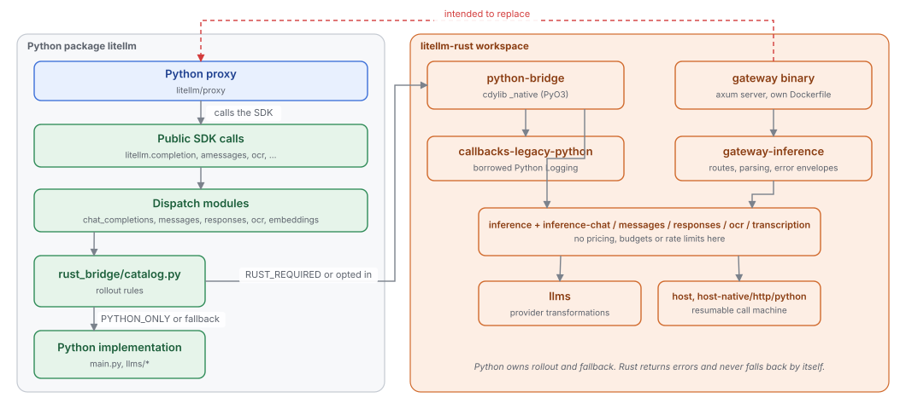
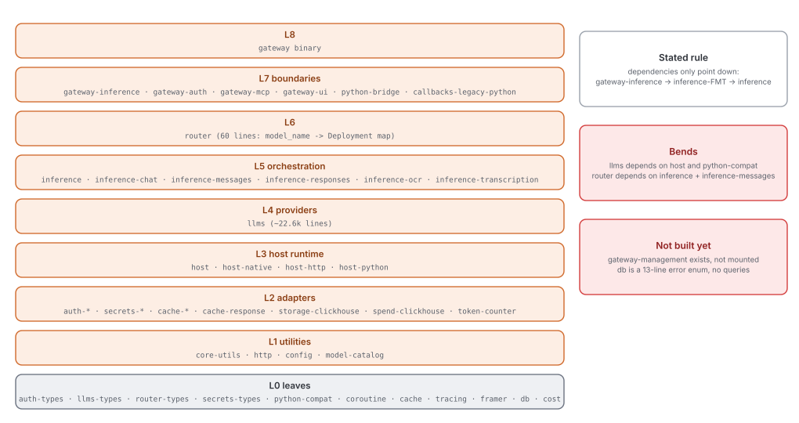
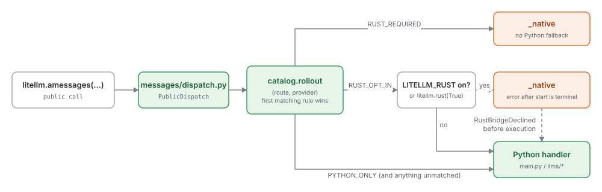

# Python and Rust: the migration in flight

Quadrant: explanation. Verified on `main` at `13118948` (2026-10-15)

litellm is in the middle of moving core execution from Python into a Rust workspace (`litellm-rust/`). This page explains what that move is meant to look like when it's done, how Python decides today whether a call runs in Rust, and how far the move has actually got

## What the code says it's aiming for

There is no single design document for the Rust work. The intent is spread across two ADRs and about a dozen crate `AGENTS.md` files. The clearest statement of the end state is one paragraph in `litellm-rust/crates/cache-response/AGENTS.md:3`

> The Python SDK will remain, with more core execution moving to Rust and Python callbacks staying in Python. The Rust gateway is still evolving and is intended to replace the Python proxy

So there are two Rust hosts planned for the same core. The first is a PyO3 extension (`litellm.rust_bridge._native`, built from `crates/python-bridge`) that runs under the Python SDK. The second is a standalone axum server (`crates/gateway`, binary `litellm-gateway`) that is meant to replace `litellm/proxy`. Both sit on the same provider and inference crates

The crate rules that matter for architecture are these

| Rule | Where it's written |
|---|---|
| Dependencies only point down: `gateway-inference -> inference-<fmt> -> inference`, and provider code never imports `inference*` | `crates/inference/AGENTS.md:347-398` |
| Inference never prices, charges budgets or updates rate limits | `crates/inference/AGENTS.md:423` |
| Core never calls the host. It yields operations and the caller's asyncio task awaits host work | `crates/coroutine/AGENTS.md`, `litellm/rust_bridge/execution.py` |
| Python owns rollout state and fallback. Rust returns errors and never decides to fall back | `crates/python-bridge/AGENTS.md`, `litellm/rust_bridge/AGENTS.md` |
| No fallback once execution has started | `litellm/rust_bridge/AGENTS.md` |
| Every Python internal that Rust still borrows is a `LegacyPython` variant, and that enum only shrinks | `crates/callbacks-legacy-python/AGENTS.md` |
| Rust reads Python state only through `litellm/rust_bridge/host/*`, one module per question | `litellm/rust_bridge/host/AGENTS.md` |
| Don't type requests in Python, pass the raw object and translate at the Rust boundary | ADR 001, `litellm-rust/docs/adrs/adr_001_only_type_inference_inside_rust.md` |
| Cache, HTTP client and similar services are built at the boundary and injected, never discovered from Python globals | `crates/cache-response/AGENTS.md:9` |

Reading the `[dependencies]` of every crate gives this layering, bottom to top

## How a call picks Python or Rust today

Every public entry point that might run in Rust goes through a dispatch module, and every dispatch module asks `litellm/rust_bridge/catalog.py` for a rollout. The first matching rule wins and anything unmatched stays on Python (`catalog.py:68-84`). `configuration.py:47-76` turns the rollout into a decision. `RUST_REQUIRED` always means Rust, `PYTHON_ONLY` always means Python, and the opt-in rollouts only go to Rust when the `LITELLM_RUST` env var (or `litellm.rust(True)`) is on

The current rules are

| Public call | Rule on main | What actually runs |
|---|---|---|
| `completion` / `acompletion` | `PYTHON_ONLY` | Always Python, `LITELLM_RUST` has no effect |
| `embedding` | `PYTHON_ONLY` | Always Python. The Rust side is a stub that declines |
| `responses` / `aresponses` | `PYTHON_ONLY` | Always Python, so the Rust Responses websocket path is unreachable |
| `anthropic_messages` / `amessages` | `RUST_OPT_IN` for anthropic, deepseek, vertex_ai | Rust only when opted in, Python otherwise and for every other provider |
| `ocr` / `aocr` | `RUST_REQUIRED`, `NO_PYTHON` | Rust only. The Python OCR code is gone |
| Bedrock transcription | `RUST_REQUIRED`, `NO_PYTHON` | Rust only |
| Legacy loggers | `LoggerRule(RUST_OPT_IN)` | Opt-in |

A few modules call `_native` directly without asking the catalog: `litellm/_v2/cache/__init__.py`, `litellm_core_utils/tokenizer.py`, `litellm/tracing/otlp_http.py`, the ClickHouse spend logger and the proxy's secret-manager capture at `proxy/proxy_server.py:7493`

The dispatch modules are protected by a ruff `TID251` ban in `ruff-strict.toml:64-75` on importing `main.completion`, `main.acompletion`, `responses.main.responses` / `aresponses` and the raw Anthropic messages handler. Because the strict gate is a count-may-not-grow ratchet, the ban stops new bypasses only as long as nobody removes a different violation in the same PR

## The gap

| Intent | What's in place | Evidence |
|---|---|---|
| Rust gateway replaces the Python proxy | The gateway serves `/v1/messages`, `/chat/completions`, `/responses`, `/ocr` and `/audio/transcriptions`. Auth is master key only, `gateway-management` exists but isn't mounted, `/embeddings` and `/completions` return unsupported, and there is no DB access, accounting or rate limiting | `crates/gateway-inference/src/lib.rs:91-112`, `crates/gateway-auth/AGENTS.md`, `crates/gateway/Cargo.toml` |
| Shared router in Rust | `crates/router` is a 60-line `model_name -> Deployment` map. None of the Python Router's load balancing, fallbacks or cooldowns exist | `crates/router/src/lib.rs` |
| Shared DB schema | `crates/db` is a 13-line error enum with no queries. `db-testing` does apply the real Prisma migrations to a test Postgres, so the shared schema is at least the plan | `crates/db/src/failure.rs`, `crates/db-testing/src/migrations.rs:10-13` |
| Chat, embeddings and responses move to Rust | Bridges exist for all three, but the catalog pins them to Python. Rust chat covers anthropic, bedrock and openai_like, non-streaming only | `catalog.py:70-75`, `crates/inference-chat/AGENTS.md` |
| Rust Messages is the default for its providers | Rust Messages implements 11 providers, Python opts in 3 of them, and only behind `LITELLM_RUST` | `crates/llms/src/*/messages`, `catalog.py:73` |
| Dependencies only point down | `llms` (providers) depends on `host` and `python-compat`, `host` depends on `auth`, and `router` depends on `inference` and `inference-messages` although a `router-types` crate exists to avoid that | each crate's `Cargo.toml` |
| Hard-to-reverse decisions get an ADR | Two ADRs exist. The biggest decisions (gateway replaces proxy, the coroutine host model, two hosts on one core) live only in `AGENTS.md` prose | `litellm-rust/docs/adrs/` |
| Python is fully typed (root `AGENTS.md`) | ADR 001 says the opposite for requests. The dispatch layer reconciles them with `*args/**kwargs  # kwargs-ok` and `cast-ok` | `litellm/*/dispatch.py` |
| Parity between Python and Rust is checked | `tests/rust-python-harness/` compares both sides but is local only, with no CI job | `tests/rust-python-harness/AGENTS.md` |
| The extension is optional | OCR and Bedrock transcription have no Python fallback, so every `litellm` and `litellm-core` wheel must compile Rust through maturin | `pyproject.toml:307-317`, `packaging/litellm-core/pyproject.toml` |

Several crate docs say plainly that they describe a target, not a finished state. `crates/llms/AGENTS.md:444` says "These are the intended boundaries, not a claim that all code already satisfies them", and `python-bridge` and `host-python` say not to treat their rules as evidence that the migration is complete. Read the Rust `AGENTS.md` files as intent and the catalog as the truth about what runs

The word "gateway" means three different things in this repo, which is worth knowing before reading any of them. `gateway/main.py` is a trimmed copy of the Python FastAPI app with only data-plane routes, `backend/main.py` is the same app trimmed to the admin routes, and `litellm-rust/crates/gateway` is the Rust server. See [07-deployment-shapes.md](07-deployment-shapes.md)
