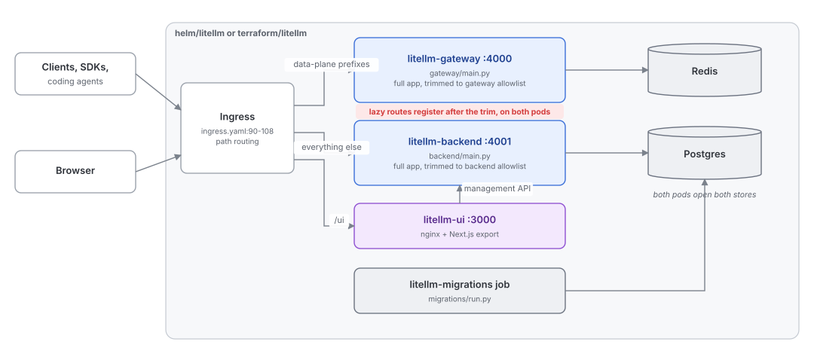
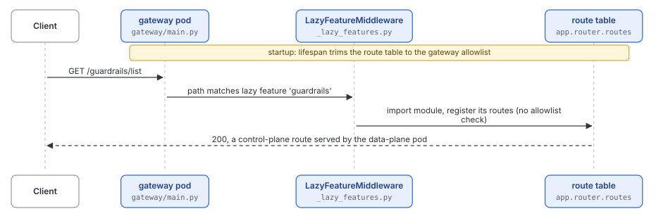

# Deployment shapes: monolith, componentized and Rust gateway

Quadrant: explanation. Verified on `main` at `13118948` (2026-10-15)

One FastAPI app, `litellm.proxy.proxy_server:app`, holds every HTTP route the product has, about 970 of them. There are three ways that app (or its replacement) gets deployed today, and they disagree about which process serves which route

## Shape 1, the monolith

This is what almost every deploy path runs. The `litellm` CLI (`proxy/proxy_cli.py:1086`) starts uvicorn, gunicorn, hypercorn or granian on the full app. The Admin UI is a static Next.js export committed under `litellm/proxy/_experimental/out` (714 files) and served by the same process at `/ui` (`proxy_server.py:2554`)

Used by the root `Dockerfile` (via `docker/prod_entrypoint.sh`), `docker-compose.yml`, `docker-compose.hardened.yml`, `docker-compose.liteadmin.yml`, `render.yaml` and the older `helm/litellm-helm` chart

## Shape 2, componentized (data plane, control plane, UI)

`gateway/` and `backend/` are two thin entry points that import the same full app and then drop routes. Each wraps the app's lifespan and, once startup has finished, filters `app.router.routes` once against an allowlist (`gateway/main.py:61-73`, `backend/main.py`). The gateway keeps the LLM data plane, the backend keeps management routes, and the UI moves into its own nginx container that finds the backend through `LITELLM_BACKEND_URL`

Used by `helm/litellm` ("LiteLLM componentized", `Chart.yaml:3`), `terraform/litellm/aws` (three ECS services) and `terraform/litellm/gcp/cloudrun.tf`. CI builds the images only in `image-scan.yml:197,257`, and no publish workflow for them is visible in `.github/`

The intent is clear from the docstrings. Scale and secure the hot data plane on its own, keep the admin API off the public path, and do it "purely additively" without changing `proxy_server.py`. A unit test guards it, `tests/unit/proxy/test_component_allowlists.py:257`, which asserts every route registered at startup is in one allowlist or the other

## Shape 3, the Rust gateway

`litellm-rust/crates/gateway` is a separate axum binary with its own Dockerfile. It serves a handful of inference routes, MCP and UI login, uses master-key-only auth and has no database access. It reports to the Python control plane through `/v1/rust_control_plane/*` (`proxy/logging_endpoints/callback_logs_endpoints.py:38`). Crate docs say it is meant to replace the Python proxy eventually. See [06-python-and-rust.md](06-python-and-rust.md)

## The gap

The componentized shape is built on one assumption that no longer holds. It trims the route table once at startup, but about 37 features register their routes lazily, on the first request that matches their prefix, through `LazyFeatureMiddleware` (`proxy/_lazy_features.py:328-381`). The middleware isn't a route, so the trim never removes it, and `_register_feature` (`_lazy_features.py:498`) splices the feature's routes in with no allowlist check

So the backend will load and serve `/v1/messages` or `/anthropic/*` if a request reaches it, and the gateway will serve `/guardrails/*` or `/scim`. The allowlist test admits it only checks the startup table (`test_component_allowlists.py:258-266`). Today this quietly rescues the deploy rather than breaking it, because many lazy prefixes are in neither allowlist and only work thanks to it

| Intent | What's in place | Evidence |
|---|---|---|
| Each pod serves only its plane | Lazy routes bypass the trim on both pods | `_lazy_features.py:498-514`, `gateway/main.py:61-73` |
| Every route belongs to exactly one plane | About 30 lazy prefixes are in neither allowlist, e.g. `/guardrails/*`, `/policies*`, `/vector_store/`, `/scim`, `/prompts`, `/agents`, `/evals`, root OAuth paths `/authorize` and `/token`. Eight paths are in both | `gateway/routes/allowlist.py`, `backend/routes/allowlist.py` |
| The ingress matches the allowlists | The helm gateway prefix list is missing `/deepgram`, `/fal_ai`, `/gigachat`, `/openrouter`, `/nvidia_nim`, `/watsonx`, `/v1/live/sessions` and others, so they fall through to the backend. `/v1/live/sessions` is an eager websocket the backend trims, so it 404s | `helm/litellm/templates/ingress.yaml:90-108` |
| MCP tool calls are data plane (gateway docstring) | `/mcp`, `/mcp/proxy` and `/{mcp_server_name}/mcp` are backend-only, the gateway keeps only `/toolset/` | both allowlists |
| One gateway | Three things are called gateway: the Python trim, the Rust binary, and the product name "AI Gateway" for the monolith | `gateway/`, `litellm-rust/crates/gateway`, `ARCHITECTURE.md` |
| The split is documented | `ARCHITECTURE.md` doesn't mention it | |
| The VS Code extension works against a gateway | It needs `/model_group/info`, which is backend-only | `vscode-extension/src/gateway.ts:66,94` |

Splitting by trimming a monolith also means both pods import every module, run every startup hook and open the same DB and Redis connections, so the data-plane pod pays the control plane's startup cost and attack surface in memory even when the routes are gone. A split that is enforced (a route registry per plane, with lazy features declaring their plane) would close the gaps above and is the natural next step if the componentized shape is the direction
