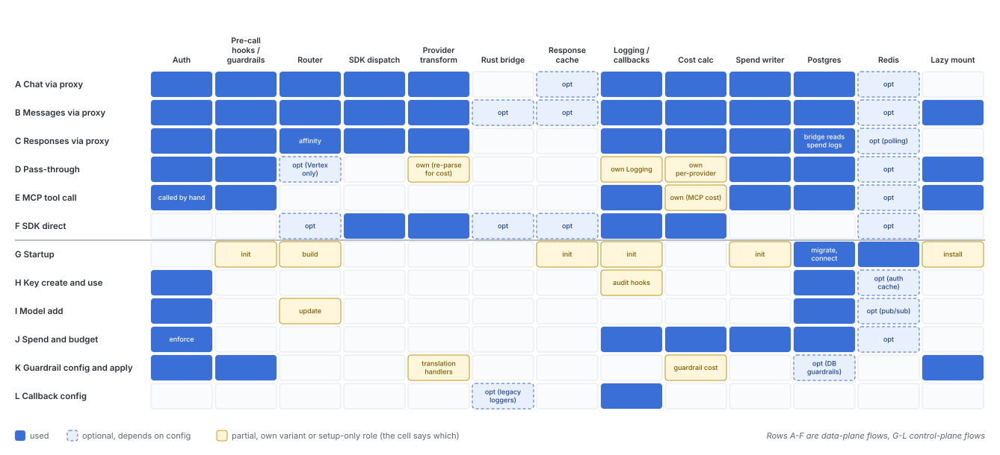

# Flow and subsystem matrix

Quadrant: reference. Verified on `main` at `13118948` (2026-10-15)

Rows are the user flows in [user-flows-data-plane.md](user-flows-data-plane.md) and [user-flows-control-plane.md](user-flows-control-plane.md). Columns are the shared subsystems. Use it to answer "if I change subsystem X, which user flows can break"

Legend: **Y** the flow always goes through it, **opt** only with a setting or a particular provider, **own** the flow has its own copy instead of the shared one, blank means not touched

| Flow | Auth | Pre-call hooks / guardrails | Router | SDK dispatch | Provider transform | Rust bridge | Response cache | Logging / callbacks | Cost calc | Spend writer | Postgres | Redis | Lazy mount |
|---|---|---|---|---|---|---|---|---|---|---|---|---|---|
| A Chat via proxy | Y | Y | Y | Y | Y | | opt | Y | Y | Y | Y | opt | |
| B Messages via proxy | Y | Y | Y | Y | Y | opt | opt | Y | Y | Y | Y | opt | Y |
| C Responses via proxy | Y | Y | Y (affinity) | Y | Y | | | Y | Y | Y | Y (bridge reads spend logs) | opt (polling) | |
| D Pass-through | Y | Y | opt (Vertex only) | | own (re-parse for cost) | | | own Logging | own per-provider | Y | Y | opt | Y |
| E MCP tool call | Y (called by hand) | Y | | | | | | Y | own (MCP cost) | Y | Y | opt | Y |
| F SDK direct | | | opt | Y | Y | opt | opt | Y | Y | | | opt | |
| G Startup | | init | build | | | | init | init | | init | Y (migrate, connect) | Y | install |
| H Key create and use | Y | | | | | | | audit hooks | | | Y | opt (auth cache) | |
| I Model add | Y | | update | | | | | | | | Y | opt (pub/sub) | |
| J Spend and budget | Y (enforce) | | | | | | | Y | Y | Y | Y | opt | |
| K Guardrail config and apply | Y | Y | | | translation handlers | | | | guardrail cost | | opt (DB guardrails) | | Y |
| L Callback config | | | | | | opt (legacy loggers) | | Y | | | | | |

## As a grid

## Blast radius by subsystem

| If you change | Flows that can break | Where the tests mostly are |
|---|---|---|
| `proxy/auth/user_api_key_auth.py`, `auth_checks.py` | A B C D E H J K, and every management route | `tests/unit/proxy/auth/`, see [test-suites-by-layer.md](/mnt/project-files/invariants/test-suites-by-layer.md) |
| `ProxyLogging.pre_call_hook` / `post_call_success_hook` | A B C D E K | `tests/unit/proxy/guardrails/` |
| `router.py` | A B C, plus SDK users of `Router`, plus I (deployment upsert) | `tests/unit/test_router*.py`, `tests/unit/router_strategy/`, `tests/unit/router_utils/` |
| `litellm_core_utils/litellm_logging.py` | Every flow that logs, so A to F, J, L | `tests/unit/litellm_core_utils/` |
| `cost_calculator.py` | A B C D F J, and the cost header | `tests/unit/test_cost_calculator.py` |
| `proxy/db/db_spend_update_writer.py` | A to E, J, and Responses sessions in C | `tests/unit/proxy/db/` |
| `proxy/_lazy_features.py` | B D E K and the componentized deploy | `tests/unit/proxy/test__lazy_features.py`, `test_component_allowlists.py` |
| `rust_bridge/catalog.py` | B (opt-in), OCR, Bedrock transcription | `tests/unit/rust_bridge/`, `tests/test_litellm_rust/` |
| `litellm/__init__.py` globals | Everything, since settings are read from the package root | |
