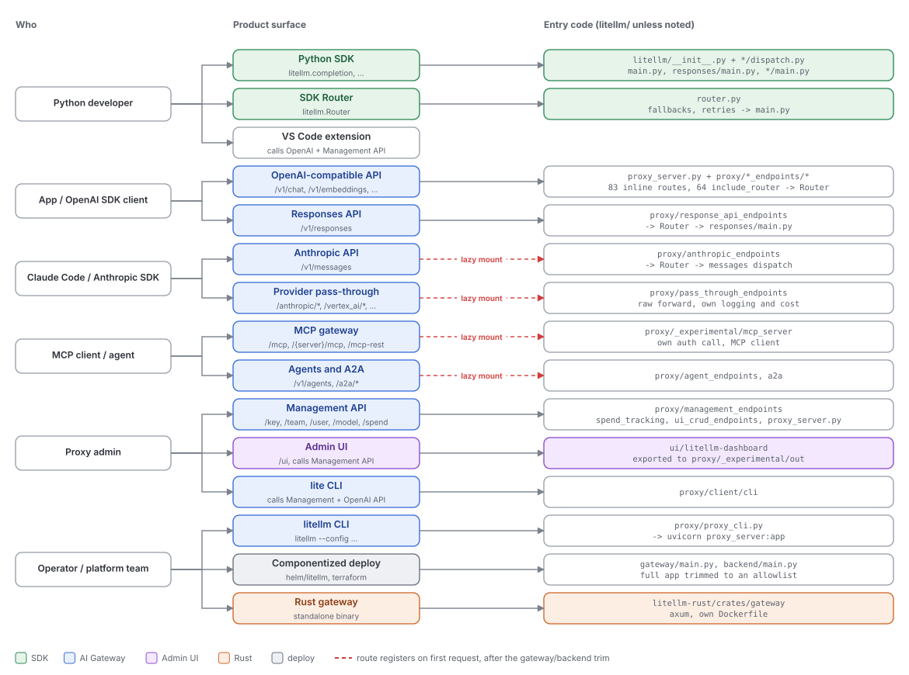

# Product surface map

Quadrant: reference. Verified on `main` at `13118948` (2026-10-15). Route counts come from counting route decorators per file, so treat them as approximate

This page maps every way a person or program touches litellm to the code that receives it. The companion [flow-subsystem-matrix.md](flow-subsystem-matrix.md) maps those entry points onward to the shared subsystems they reach

## Overview

## SDK surfaces

| Surface | Public names | Entry code | Notes |
|---|---|---|---|
| Chat | `completion`, `acompletion` | `chat_completions/dispatch.py` -> `main.py:5124`, `:425` | Rebinds the `main.py` names at `__init__.py:1494` |
| Embeddings | `embedding`, `aembedding` | `embeddings/dispatch.py` -> `main.py:6260` | |
| Responses | `responses`, `aresponses` and CRUD | `responses/dispatch.py` -> `responses/main.py:666`, `:1239` | |
| Anthropic Messages | `anthropic_messages`, `amessages`, `litellm.anthropic_interface` | `messages/dispatch.py` -> `llms/anthropic/pass_through/messages/handler.py:296` | Rust opt-in for 3 providers |
| OCR | `ocr`, `aocr` | `ocr/dispatch.py` | Rust only |
| Audio | `transcription`, `speech` | `main.py:7949`, `:8257` | Bedrock transcription is Rust only |
| Text completion, moderation | `text_completion`, `moderation` | `main.py:7477`, `:7784` | |
| Images | `image_generation`, `image_edit`, `image_variation` | `images/main.py` | |
| Batches, files, fine-tuning | `create_batch`, `create_file`, ... | `batches/main.py`, `files/main.py`, `fine_tuning/main.py` | |
| Rerank, search | `rerank`, `search` | `rerank_api/main.py`, `search/main.py` | |
| Vector stores | `vector_stores.*` | `vector_stores/main.py`, `vector_store_files/main.py` | |
| Videos, containers, skills, evals, assistants, realtime, RAG | | `videos/main.py`, `containers/main.py`, `skills/main.py`, `evals/main.py`, `assistants/main.py`, `realtime_api/main.py`, `rag/main.py` | |
| Google GenAI | `generate_content` | `google_genai/main.py` | |
| A2A client | `send_message`, `asend_message`, `create_a2a_client` | `a2a_protocol/__init__.py:57` | |
| MCP client | `load_mcp_tools`, `call_openai_tool` | `experimental_mcp_client/` | Imports proxy MCP modules at module level (L1) |
| Router | `litellm.Router` and its `a*` methods | `router.py:978`, generic wrappers via `factory_function` (`:2133-2212`) | 15,478 lines |
| Settings and callbacks | `litellm.callbacks`, `litellm.success_callback`, `litellm.cache`, `litellm.drop_params`, ... | `litellm/__init__.py` | 419 module-level names |
| Rust switch | `litellm.rust(True)`, `LITELLM_RUST` | `rust_bridge/configuration.py` | |

## Proxy data-plane surfaces

| Family | Example path | Router file | Lazy | Routes |
|---|---|---|---|---|
| Chat, completions, embeddings, moderation, audio | `/v1/chat/completions` | `proxy_server.py:12305-13031` | no | inline |
| Models | `/v1/models`, `/model/info`, `/model_group/info` | `proxy_server.py:11896`, `:15724-16786` | no | inline |
| Realtime websockets | `/v1/realtime`, `/vertex_ai/live`, `/v1/live/sessions` | `proxy_server.py:13188-13515` | no | inline |
| Assistants and threads | `/v1/assistants` | `proxy_server.py:13605-14134` | no | inline |
| Responses | `/v1/responses` | `response_api_endpoints/endpoints.py:199` | no | 26 |
| Anthropic Messages | `/v1/messages` | `anthropic_endpoints/endpoints.py:124` | yes | 3 |
| Claude Code gateway, marketplace | `/claude_code_gateway/v1/messages` | `anthropic_endpoints/` | yes | 16 |
| Skills | `/v1/skills` | `anthropic_endpoints/skills_endpoints.py:84` | yes | 4 |
| Images | `/v1/images/generations` | `image_endpoints/endpoints.py:71` | no | 6 |
| Batches | `/v1/batches` | `batches_endpoints/endpoints.py:235` | no | 12 |
| Files | `/v1/files` | `openai_files_endpoints/files_endpoints.py:538` | no | 15 |
| Fine-tuning | `/v1/fine_tuning/jobs` | `fine_tuning_endpoints/endpoints.py:65` | no | 8 |
| Rerank | `/v2/rerank` | `rerank_endpoints/endpoints.py:28` | no | 3 |
| Vector stores | `/v1/vector_stores` | `vector_store_endpoints/endpoints.py:101` | yes | 26 |
| OCR | `/v1/ocr` | `ocr_endpoints/endpoints.py:261` | no | 2 |
| Search | `/v1/search/{tool}` | `search_endpoints/endpoints.py:19` | no | 6 |
| Videos, containers | `/v1/videos`, `/v1/containers` | `video_endpoints/`, `container_endpoints/` | no | 26 |
| RAG, memory, evals | `/v1/rag/ingest`, `/v1/memory` | `rag_endpoints/`, `memory/`, `openai_evals_endpoints/` | partly | 20 |
| Google GenAI | `/v1beta/models/{m}:generateContent` | `google_endpoints/endpoints.py:21` | no (on purpose) | 14 |
| Agents and A2A | `/v1/agents`, `/a2a/{id}/...` | `agent_endpoints/` | yes | 18 |
| MCP | `/mcp`, `/{server}/mcp`, `/mcp-rest/tools/list` | `_experimental/mcp_server/server.py`, `rest_endpoints.py` | yes | ASGI + 4 |
| MCP OAuth | `/authorize`, `/token`, `/.well-known/*` | `discoverable_endpoints.py`, `byok_oauth_endpoints.py` | yes | 32 |
| Provider pass-through | `/anthropic/*`, `/vertex_ai/*`, `/bedrock/*` (29 prefixes) | `pass_through_endpoints/llm_passthrough_endpoints.py` | yes | 34 |
| Config-defined pass-through | user paths | `pass_through_endpoints/pass_through_endpoints.py:3746` | no | 5 |

## Proxy control-plane surfaces

| Family | Example path | Router file | Routes |
|---|---|---|---|
| Keys | `/key/generate` | `management_endpoints/key_management_endpoints.py:2147` | 18 |
| Teams | `/team/new` | `management_endpoints/team_endpoints.py:1433` | 26 |
| Users | `/user/new` | `management_endpoints/internal_user_endpoints.py:482` | 10 |
| Organizations | `/organization/new` | `management_endpoints/organization_endpoints.py:366` | 11 |
| Customers / end users | `/end_user/block` | `management_endpoints/customer_endpoints.py:152` | 16 |
| Budgets | `/budget/new` | `management_endpoints/budget_management_endpoints.py:39` | 6 |
| Projects | `/project/new` | `enterprise/litellm_enterprise/proxy/management_endpoints/project_endpoints.py:437` | 5 |
| Models and access groups | `/model/new`, `/model_access_group/*` | `management_endpoints/model_management_endpoints.py:1149` and siblings | 34 |
| MCP admin | `/v1/mcp/server` | `management_endpoints/mcp_management_endpoints.py` | 42 |
| Spend and analytics | `/spend/keys`, `/global/activity/*`, daily activity | `spend_tracking/spend_management_endpoints.py:419`, `analytics_endpoints/` | 48+ |
| Guardrails and policies | `/guardrails/list`, `/policies/list` | `guardrails/guardrail_endpoints.py:161`, `policy_engine/policy_endpoints.py:75` | 53 |
| SSO, login, SCIM, JWT mappings | `/sso/*`, `/login`, `/scim/v2/*` | `management_endpoints/ui_sso.py:719`, `proxy_server.py:17344-17576`, `scim/scim_v2.py` | 40 |
| UI settings and public hubs | `/get/ui_theme_settings`, `/public/model_hub` | `ui_crud_endpoints/`, `public_endpoints/public_endpoints.py:217` | 44 |
| Config and reload | `/config/*`, `/reload` | `proxy_server.py:18389-20215`, `config_overrides` | inline + 30 |
| Health | `/health`, `/health/readiness` | `health_endpoints/_health_endpoints.py` | 16 |
| Callbacks and logs | `/callbacks/list`, `/v1/rust_control_plane/*` | `callback_management_endpoints.py:21`, `logging_endpoints/` | |
| Tools, prompts, tags, credentials, workflows | `/v1/tool`, `/prompts`, `/tag/*`, `/credentials` | various | 50+ |
| Enterprise | `/audit`, `/email/event_settings` | `enterprise/litellm_enterprise/proxy/enterprise_routes.py` | |

## Clients and deploy surfaces

| Surface | What it is | Entry code | Talks to |
|---|---|---|---|
| Admin UI | Next.js static export, 41 dashboard pages plus chat, login, onboarding, model hub | `ui/litellm-dashboard/src/app/**`, served from `proxy/_experimental/out` at `/ui` (`proxy_server.py:2554`) | About 280 distinct backend paths through `src/components/networking.tsx` (7,986 lines, 314 exported calls) |
| `litellm` CLI | Starts the proxy server, `--setup` wizard | `proxy/proxy_cli.py:1086`, `setup_wizard.py` | The app in-process |
| `lite` CLI (`litellm-proxy` is a deprecated alias) | Admin and chat client | `proxy/client/cli/main.py:104`, `proxy/client/*` | Management and data-plane HTTP |
| VS Code extension | Language model chat provider | `vscode-extension/src/gateway.ts` | `/model_group/info`, `/v1/chat/completions` |
| Componentized deploy | Gateway, backend, UI and migrations images | `gateway/main.py`, `backend/main.py`, `ui/Dockerfile`, `migrations/run.py`, `helm/litellm`, `terraform/litellm` | Same app, trimmed per plane. See [07-deployment-shapes.md](../explanation/07-deployment-shapes.md) |
| Rust gateway | axum server | `litellm-rust/crates/gateway` | Messages, chat, responses, OCR, transcription, MCP |
| Enterprise package | Extra routes, hooks, loggers | `enterprise/litellm_enterprise`, try-imported at `proxy_server.py:1033-1039` and in auth, logging and callback utils | |
| Migrations package | Prisma schema and 220 migrations | `litellm-proxy-extras` | Postgres |

## Things on this map that lead nowhere

| Item | State |
|---|---|
| `mcp_servers.json`, `router_plugins.json` at repo root | Not referenced by filename anywhere in the repo |
| `management_endpoints/roi_calculator_endpoints.py`, `roi_observed_endpoints.py` | Routers defined (about 23 routes) but never included |
| `config_management_endpoints/pass_through_endpoints.py` | Router never included |
| `enterprise/litellm_enterprise/proxy/vector_stores/endpoints.py` | Duplicates `/vector_store/*` from the lazy vector store management router, never included |
| `litellm-rust/crates/gateway-management` | Exists, not a dependency of the gateway, so not mounted |
| `litellm-rust/crates/litellm` | 2-line placeholder |
