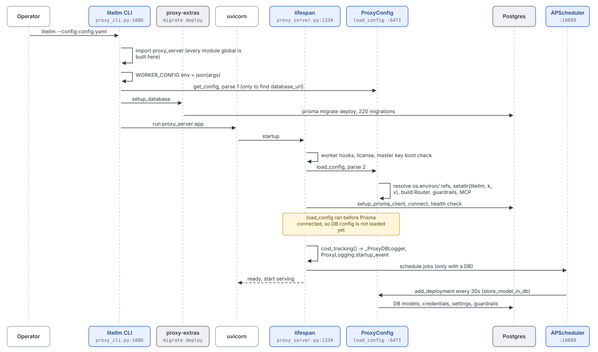
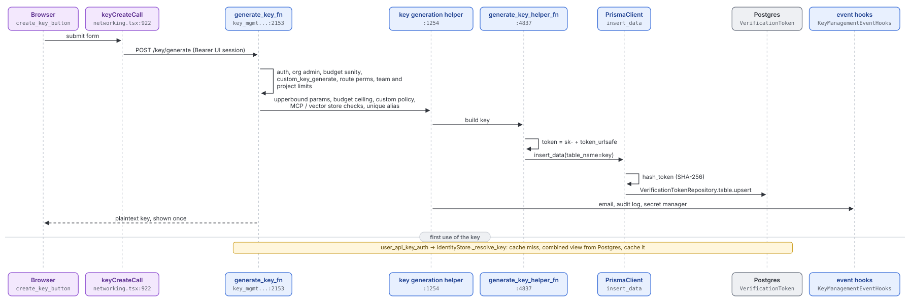
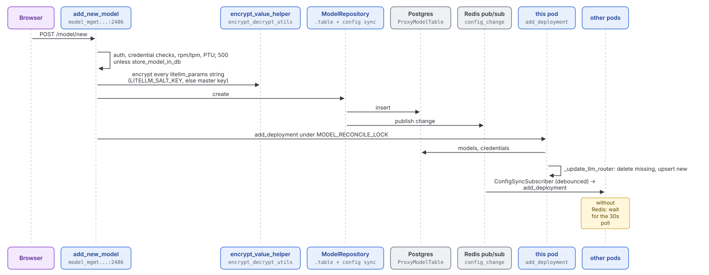
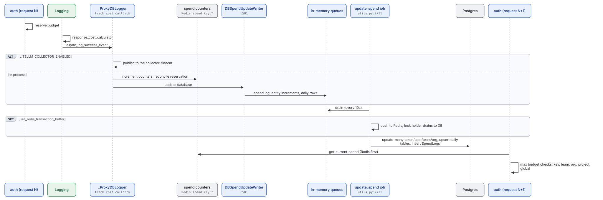
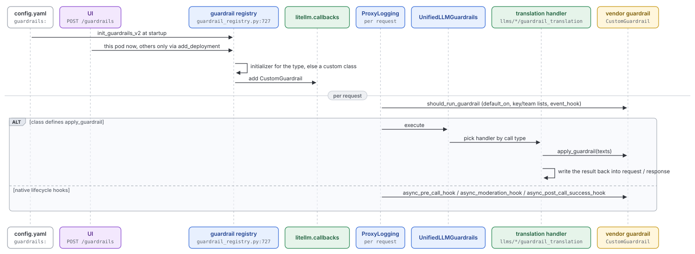
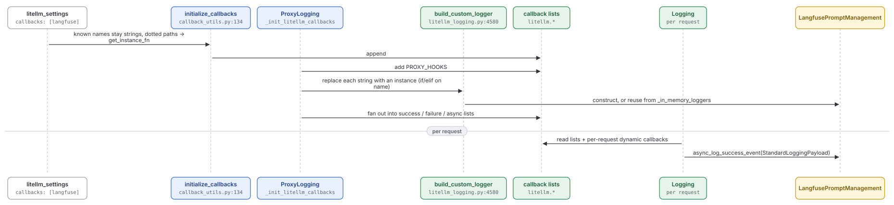

# User flows: control plane

Quadrant: reference. Verified on `main` at `13118948` (2026-10-15). The model behind these flows is explained in [04-control-plane-config-and-state.md](../explanation/04-control-plane-config-and-state.md)

Paths are under `litellm/` unless they start with another top-level directory

## G. Proxy startup from a config file

Who does this: an operator running `litellm --config config.yaml` or the Docker image

Scheduled jobs (defaults from `constants.py:1883-1884` and `initialize_scheduled_background_jobs`)

| Job | Default interval | What it does |
|---|---|---|
| `update_spend` | 10s plus 0-5s jitter | Flush in-memory spend queues to Postgres (or to Redis first with `use_redis_transaction_buffer`) |
| `add_deployment` | 30s, only with `store_model_in_db` | Reload DB models, credentials, settings, guardrails into this pod |
| `reset_budget` | about 10 minutes | Reset key, user, team and budget windows |
| `proxy_worker_heartbeat`, `update_daily_tag_spend`, `update_gateway_requests`, `update_request_errors` | short intervals | Bookkeeping |
| key rotation, UI session cleanup, spend log cleanup, PTU rollup, Slack reports | hourly to monthly | Housekeeping |
| `check_batch_cost`, `check_responses_cost` | 30 minutes | Enterprise, cost for async jobs |

## H. Admin creates a virtual key in the UI, then the key is used

Who does this: a proxy admin or team admin on the API Keys page

First use of that key follows flow A, stage 2. `IdentityStore._resolve_key` (`auth/resolvers/store.py:108`) misses `user_api_key_cache`, reads the combined key view from Postgres with reconnect (`auth_checks.py:4078`), and caches the result. Updates, deletes and regenerations call `delete_cache_key_object` (`auth_checks.py:3315`), which clears the local cache and Redis and publishes an invalidation for other workers

## I. Admin adds a model in the UI

## J. Spend tracking and budget enforcement

Tables written: `LiteLLM_SpendLogs` (`schema.prisma:720`), the `LiteLLM_Daily*Spend` family (user, team, org, end user, agent, tag, global), and the `spend` columns on token, user, team and organization rows. `ResetBudgetJob.reset_budget` (`proxy/common_utils/reset_budget_job.py:532`) resets them on schedule under a pod lease

## K. Guardrail configured, then applied

## L. Observability callback configured

