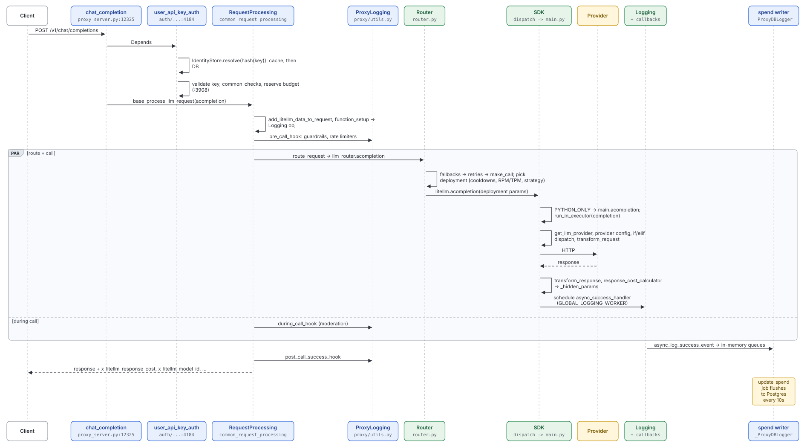
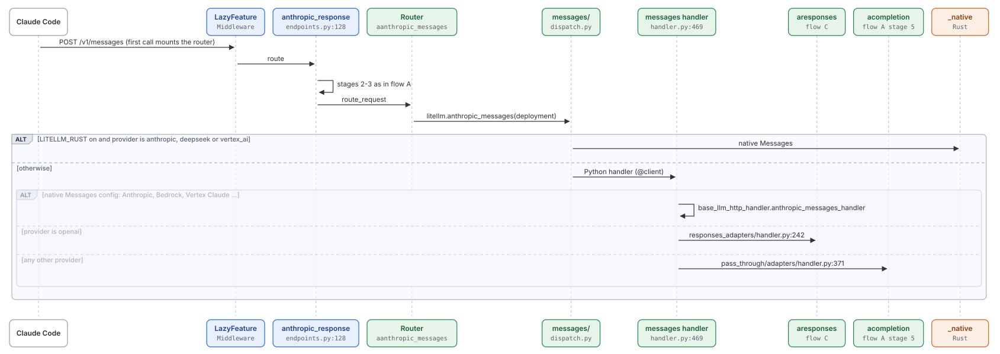
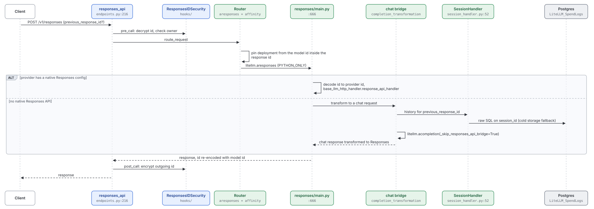
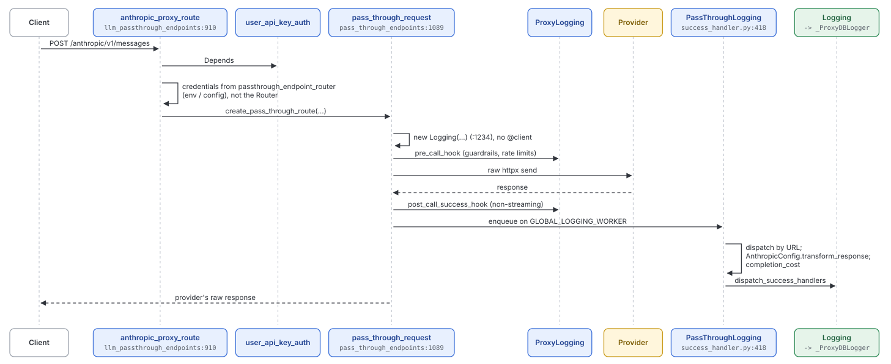
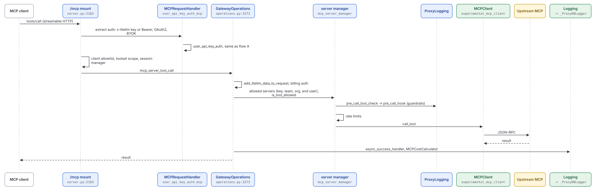
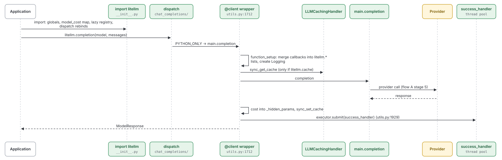

# User flows: data plane

Quadrant: reference. Verified on `main` at `13118948` (2026-10-15). Line numbers drift, so re-check before relying on one. The stage model these flows follow is explained in [03-data-plane-request-pipeline.md](../explanation/03-data-plane-request-pipeline.md), and which subsystems each flow touches is in [flow-subsystem-matrix.md](flow-subsystem-matrix.md)

Paths are under `litellm/` unless they start with another top-level directory

## A. Chat completion through the proxy with a virtual key

Who does this: any OpenAI SDK client, the VS Code extension, most coding agents

Streaming differs once the Router call returns. The Router returns `_acompletion_streaming_iterator` (`router.py:3135`), which can fall back mid-stream, and the proxy wraps it in `async_data_generator` (`proxy_server.py:10126`), which runs `async_post_call_streaming_iterator_hook` and the per-chunk hook. `post_call_success_hook` isn't called for streams. Cost and success logging run at stream end inside `CustomStreamWrapper` (`litellm_core_utils/streaming_handler.py:1733`, `:2043`)

## B. Anthropic Messages through the proxy

Who does this: Claude Code and other Anthropic-SDK clients, including through `/claude_code_gateway/v1/messages`

The Messages to chat translation is `LiteLLMAnthropicMessagesAdapter` (`llms/anthropic/pass_through/adapters/transformation.py:355`). `litellm.use_chat_completions_url_for_anthropic_messages` forces OpenAI onto the chat path instead of Responses

## C. Responses API through the proxy

## D. Provider pass-through

Who does this: clients that want the provider's raw API (`/anthropic/v1/messages`, `/vertex_ai/...`, `/bedrock/...`) with LiteLLM auth and spend

Vertex is the one pass-through that can use the Router. If the model in the URL is a Router model, `_base_vertex_proxy_route` (`:2806`) takes that deployment's credentials

## E. MCP tool call

Who does this: MCP clients (Claude Desktop, Cursor, coding agents) pointed at `/mcp` or `/{server}/mcp`

## F. Direct SDK call, no proxy

Who does this: Python applications that `pip install litellm`

No auth, guardrails, Router, DB or Redis unless the application builds a `litellm.Router` or sets a Redis `litellm.cache`. Retries come from `num_retries` and `completion_with_retries`
