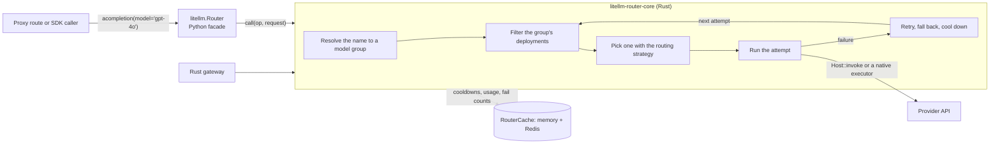

# Router

`litellm.Router` decides which deployment serves a request, makes the call, and handles what happens when the call fails. It retries in the same model group, falls back to other groups, and puts failing deployments into cooldown so the next requests avoid them. The Python proxy builds one Router from its config and sends every model request through it, SDK users can build their own, and the Rust gateway runs the same routing core natively

The routing itself lives in Rust, in the `litellm-router-core` crate. `litellm.Router` is a thin Python facade over it. The core asks its host for everything outside routing, such as running a provider call or reading Redis

## Status

These pages describe the router after the core swap is finished, which means three things. [#49120](https://github.com/BerriAI/litellm/pull/49120) has landed. Differential fuzzing has shown the Rust core behaves like the Python one, so the Rust core is the default. And the Python core, `DeprecatedRouterMembers` and `litellm/router_utils/` are deleted. They do not describe the code on the default branch today

Until the Rust core is the default, set `LITELLM_RUST=1` to build Routers on it. A config the Rust core does not serve yet falls back to the Python core, and you can tell which core a Router got from `type(router._core).__name__`

## Where to start

New to the router? Work through the tutorial, [Route your first requests](tutorial/route-your-first-requests.md). It builds a Router with mock deployments, so it needs no API keys, and shows load balancing, retries, cooldowns and fallbacks in about fifteen minutes

### How-to guides

- [Read router state from outside the router](how-to/read-router-state.md)
- [Change deployments or settings at runtime](how-to/change-the-router-at-runtime.md)
- [Port code written against the old Router members](how-to/port-old-router-code.md)
- [Add a custom routing strategy](how-to/add-a-routing-strategy.md)
- [Find out why a request went where it did](how-to/debug-a-routing-decision.md)

### Reference

- [Entry points](reference/entry-points.md), every method on the public surface and what it replaced
- [Core, config and host interfaces](reference/core-and-host.md), `RouterCore`, `RouterConfig`, the Rust `Router` and the `Host` trait
- [Configuration and defaults](reference/configuration.md), constructor arguments, strategies and constants
- [Routing state and cache keys](reference/state-and-cache-keys.md), what the router stores and for how long
- [Code map](reference/code-map.md), which file holds what

### Explanation

- [Concepts](explanation/concepts.md), deployments, model groups, aliases, wildcards, teams and routing groups
- [The facade, the core and the hosts](explanation/core-and-hosts.md), how the router is split and why
- [The life of a request](explanation/request-lifecycle.md), from `acompletion` through the core to the provider
- [How a deployment is picked](explanation/selection.md), the filter chain and the strategies
- [Retries, fallbacks and cooldowns](explanation/reliability.md)
- [Shared state across proxy pods and gateways](explanation/shared-state.md)
