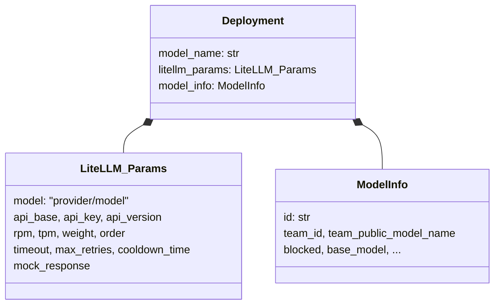
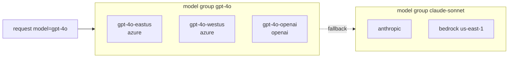
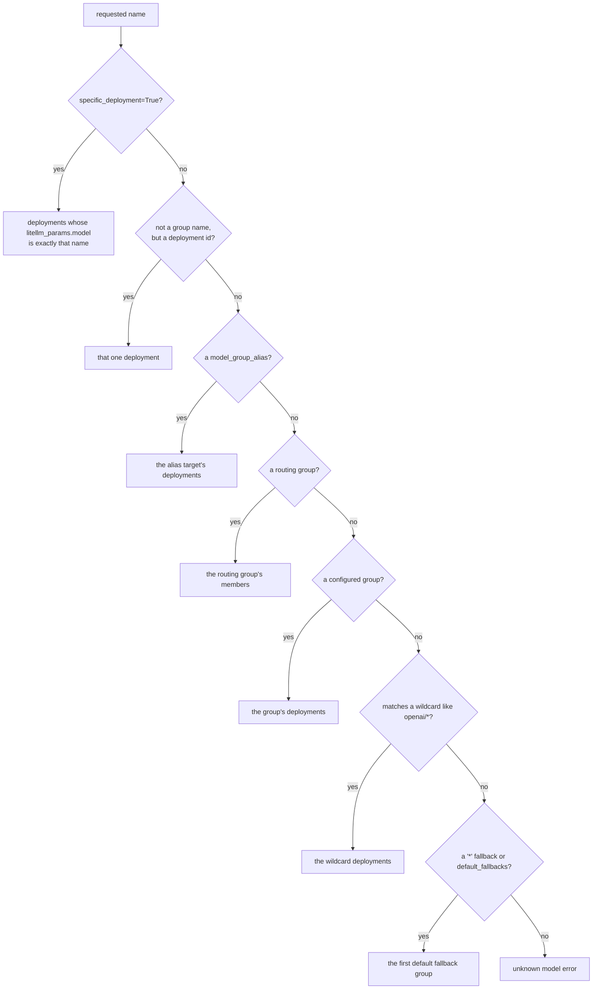

# Concepts

This page names the things the router works with. The rest of the router docs use these words in exactly these meanings

## Deployment

A deployment is one place that can serve a model, such as an Azure OpenAI resource in `eastus`, a Bedrock model in one AWS account, or a vLLM cluster behind a URL. In config it is one entry of `model_list`

```yaml
model_list:
  - model_name: gpt-4o            # the model group callers ask for
    litellm_params:               # passed to litellm.acompletion when this deployment is picked
      model: azure/gpt-4o-eastus
      api_base: https://eastus.example.openai.azure.com
      api_key: os.environ/AZURE_EASTUS_KEY
      rpm: 600
    model_info:                   # metadata about the deployment
      id: gpt-4o-eastus
```



`litellm_params` are the arguments for the provider call. The router copies them into the request when it picks this deployment, and also reads a few of them itself, such as `rpm`, `tpm`, `weight` and `order` for routing and `cooldown_time` for cooldowns. `model_info.id` is the deployment's identity. Cooldowns, usage counters and health results are all keyed by it. When the config leaves it out, the core derives one by hashing the group name and the params (`deployment_id` in `registry.rs`, also exposed as `litellm.router_api.deployment_id`), so the same config gets the same id on every pod and in every process, Python or Rust

The typed form in Python is `Deployment` in `litellm/types/router.py`. The core parses each entry into its own `Deployment` when the registry is built, so a malformed entry fails at construction, not at the first request that reaches it

## Model group

A model group is every deployment that shares a `model_name`. Callers ask for a group, never for a deployment, and the router picks a deployment inside it. Load balancing, retries and cooldowns all happen inside one group, and fallbacks move a request from one group to another



## How a requested name becomes a group

The name in a request does not have to be a group name. `Registry::resolve` in `litellm-rust/crates/router-core/src/registry.rs` resolves it in this order, and the first match wins



A model group alias maps one name to another group (`model_group_alias={"gpt-4": "gpt-4o"}`), optionally hidden from model listings. A wildcard deployment such as `model_name: "openai/*"` serves any matching name, and the requested model is filled into its params for the attempt. The proxy sends `specific_deployment=True` when the request names a deployment's `litellm_params.model` instead of a group

## Team models

A deployment with `model_info.team_id` belongs to one team. Only requests whose metadata carries that team id can use it, which the core's team filter enforces during selection. A team deployment can also carry `team_public_model_name`, the name members of that team call it by, and the proxy maps it to the real group with `registry().resolve(name, kind="team_model", team_id=...)`

## Routing groups

`routing_groups` let one set of deployments use a different strategy from the router's default. Each group has a name you can call, a list of member model groups, and its own `routing_strategy`. Every model belongs to exactly one routing group, either a configured one or the implicit `default` group that uses the router's top-level `routing_strategy`. The core resolves which strategy applies to a request from the routing group it resolved to

## Strategy, filter and plugin

A routing strategy picks one deployment from a list that is already filtered, such as `simple-shuffle` or `latency-based-routing`. A filter removes deployments that must not serve this request, for example cooled-down, blocked, wrong team, or over a context window. A plugin runs in the host during selection. It narrows the candidate list, as pre-call checks and the budget limiter do, or chooses which group a request goes to, as the auto, complexity, quality and adaptive routers do. [How a deployment is picked](selection.md) puts these in order

## Retry, fallback and cooldown

A retry runs selection again in the same model group, so it can land on a different deployment. A fallback moves the request to a different model group after retries in the current one are used up. A cooldown takes one deployment out of selection for a few seconds after it fails in a way that counts. [Retries, fallbacks and cooldowns](reliability.md) has the details
