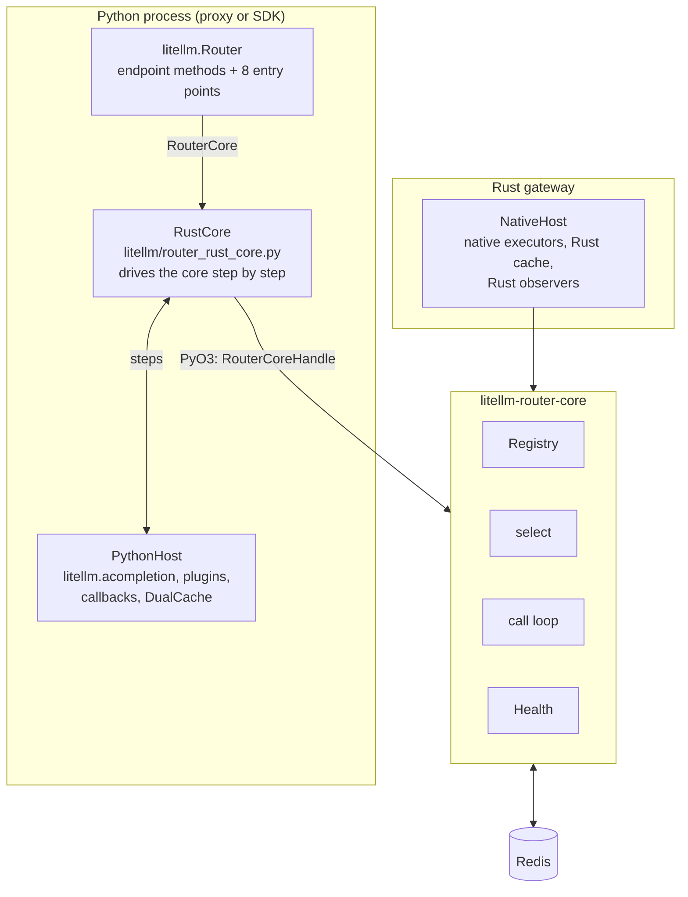
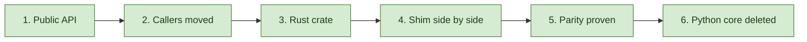
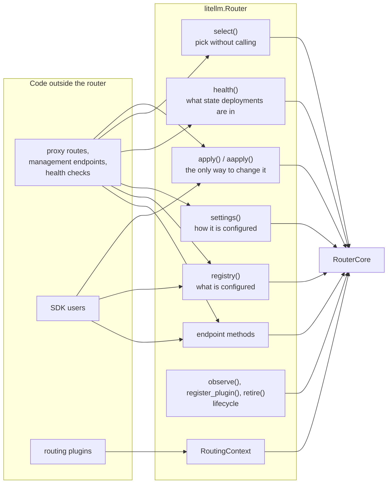
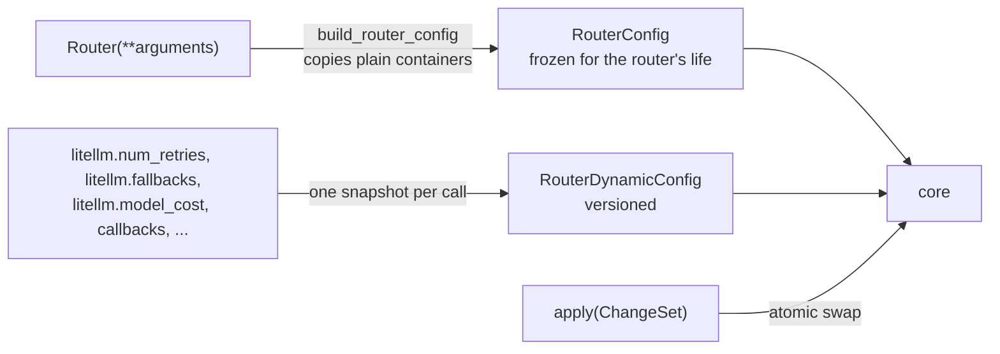
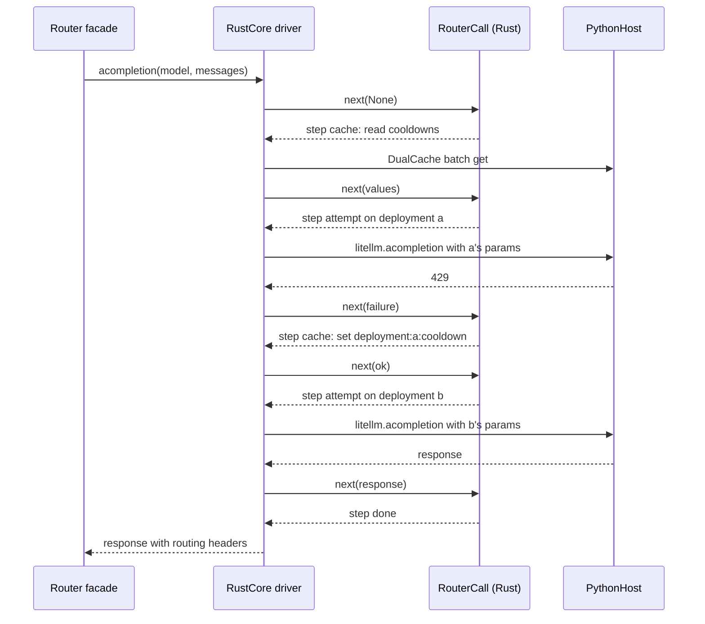

# The facade, the core and the hosts

The router is split into three parts. A Python facade, `litellm.Router`, which callers use. A routing core in Rust, `litellm-router-core`, which makes every routing decision. And a host, which gives the core everything that is not routing, such as provider calls, callbacks and Redis. This page explains the split and why it was made

## Why the router was split

Before the migration `Router` had about 700 members, and code outside `router.py` used 165 of them, most without an underscore. A Rust core cannot implement 165 loosely typed members that hand out live dicts, and every one of them was a place where Python and Rust could drift apart. The router went through the six-step path every module follows, define the public API, route every caller through it, build the Rust crate, run a Python shim over Rust side by side, prove parity with differential fuzzing, and delete the old code

## The facade

`litellm/router.py` holds no routing logic. `Router(**arguments)` freezes its arguments into a `RouterConfig`, picks a core once with `make_core`, and delegates every member to that core. `Router.from_config(config, host)` does the same from a config built elsewhere

The public surface is the endpoint methods (`acompletion`, `aembedding`, `aresponses`, `aanthropic_messages`, the files, batches, assistants and vector store wrappers) and eight entry points. Each entry point owns one kind of question

`tests/code_coverage_tests/router_surface_check.py` keeps it that way. It scans every non-test file under `litellm/` and `enterprise/` for Router member uses and compares them with a shrink-only allowlist. A second check, `router_litellm_globals_check.py`, makes sure `litellm/router_config.py` is the only router module that reads `litellm.*` settings

Routing plugins get a `RoutingContext` instead of the Router. It exposes the three views plus the few request-time helpers a plugin needs, so a plugin never holds the router itself

## Static settings and the dynamic snapshot

The router reads two kinds of configuration, and they are kept apart on purpose

`RouterConfig` holds the constructor arguments, copied so the caller's own lists and dicts cannot change the router later. Settings are static after construction. `apply(ChangeSet(...))` is the only way to change them, and the core builds the next registry and settings from the whole change set and swaps them in at once. Assigning an attribute on the Router, such as `router.cooldown_time = 30`, does not change routing

`RouterDynamicConfig` is a snapshot of the process settings the router reads while serving, such as `litellm.num_retries`, the fallback lists, `litellm.model_cost` and the callback lists. Each call reads one snapshot at its start, so a setting that changes during a call does not change that call halfway through

## The core

`litellm-rust/crates/router-core` owns the registry, the settings view, health (cooldowns, allowed fails counters, usage), selection and the call loop with its retries and fallbacks. Its `Router` is built from a `RouterConfig`, a `RouterDynamicConfig` and a `Host`. `apply` swaps an immutable registry and settings snapshot through an `ArcSwap`, so a call in flight finishes on the snapshot it started with. `retire` makes later calls fail with `Error::Retired`

When the core is built it checks that its host can serve the config. A strategy the core does not run natively, or any plugin, needs a host that can run selection stages. Every served operation needs either a native executor or a host that can invoke. A config that fails this check fails when the router is built, never partway through a request

## The hosts

`Host` is what the embedding process provides

| Host op | What the core asks |
| --- | --- |
| `invoke(attempt)` | run one attempt on one deployment, for operations without a native executor |
| `select(stage, ctx, candidates)` | run plugins (`SelectStage::Plugins`), or a strategy not yet ported to Rust (`SelectStage::Strategy`) |
| `allow_fallback(request, target)` | the access and budget checks before a cross-group fallback |
| `sleep(duration)` | the backoff before a retry |
| `observe(event)` | a routing event, for logs, callbacks, metrics and alerts |
| `cache()` | the shared store all routing state lives in |

There are two hosts. `PythonHost` serves the core inside a Python process. Provider calls go through `litellm.acompletion` and its siblings, so request preparation, logging and cost tracking are the same code SDK users run. Python plugins, unported strategies and the fallback access checks run through the select and allow_fallback bridges, and the cache is the router's `DualCache`. With these bridges the Rust core serves every config the Python router accepted

`NativeHost` serves the core inside the Rust gateway, with native executors, a Rust dual cache over the shared Redis and Rust observers. It cannot invoke Python or run Python plugins. A config that needs either fails when the gateway builds its router, and the gateway forwards that traffic to the Python proxy, as it does for other features it does not run natively

## Driving the core from Python without awaiting Python in Rust

The core never awaits Python. `RustCore` in `litellm/router_rust_core.py` starts a call with `RouterCoreHandle.start` and then loops. Each time it asks `RouterCall.next`, the core runs until it needs something only the host can give and returns that need as a step. The driver answers the step and asks again

The step kinds are `attempt`, `sleep`, `allow_fallback`, `select`, `cache`, `done` and `failed`. Every step also carries the routing events since the last one, which the driver hands to the host's observers

## Executors

After the core picks a deployment it resolves an executor for the attempt. An operation and provider pair in `NATIVE_RULES` with a registered native route runs in-process. Today that is Anthropic `/v1/messages`. Everything else goes through `Host::invoke`. An attempt runs on exactly one executor and is never replayed on another, so a native failure is that attempt's failure and the retry selects afresh

## The application host

The core's host is about routing. Separately, the router still needs a few answers only the proxy has, such as vertex pass-through credentials and whether a caller may use a member auto-router. It asks a `RouterHost` (`litellm/router_host.py`) for those, which is the proxy's `ProxyRouterHost` when the proxy can be imported and a default that refuses member auto-routers otherwise. This keeps the router from importing the proxy while the proxy imports the router
