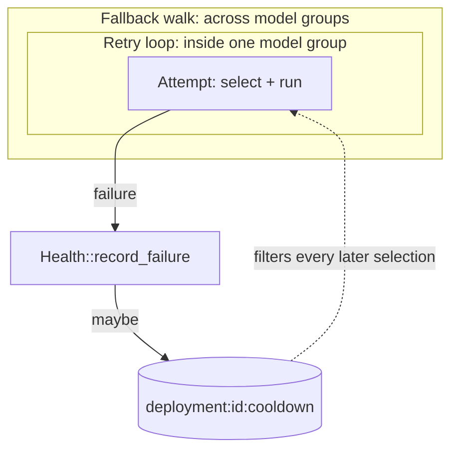
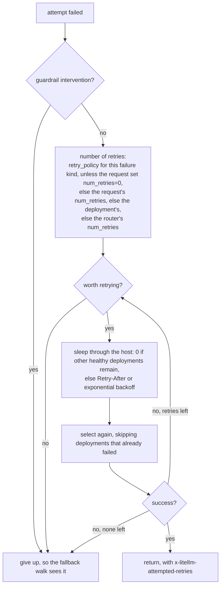
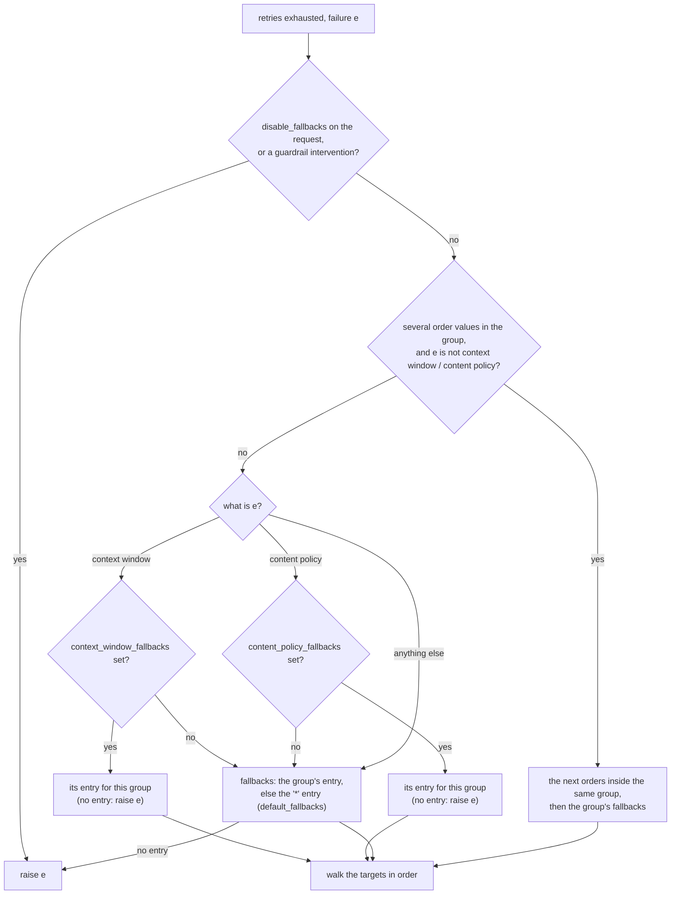
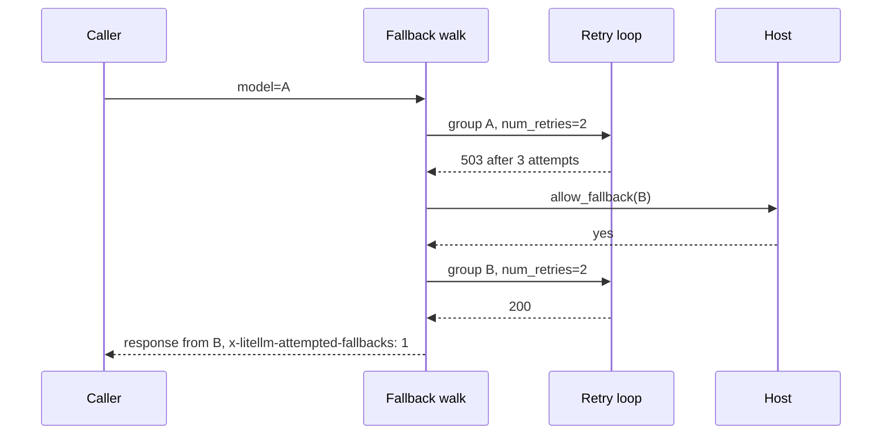
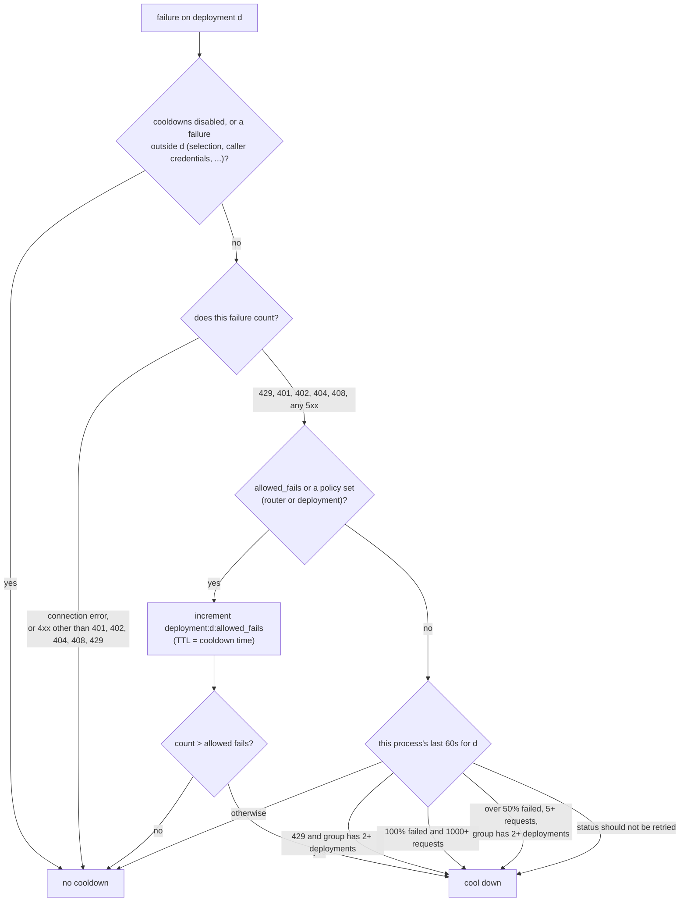

# Retries, fallbacks and cooldowns

The router has three tools for failures, and they work at different scopes. A retry tries the same model group again, and selection can land on a different deployment. A fallback moves the request to a different model group. A cooldown takes one deployment out of selection for every request, for a few seconds. All three live in the Rust core, the call loop in `call.rs` and the cooldown rules in `health.rs`, and they keep the rules, keys and TTLs the Python router had, so a fleet can mix Python proxies and Rust gateways on one Redis

Every decision reads the attempt's typed failure, its kind (rate limit, context window, content policy, auth, not found, timeout, ...), its status code and its `Retry-After`

## Retries

The retry loop runs the first attempt. When it fails, the core works out how many retries this request gets, decides whether this failure is worth retrying, waits, and loops

A failure is not worth retrying in these cases. A context window error when `context_window_fallbacks` is set, and a content policy error when `content_policy_fallbacks` is set, because a fallback will do better than another deployment of the same model. A status code that should not be retried, other than 401 and 403. A not found error. A rate limit when no healthy deployment is left and fallbacks exist. An auth or permission error in a group with a single deployment. And any failure when no healthy deployment is left

The sleep is zero while the group has more than one deployment and some are still healthy, since the next attempt can go somewhere else. Otherwise the core honors the provider's `Retry-After` up to one minute, and without one it backs off exponentially from 0.5 seconds up to 8 seconds, never less than the router's `retry_after`, plus up to 0.75 seconds of jitter. The sleep itself is a host op, so tests can run it on a scripted clock

## Fallbacks

When the retry loop gives up, the core chooses where to go next

Each list is a list of single-key dicts that map a model group to an ordered list of groups to try, for example `fallbacks=[{"gpt-4o": ["claude-sonnet", "gpt-4o-mini"]}]`. `default_fallbacks=["gpt-4o-mini"]` becomes the catch-all entry `{"*": ["gpt-4o-mini"]}`. The core looks up the group being served first and then the group the request asked for, so a fallback target's own fallbacks apply on the next hop. The lists come from the router's arguments or, when the router sets none, from the process settings in the dynamic snapshot

The walk takes each target in order. Before a target in another group it asks the host `allow_fallback`, which runs `fallback_access_check` (may this caller use that group) and `fallback_budget_check`. It skips targets this request already tried, then runs the whole retry loop again against the target, which can fall back further. A depth counter stops the walk at `max_fallbacks` (default 5, or the `ROUTER_MAX_FALLBACKS` environment variable). Each hop is reported as a `Fallback` routing event with its source, target, order, depth and level

With `fallbacks=[{"A": ["B"]}]`, `context_window_fallbacks=[{"A": ["A-long"]}]` and `num_retries=2`, a 503 from A is retried twice in A, then the request goes to B with two retries of its own. A context window error from A is not retried at all, since a context window fallback exists, and goes straight to A-long

## Cooldowns

A cooldown is a key `deployment:{id}:cooldown` in the routing cache, with a TTL equal to the cooldown time. While the key exists, the cooldown filter drops the deployment from every selection, on every process that shares the Redis. When the TTL expires the deployment is simply eligible again. There is no probe request and no early reset on success

`Health::record_failure` decides whether a failure cools the deployment down. It runs two checks, first on the failure and then on the deployment's recent history

The cooldown time comes from the deployment's own `cooldown_time` if it sets one, then the provider's `Retry-After`, then the router's `cooldown_time`, which defaults to 5 seconds. Every cooldown set is reported as a `CooldownSet` routing event, which the host turns into alerts and metrics

Two details are easy to miss. The success and failure counts for the error-rate rule are kept in memory only, per process, with a 60 second TTL, so on a fleet each pod judges a deployment by the traffic it saw itself. The `allowed_fails` counter and the cooldown key live in Redis when it is configured, so they apply to the whole fleet. And by default a lone deployment is protected from the error-rate rule, since cooling down the only deployment of a group would fail every request for that group

When every candidate is cooled down, the attempt fails with no healthy deployments and the time until the soonest cooldown ends, and the fallback walk treats it like a rate limit. `enable_health_check_routing` with an allowed fails policy changes this, by ignoring cooldowns for the request when they would leave nothing
