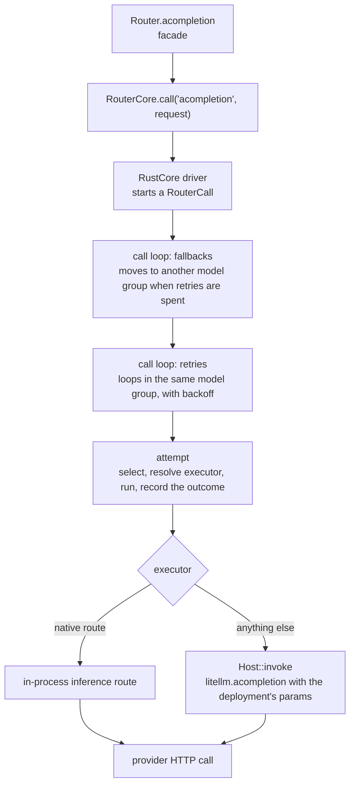
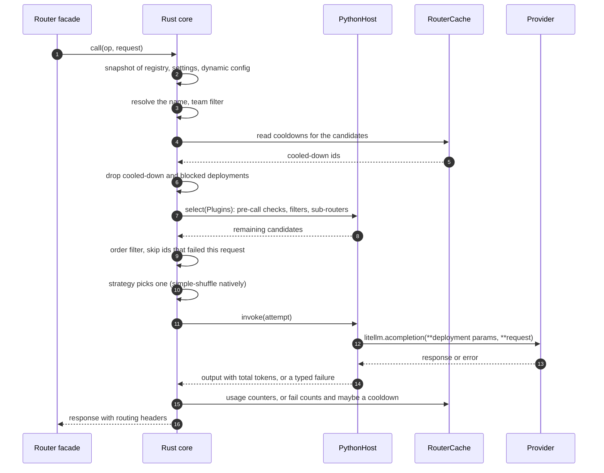
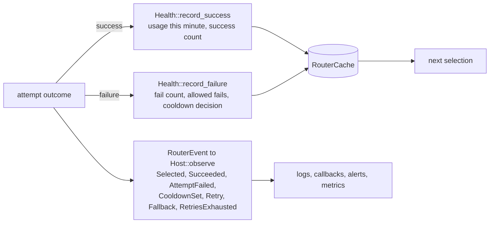

# The life of a request

This page follows one `await router.acompletion(model="gpt-4o", messages=...)` from the facade, through the Rust core, to the provider and back. The other endpoint methods (`aembedding`, `aresponses`, `aanthropic_messages` and the rest) take the same path with a different operation name

## From the facade to the core

Every endpoint method is a thin wrapper over one core call, `call(op, request)`. The operation names the endpoint (`acompletion`, `aembedding`, `aanthropic_messages`, ...) and the request is the caller's keyword payload. In the core they become an `Op` and a `RouterRequest`, which carries the requested name and the few request fields routing reads, such as the caller's team id, `specific_deployment`, a per-request `num_retries`, `disable_fallbacks` and per-team weights. The rest of the payload travels with the request untouched, for the attempt to use

Fallbacks wrap retries, and retries wrap a single attempt. Each attempt selects a deployment and calls it, so a retry can land on a different deployment. The loop is in `litellm-rust/crates/router-core/src/call.rs`

## One attempt, in order

Some details worth knowing

The snapshot is taken once, at the start of the call. A concurrent `apply()` swaps in a new registry for later calls, and this call keeps the one it started with

The core turns an attempt's error into a typed `AttemptError` with a failure kind (rate limit, context window, content policy, auth, timeout, ...), the status code and any `Retry-After`. Retry, fallback and cooldown rules read those facts, never the exception text

The provider SDK and HTTP client are told not to retry (`max_retries=0`). The router's loop is the only retry loop, which is what lets each retry pick a different deployment

`litellm.acompletion` is the same function SDK users call. Under `PythonHost` the router does not talk to providers itself. It chooses the deployment, and the provider transformation layer does the rest. Under the gateway's `NativeHost`, or for a native route, the attempt runs in Rust

The response carries the chosen deployment's id in `response._hidden_params["model_id"]`, and the proxy reports it in the `x-litellm-model-id` header together with the model group, the retries and the fallbacks the call used

## How results flow back into routing

The core records each outcome itself, right after the attempt, so nothing depends on a logging callback firing

Strategies that keep their own statistics, such as latency or in-flight counts, still learn from the logging callbacks of each call. Until a strategy is ported to Rust it runs in Python through the select bridge and keeps its counters there. `router.observe(request_scoped=True)` binds the router's observers to each request's logging object instead of registering them globally

## The sync path

`router.completion()` and the other sync methods run the same core call to completion on the calling thread. The proxy uses the async methods for every request
