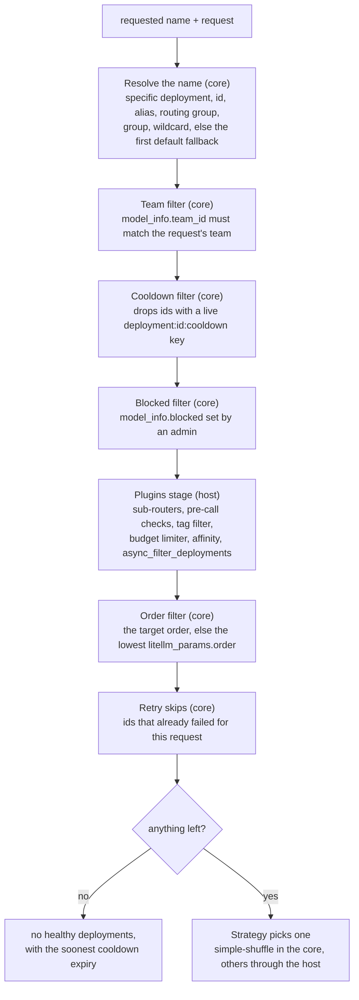
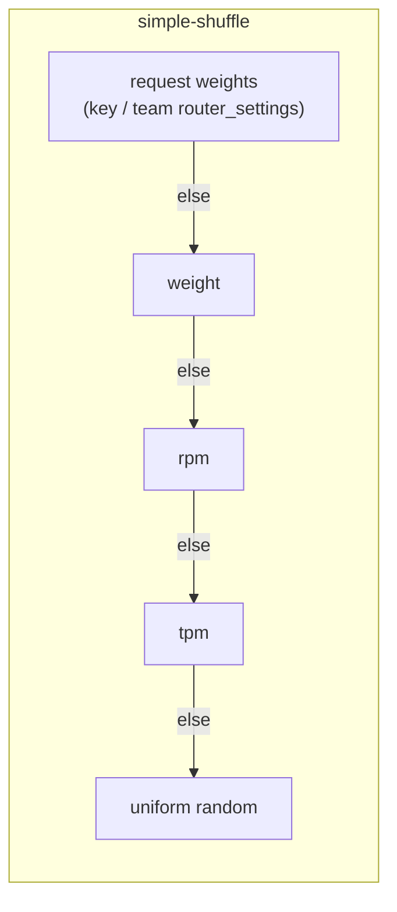
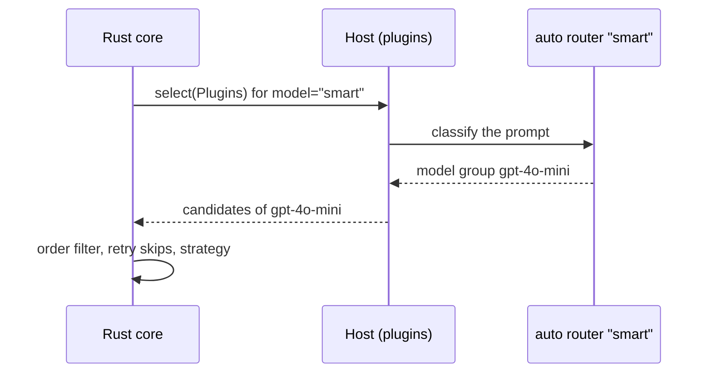

# How a deployment is picked

Selection turns a requested name into one deployment. It runs inside every attempt, so a retry selects again. It lives in `litellm-rust/crates/router-core/src/select.rs`, and `router.select()` runs it without calling the provider

## The filter chain

Each stage can only remove candidates. The strategy at the end sees what is left. The core runs most stages itself and asks the host for the ones written as plugins

The core skips the plugins stage when the router has no plugins, so a plain config never leaves Rust during selection

With `enable_health_check_routing` on and an allowed fails policy set, a group whose deployments are all cooled down is routed as if none were, instead of failing. A name that resolves to a single deployment by id, or by `specific_deployment=True`, still goes through the same filters

The `order` filter is how in-group priority works. Deployments with `order: 1` take all traffic while any of them pass the filters. The ones with `order: 2` only see traffic when the fallback walk targets the group at that order, after the lower order is exhausted (see [Retries, fallbacks and cooldowns](reliability.md))

## Strategies

The strategy is the last step. It gets the filtered list and returns one deployment. `simple-shuffle` runs in the core. The others are Python plugins that the core runs through `Host::select(SelectStage::Strategy)`, which returns the candidates with the pick first. Each is ported to Rust one at a time and proven equal with differential fuzzing before its Python version is deleted. Under the gateway's `NativeHost` a strategy that is not ported yet makes the config fail at build time, and the gateway forwards that traffic to the Python proxy

| Strategy | Picks | Reads | Runs in |
| --- | --- | --- | --- |
| `simple-shuffle` (default) | a weighted random deployment | per-request weights, then `weight`, then `rpm`, then `tpm`, else uniform | the core |
| `usage-based-routing-v2` | the deployment with the lowest tpm this minute that stays under its tpm and rpm | per-minute usage counters | the host, until ported |
| `usage-based-routing` | the v1 version of the above, kept for old configs | per-minute usage | the host, until ported |
| `latency-based-routing` | the lowest recent latency, or time to first token for streams, within a buffer | latency samples | the host, until ported |
| `least-busy` | the deployment with the fewest requests in flight | in-flight counters | the host, until ported |
| `cost-based-routing` | the cheapest deployment still under its limits | model cost map, usage | the host, until ported |
| `lar1` | a deployment by the caller's confidence level (LAR-1), with thresholds from `routing_strategy_args` | `metadata.lar1` on the request | the host, until ported |
| a registered plugin | whatever the plugin decides | the request and `RoutingContext` | the host |

Routing groups can also use `priority`, which tries member groups by `model_priorities` and shares traffic between equal priorities. `register_plugin()` puts your own strategy in place of the configured one, see [Add a custom routing strategy](../how-to/add-a-routing-strategy.md)

Each weight is normalized by the largest in the list. Per-request weights come from key or team level `router_settings`. The proxy validates them into the request as `{model_group: {deployment_id: weight}}`, so one team can send most of a group's traffic to one deployment while everyone else gets the global split, without a separate Router per team. The randomness is injectable (`Randomness`), so tests can seed it

## Sub-routers are plugins

The auto router, complexity router, quality router and adaptive router are not strategies. Each is configured as a deployment whose `litellm_params.model` starts with a marker such as `auto_router/`. It looks at the request, decides which model group should serve it, and normal selection then runs on that group. Marker deployments are never called directly

Whether a caller may use a member auto-router needs the proxy's team checks, so the plugin asks the application host (`RouterHost.authorize_strategy_inference`). See [The facade, the core and the hosts](core-and-hosts.md)
