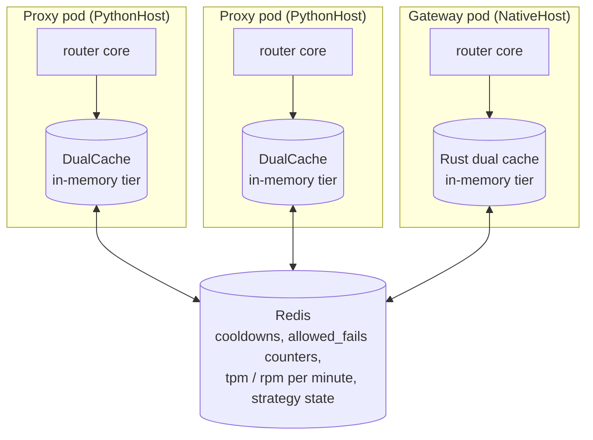
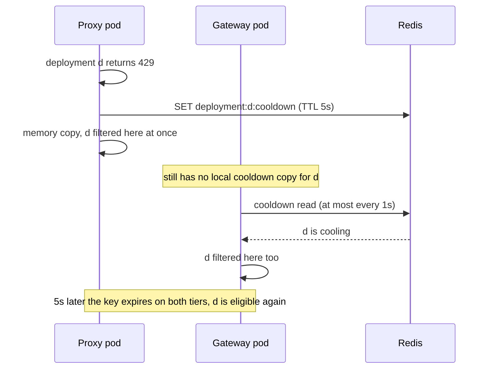

# Shared state across proxy pods and gateways

A production deployment runs many processes, Python proxy pods and Rust gateway pods, each with its own router built from the same config. They agree on routing through Redis. The Rust core reads and writes the same keys, encodings and TTLs the Python router used, so every process sees the same cooldowns and counters whichever host it runs. This page explains what is shared, what is not, and how fresh each piece is

## The routing cache

The core keeps all its state behind one trait, `RouterCache` (`litellm-rust/crates/router-core/src/cache.rs`), which it gets from `Host::cache()`. Under `PythonHost` that is the router's `DualCache` (`litellm/caching/dual_cache.py`), built from the `redis_*` arguments. Under `NativeHost` it is the Rust dual cache over the same Redis. Both have two tiers. Writes go to both. Reads check memory first and only go to Redis on a miss, then copy the Redis value into memory. Without Redis settings the router runs with the in-memory tier alone, which is fine for one process and means every process routes on its own view

`router.health().store` is that cache

Under `PythonHost` the core does not touch the cache directly. A cache read or write is a step the core hands to the Python driver, which answers it against the `DualCache`, so a Python worker and the Rust core inside it never hold two copies of the same state

Reading memory first keeps Redis off the hot path, at the cost of freshness. A value another process wrote is only seen once the local copy expires or was never there. The router handles that per kind of state

| State | Key | Tiers | How fresh other processes see it |
| --- | --- | --- | --- |
| Cooldown | `deployment:{id}:cooldown` | memory + Redis | the local copy is re-checked against Redis at least every `DEFAULT_COOLDOWN_REDIS_READ_INTERVAL_SECONDS` (1s) |
| Allowed fails counter | `deployment:{id}:allowed_fails` | memory + Redis, incremented in Redis | fleet-wide at increment time, falling back to the local count if Redis errors |
| Success / fail counts for the error-rate rule | `{id}:successes`, `{id}:fails` | memory only, 60s TTL | never, each process judges on its own traffic |
| Usage per minute | `global_router:{id}:{model}:tpm:{HH-MM}`, `...:rpm:...` | Redis increment after each response | at once in Redis, local reads may lag |
| Strategy state (usage-based v2, latency, least-busy) | strategy keys | memory, pushed to Redis every `DEFAULT_REDIS_SYNC_INTERVAL` (1s) or on write | about a second behind |

See [Routing state and cache keys](../reference/state-and-cache-keys.md) for the full list with TTLs

## What this means in practice

Cooldowns are shared. When one process cools a deployment down, the others stop picking it within about a second, whether they are Python proxies or Rust gateways

Rate limits through `rpm` and `tpm` are soft. Processes do not reserve capacity before a call, they read counters that are incremented after responses, so a burst can overshoot a deployment's limit by roughly what the fleet sends in one sync interval. The proxy's own rate limiter for keys and teams is a separate system that uses atomic Lua scripts, and the router does not use it

The default error-rate cooldown is decided per process. A deployment that fails half its traffic everywhere gets cooled down by each process independently, and the resulting cooldown key is shared. With `allowed_fails` or an `allowed_fails_policy` set, the counter is in Redis and the threshold is fleet-wide

## Redis outages

The router keeps routing when Redis fails. The cache logs the failure and serves from memory, and the `allowed_fails` increment falls back to the process's own count. Routing quality drops to what each process knows alone until Redis returns
