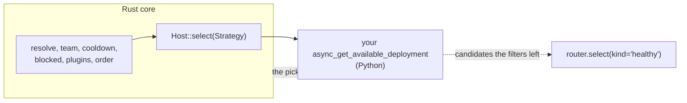

# Add a custom routing strategy

Use this guide when none of the built-in strategies picks deployments the way you need and you want to plug your own in without changing the core. You write a `CustomRoutingStrategyBase` and register it with `router.register_plugin()`

## Know where it runs

`register_plugin` puts your strategy in place of the configured one. The Rust core does not run Python, so it calls your strategy through the host's select bridge every time it picks a deployment for this router. Your strategy is the only Python code on the selection path, and the rest of selection, from resolving the name to the cooldown and order filters, still runs in the core



Your method receives the request, not the candidate list. Ask the router for the filtered candidates with `select(kind="healthy")` and choose among them, as the example does, so cooldowns, team checks and the other filters keep applying to your picks

The Rust gateway cannot run Python, so a router with a registered strategy is served by the Python proxy only. If the strategy should also run in the gateway, it needs a Rust port, the same way the built-in strategies are being ported

## Write the strategy

```python
from litellm import Router
from litellm.types.router import CustomRoutingStrategyBase


class LowestIdStrategy(CustomRoutingStrategyBase):
    def __init__(self, router: Router) -> None:
        self.router = router

    async def async_get_available_deployment(
        self, model, messages=None, input=None, specific_deployment=False, request_kwargs=None
    ):
        healthy = await self.router.select(
            model,
            request_kwargs,
            kind="healthy",
            messages=messages,
            input=input,
            specific_deployment=specific_deployment,
        )
        if isinstance(healthy, dict):  # the name resolved to one specific deployment
            return healthy
        return min(healthy, key=lambda d: d["model_info"]["id"])

    def get_available_deployment(
        self, model, messages=None, input=None, specific_deployment=False, request_kwargs=None
    ):
        raise NotImplementedError("this strategy serves the async path only")
```

The method returns one deployment dict from the model list. `select(kind="healthy")` raises the router's usual no-deployments error when everything is filtered out, so you do not need your own

## Register it

```python
router = Router(model_list=[...])
router.register_plugin(LowestIdStrategy(router))
```

From here on every pick for this router, for `acompletion`, `aembedding` and the other endpoint methods, goes through it. `get_available_deployment` serves `router.completion()` and the other sync methods, so implement it too if you use them

## Check it

`router.select(model)` now returns your pick without calling the provider, which makes the strategy easy to unit test with mock deployments. [The tutorial](../tutorial/route-your-first-requests.md) shows how to build a Router with `mock_response` deployments

## When a plugin is the better fit

If you only need to narrow the candidates, or to send some requests to a different model group, you do not need to replace the strategy. A deployment-level filter fits as a `CustomLogger` that implements `async_filter_deployments` and is added to `litellm.callbacks`, which the core runs in its plugins stage. Choosing a model group per request is what the auto, complexity, quality and adaptive sub-routers do in the same stage. Both keep the configured strategy, so a `simple-shuffle` router still picks in Rust. See [How a deployment is picked](../explanation/selection.md) for where each stage runs
