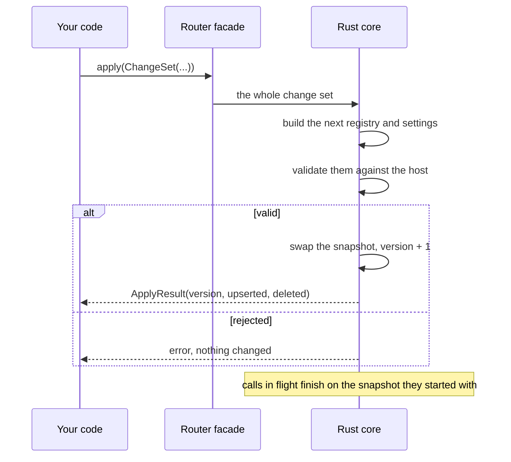

# Change deployments or settings at runtime

Use this guide to add, replace or remove deployments, or to change router settings, on a Router that is already serving traffic. Router settings are static after construction, and `router.apply()` with a `ChangeSet` is the only way to change them. Assigning a Router attribute, or changing a list that `settings()` or `registry()` returned, does not change routing



## Add or replace a deployment

`upsert` matches on `model_info.id`. A deployment with a new id is added, one with an existing id replaces the old one

```python
from litellm.router_api import ChangeSet
from litellm.types.router import Deployment

result = router.apply(ChangeSet(upsert=[
    Deployment(
        model_name="gpt-4o",
        litellm_params={"model": "azure/gpt-4o-westus", "api_base": "...", "api_key": "..."},
        model_info={"id": "gpt-4o-westus"},
    )
]))
previous = result.upserted[0]  # the deployment it replaced, or None
```

## Remove a deployment

```python
result = router.apply(ChangeSet(delete=["gpt-4o-westus"]))
removed = result.deleted[0]  # the removed deployment, or None if the id was unknown
```

## Change settings

Use `settings` for validated settings, with the same names and casting the proxy's `router_settings` use, and `assign` to replace a setting as it is

```python
router.apply(ChangeSet(settings={"num_retries": 3, "routing_strategy": "latency-based-routing"}))
router.apply(ChangeSet(assign={"cooldown_time": 30, "fallbacks": [{"gpt-4o": ["claude-sonnet"]}]}))
```

`assign` takes names from `SETTING_FIELDS`, the plain settings `num_retries`, `max_fallbacks`, `retry_after` and `timeout`, and `model_group_alias`. Any other name raises a `ValueError`. The values are copied when the change is applied, so changing your own dict afterwards does not reach the router

A change the core cannot serve is rejected as a whole. Under the gateway's `NativeHost`, switching to a strategy that is not ported to Rust yet is such a change

## Changes that need I/O

Re-reading discovered model info is async, so it needs `aapply`

```python
await router.aapply(ChangeSet(refresh_model_info=True))
```

## Several changes at once

One `ChangeSet` can carry all of these, and the core applies them together. A request sees either the router before the change set or after it, never part of it. `ApplyResult.version` is the registry version after the change

## Old code you may find

The left column no longer works. `DeprecatedRouterMembers`, which kept these names alive during the migration, has been deleted

| Old | New |
| --- | --- |
| `router.upsert_deployment(d)` | `router.apply(ChangeSet(upsert=[d]))` |
| `router.delete_deployment(id=i)` | `router.apply(ChangeSet(delete=[i]))` |
| `router.update_settings(**s)` | `router.apply(ChangeSet(settings=s))` |
| `router.cooldown_time = 30` | `router.apply(ChangeSet(assign={"cooldown_time": 30}))` |
| `router.update_redis_cache(cache=c)` | `router.apply(ChangeSet(redis_cache=c))` |
| `await router.arefresh_model_info()` | `await router.aapply(ChangeSet(refresh_model_info=True))` |
