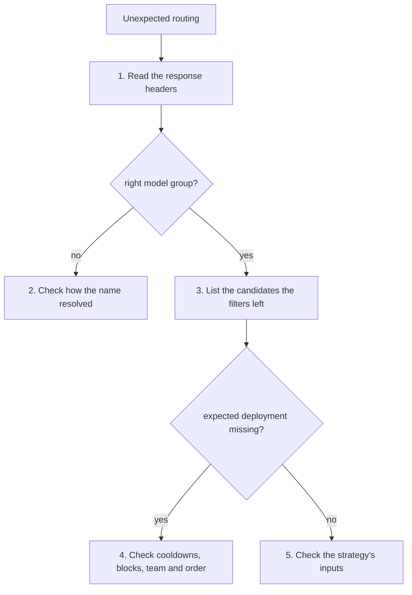
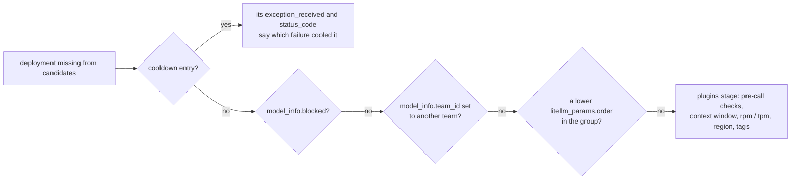

# Find out why a request went where it did

Use this guide when a request landed on an unexpected deployment, fell back when it should not have, or failed with "No deployments available for selected model". Work from what the response tells you toward what the router saw



## 1. Read the response headers

Through the proxy, every response says what happened

| Header | Tells you |
| --- | --- |
| `x-litellm-model-id` | the deployment that answered (`model_info.id`) |
| `x-litellm-model-group` | the model group that answered, which differs from the request after a fallback |
| `x-litellm-model-api-base` | the deployment's endpoint |
| `x-litellm-attempted-retries` | how many retries ran |
| `x-litellm-attempted-fallbacks` | how many fallback hops ran |

From the SDK, `response._hidden_params["model_id"]` holds the deployment id

## 2. Check how the name resolved

```python
registry = router.registry()
registry.resolve("gpt-4", kind="alias")        # alias target, or None
registry.resolve("gpt-4", kind="group")        # the group the name routes to
registry.resolve("gpt-4", kind="recognized")   # does the router know the name at all
registry.names("gpt-4", kind="route_candidates", team_id=team_id)  # deployment ids it may reach
```

A name that is not a group can still route through a deployment id, an alias, a routing group, a wildcard such as `openai/*`, or the `*` fallback. Team public names are mapped to their group before the request reaches the router. [Concepts](../explanation/concepts.md) has the order

## 3. List the candidates the filters left

`select(kind="healthy")` runs the core's whole filter chain for a request without calling anything, including the plugins stage. Pass the same `request_kwargs` the real request had, since the team filter, tags and per-request settings read them

```python
candidates = await router.select(
    "gpt-4o",
    {"metadata": {"user_api_key_team_id": team_id, "tags": ["prod"]}},
    kind="healthy",
    messages=messages,
)
print([d["model_info"]["id"] for d in candidates])

picked = await router.select("gpt-4o", {"metadata": {...}}, messages=messages)
```

For a step-by-step view, turn on debug logs with `LITELLM_LOG=DEBUG` (or `Router(set_verbose=True, debug_level="DEBUG")`). The core reports every step of a call as a routing event, `Selected`, `AttemptFailed` with the failure kind and status, `CooldownSet`, `Retry` with its delay, `Fallback` with source, target and depth, and `RetriesExhausted`, and the host logs each one. Read them in order to see what the call did

## 4. Check what removes a deployment

```python
health = router.health()
ids = list(registry.names("gpt-4o", kind="ids"))
await health.cooldowns.async_get_active_cooldowns(model_ids=ids, parent_otel_span=None)
health.is_blocked(registry.deployment("gpt-4o-eastus"))
```



A cooldown entry records the failure that caused it. The rules for when a failure counts are in [Retries, fallbacks and cooldowns](../explanation/reliability.md). Deployments with a higher `order` only get traffic once every lower-order deployment of the group has failed for the request

The error "No deployments available for selected model" is a `RouterRateLimitError`. Its message includes the cooldown list and the seconds until the soonest cooldown ends, and it says whether pre-call checks were on, since they are a common cause. The fallback walk treats it like a rate limit, so a group with fallbacks moves on to them

## 5. Check the strategy's inputs

If the right deployments made it through and the pick still looks wrong, read what the strategy reads. `router.settings().routing_strategy` says which strategy ran, unless the name resolved to a routing group with its own. For `simple-shuffle`, check `weight`, `rpm` and `tpm` on the deployments and any per-team `weights` in key or team `router_settings`, and remember the pick is random, so judge the split over many requests. For usage-based strategies, `await router.health().usage("gpt-4o")` shows this minute's counters, and remember that processes share them about a second late (see [Shared state](../explanation/shared-state.md))
