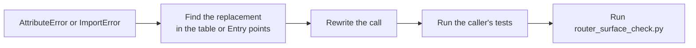

# Port code written against the old Router members

Use this guide when code from before the core swap, such as a long-lived branch, a fork or an internal plugin, uses Router members that no longer exist. It fails with `AttributeError: 'Router' object has no attribute ...`. During the migration these names lived on in `DeprecatedRouterMembers` with a `DeprecationWarning`, and that mixin has been deleted. So have `litellm/router_utils/` and the Python core, so imports from them fail too



## 1. Find the replacement

Most rewrites are mechanical

| Before | After |
| --- | --- |
| `llm_router.model_list` | `llm_router.registry().all()` |
| `llm_router.get_model_list(model_name=m)` | `llm_router.registry().deployments(m)` |
| `llm_router.get_deployment(model_id=i)` | `llm_router.registry().deployment(i)` |
| `llm_router.get_model_names()` | `llm_router.registry().names()` |
| `llm_router.model_names` | `llm_router.registry().names(kind="group_set")` |
| `llm_router.get_model_group_info(m)` | `llm_router.registry().group(m)` |
| `llm_router.get_routing_group(name)` | `llm_router.registry().routing_group(name)` |
| `llm_router.routing_strategy` | `llm_router.settings().routing_strategy` |
| `llm_router.get_settings()` | `llm_router.settings().as_dict()` |
| `llm_router.cache` | `llm_router.health().store` |
| `llm_router.cooldown_cache` | `llm_router.health().cooldowns` |
| `await llm_router.async_get_available_deployment(model=m, request_kwargs=k)` | `await llm_router.select(m, k)` |
| `llm_router.upsert_deployment(deployment=d)` | `llm_router.apply(ChangeSet(upsert=[d]))` |
| `llm_router.cooldown_time = 30` | `llm_router.apply(ChangeSet(assign={"cooldown_time": 30}))` |
| `llm_router.discard()` | `llm_router.retire()` |
| `Router.get_valid_args()` | `litellm.router_api.router_init_args()` |
| `Router.generate_model_id(group, params)` | `litellm.router_api.deployment_id(group, params)` |

[Entry points](../reference/entry-points.md) lists every query with the old name it replaced, in its "Was" column. Return types are the same as the old members had, so type checks keep passing. Where a query is overloaded on `kind`, `source` or `field`, pass the literal directly so pyright picks the right overload

Setting writes are the one place where behavior changed, not only names. Assigning a Router attribute used to change routing. Now settings are static after construction, and only `apply()` changes them

## 2. Replace `router_utils` imports

A function from `litellm.router_utils` was either moved to `litellm/litellm_core_utils/` because other modules need it too, exposed as a module-level helper in `litellm/router_api.py` (such as `fallback_chain`, `fallbacks_disabled` or `deployment_metadata`), or became part of the Rust core. A routing decision you used to compute yourself, such as whether a failure cools a deployment down, is now answered through `health()` or by the core itself

## 3. Port a routing plugin

A plugin that took the Router should take a `RoutingContext` and read through it. It has `registry()`, `settings()`, `health()` and the request-time helpers a plugin needs, and nothing else, so the plugin keeps working while the core under it changes

## 4. Check the surface

```bash
uv run python tests/code_coverage_tests/router_surface_check.py
```

It fails when code outside the router uses something other than the endpoint methods and the entry points. If it fails on your change, the fix is in the caller, not the allowlist. The allowlist only shrinks, and when your change removes the last use of a listed entry, shrink it in the same PR

```bash
uv run python tests/code_coverage_tests/router_surface_check.py --write
git diff tests/code_coverage_tests/router_surface_allowlist.json
```
