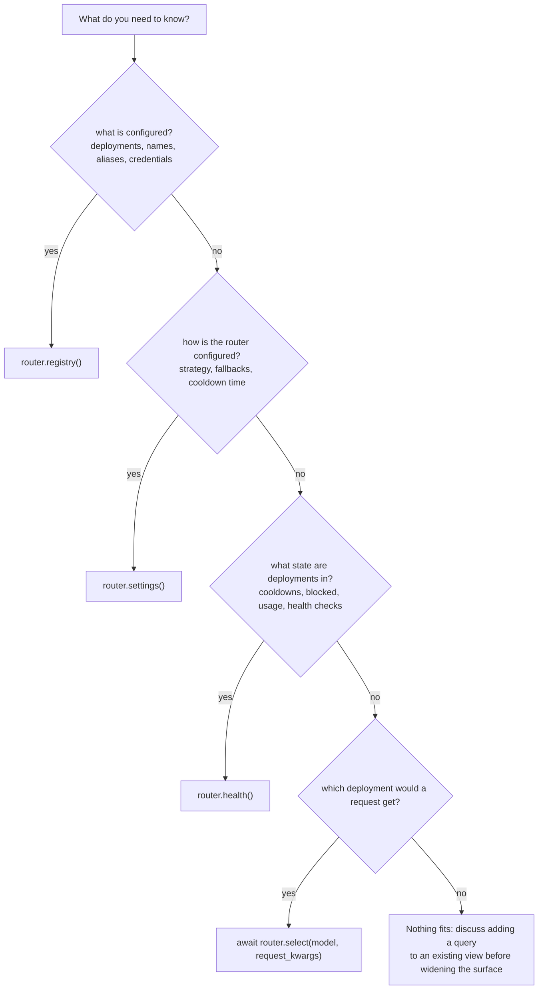

# Read router state from outside the router

Use this guide when code outside the router needs to know something about it, such as which deployments a group has, what the fallbacks are, or whether a deployment is cooled down. The entry points are the only way in. The Router facade has no other members, and the surface check in CI rejects anything that tries

## Pick the entry point



## Get the router

In the proxy, the Router is `litellm.proxy.proxy_server.llm_router`, which can be None before config loads. Import it inside the function that uses it, as the existing proxy modules do

```python
from litellm.proxy.proxy_server import llm_router

if llm_router is None:
    raise HTTPException(status_code=500, detail="router not initialized")
```

## Common reads

```python
registry = llm_router.registry()

groups = registry.names(kind="group_set")                     # configured model group names
deployments = registry.deployments("gpt-4o", team_id=team_id)  # what get_model_list returned
deployment = registry.deployment(model_id)                     # Deployment or None
group_name = registry.resolve("gpt-4", kind="alias")           # alias target or None
info = registry.group("gpt-4o", field="info")                  # merged ModelGroupInfo
routing_group = registry.routing_group("smart-tier")           # RoutingGroup or None
team_names = registry.names(kind="team_public", team_id=team_id)

settings = llm_router.settings()
strategy = settings.routing_strategy
fallbacks = settings.fallbacks

health = llm_router.health()
paused = health.is_blocked(deployment)
tpm, rpm = await health.usage("gpt-4o")
cooling = await health.cooldowns.async_get_active_cooldowns(model_ids=ids, parent_otel_span=None)
failures = health.failures_this_minute(deployment.model_info.id)
```

Each query's docstring in `litellm/router_api.py` names the old member it replaces, and [Entry points](../reference/entry-points.md) lists them all in one table

## Things to watch

Treat what you get back as read-only. Changing a list from `settings().fallbacks` or `registry().all()` does not change routing, since the core holds its own copy. Use `apply()` instead, see [Change deployments or settings at runtime](change-the-router-at-runtime.md)

`settings()` and `registry()` read the core's current snapshot. Read them again after an `apply()` instead of holding one across requests. To detect deployment changes, compare `registry().version` with the value you saw last

Inside a routing plugin you get a `RoutingContext`, not the Router. It has the same `registry()`, `settings()` and `health()`

Module-level helpers in `litellm/router_api.py`, such as `fallback_chain`, `deployment_id` and `router_init_args`, answer questions that need no Router at all
