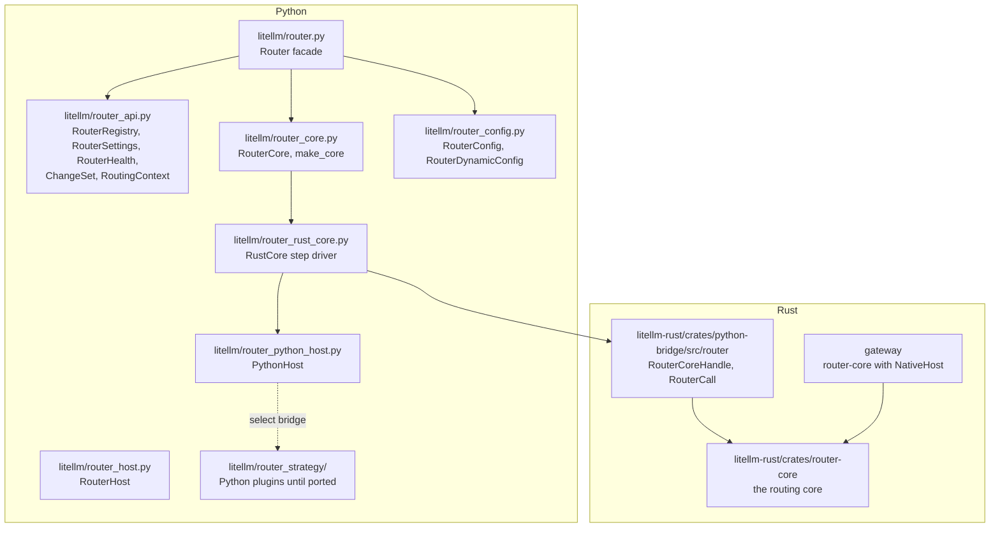

# Code map

Where the router's code lives. Paths are relative to the repo root

## Python

| File | Holds |
| --- | --- |
| `litellm/router.py` | `Router`, the facade. Builds the config, picks the core, delegates every member |
| `litellm/router_api.py` | the entry point views and types, see [Entry points](entry-points.md) |
| `litellm/router_core.py` | the `RouterCore` protocol and `make_core` |
| `litellm/router_config.py` | `RouterConfig`, `RouterDynamicConfig`, and the only router reads of `litellm.*` settings |
| `litellm/router_rust_core.py` | `RustCore`, which drives the Rust call loop and answers its steps |
| `litellm/router_python_host.py` | `PythonHost`, the core's host inside a Python process |
| `litellm/router_host.py` | `RouterHost`, what only the application can answer, and `litellm/proxy/_router_host.py` with the proxy's version |
| `litellm/router_strategy/` | Python strategies and sub-routers that run through the select bridge. Each is deleted once its Rust port is the default |
| `litellm/litellm_core_utils/` | helpers the router and other modules share, such as wildcard matching, PTU shares and the retry and fallback headers |
| `litellm/types/router.py` | `Deployment`, `RoutingGroup`, `RetryPolicy` and the other config types |
| `litellm/proxy/route_llm_request.py` | maps a proxy request to a Router endpoint method |

## Rust

`litellm-rust/crates/router-core/src/`

| File | Holds |
| --- | --- |
| `lib.rs` | `Router`, `RouterBuilder`, and the crate overview |
| `config.rs` | `RouterConfig`, `RouterDynamicConfig`, `Op`, `RoutingStrategy` |
| `registry.rs` | `Registry`, `Deployment`, `ChangeSet`, name resolution, `deployment_id` |
| `settings.rs` | the frozen `Settings` view |
| `select.rs` | the filter chain and `simple-shuffle` |
| `call.rs` | the call loop, retries and fallbacks |
| `health.rs` | cooldowns, allowed fails, usage, and the cache keys |
| `cache.rs` | `RouterCache` and an in-memory implementation |
| `host.rs` | `Host`, `Attempt`, `RouterRequest`, `RouterEvent`, `RoutingContext` |
| `executor.rs` | native routes and `NATIVE_RULES` |
| `error.rs` | `ConfigError`, `Error`, `AttemptError`, `FailureKind` |

`litellm-rust/crates/python-bridge/src/router/` exposes the core to Python as `RouterCoreHandle` and `RouterCall`, and turns Python's config and dynamic snapshot into the core's types

## Tests and checks

| Path | What it covers |
| --- | --- |
| `tests/unit/test_router/core/` | the core suite, run against every core builder with a scripted host: selection, retries and cooldowns, fallbacks, registry change sets, endpoints |
| `litellm-rust/crates/router-core` unit tests | the Rust modules, with seeded randomness and a test clock |
| `tests/unit/test_router/` | router unit tests through the facade, including `test_router_entry_points.py` |
| `tests/code_coverage_tests/router_surface_check.py` | the shrink-only surface allowlist, run in CI |
| `tests/code_coverage_tests/router_litellm_globals_check.py` | only `litellm/router_config.py` reads `litellm.*` settings |
| `tests/code_coverage_tests/router_code_coverage.py` | every router function has a test |
| litefuzz `translation-diff` suite | differential fuzzing of one core against another, the parity proof for the swap and for each plugin port |
