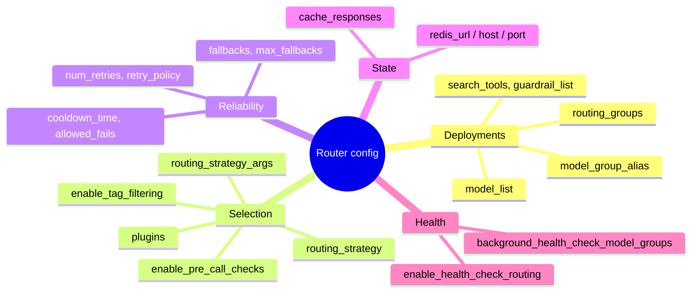

# Configuration and defaults

The constructor arguments of `litellm.Router`, grouped by what they control. In proxy config they sit under `router_settings`, with `model_list` at the top level, and the Rust gateway reads the same config. `litellm.router_api.router_init_args()` lists every accepted name

`Router(**arguments)` freezes the arguments into a `RouterConfig` and they stay fixed for the router's life. Change them with `apply()`, see [Change deployments or settings at runtime](../how-to/change-the-router-at-runtime.md). Where a default below says `litellm.<name>`, the value comes from the process settings, which the router reads as one `RouterDynamicConfig` snapshot per call

Arguments marked "host" are served by Python plugins through the select or invoke bridge until they are ported to Rust. Under the gateway's `NativeHost` a config that uses one fails at build time, and the gateway forwards that traffic to the Python proxy

## Deployments

| Argument | Default | Meaning |
| --- | --- | --- |
| `model_list` | None | the deployments, see [Concepts](../explanation/concepts.md) |
| `model_group_alias` | `{}` | name to group, or `{"model": group, "hidden": true}` |
| `routing_groups` | None | groups of model groups with their own strategy |
| `default_litellm_params` | `{}` | merged into every call, the router adds `max_retries: 0` |
| `assistants_config`, `search_tools`, `guardrail_list` | None | non-model resources the router serves |
| `ignore_invalid_deployments` | False | skip a bad deployment instead of failing construction |

## Selection

| Argument | Default | Meaning |
| --- | --- | --- |
| `routing_strategy` | `"simple-shuffle"` | see the strategy table in [How a deployment is picked](../explanation/selection.md). Only `simple-shuffle` runs in the core, the rest are host |
| `routing_strategy_args` | `{}` | strategy options, for example `ttl` and `lowest_latency_buffer` for latency routing |
| `enable_pre_call_checks` | False | run context window, region and rate limit checks per request, host |
| `optional_pre_call_checks` | None | extra checks, such as prompt caching or Responses API affinity, host |
| `enable_tag_filtering`, `tag_filtering_match_any`, `tag_routing_prefix` | False, True, `""` | route by request tags against deployment tags, host |
| `plugins` | None | routing plugins that narrow candidates or attach signals, host |
| `default_max_parallel_requests` | None | per-deployment concurrency cap when a deployment sets none |
| `provider_budget_config` | None | per-provider budgets enforced by the budget limiter filter, host |
| `deployment_affinity_ttl_seconds`, `model_group_affinity_config`, `session_affinity_repin_on_failover` | 3600, None, False | sticky routing for sessions and response chains, host |
| `default_priority`, `polling_interval` | None, None | the priority scheduler queue, host |

## Reliability

| Argument | Default | Meaning |
| --- | --- | --- |
| `num_retries` | `litellm.num_retries`, else 2 | retries in the same group |
| `retry_policy`, `model_group_retry_policy` | None, `{}` | retries per error type, router-wide or per group |
| `retry_after` | 0 | minimum seconds to wait before a backoff retry |
| `timeout`, `stream_timeout` | None | per-call timeouts, deployment params win |
| `fallbacks` | `[]` | `[{"group": ["other", ...]}]` for any error |
| `context_window_fallbacks` | `[]` | the same, for `ContextWindowExceededError` |
| `content_policy_fallbacks` | `[]` | the same, for `ContentPolicyViolationError` |
| `default_fallbacks` | None | becomes the `"*"` entry of `fallbacks` |
| `max_fallbacks` | `litellm.max_fallbacks`, else 5 | hop limit for fallbacks |
| `fallback_on_unsupported_params` | True | fall back on an unsupported-parameter 400 |
| `fallback_access_check`, `fallback_budget_check` | None | callables that may veto a fallback target, run through `Host::allow_fallback` |
| `enable_weighted_failover` | False | re-pick in the group before falling back, simple-shuffle only. Open, the core's call loop has no equivalent yet |
| `enable_mid_stream_fallback_continuation` | False | continue a broken stream on a fallback group. Open, the core's call loop has no equivalent yet |
| `cooldown_time` | 5 seconds | how long a deployment stays cooled down |
| `allowed_fails` | `litellm.allowed_fails` (3) | fails allowed per cooldown window, used only when set explicitly or changed from the default |
| `allowed_fails_policy` | None | allowed fails per error type |
| `disable_cooldowns` | None | turn cooldowns off |

## State

| Argument | Default | Meaning |
| --- | --- | --- |
| `redis_url`, `redis_host`, `redis_port`, `redis_password`, `redis_db` | None | the Redis behind the routing state, see [Shared state](../explanation/shared-state.md) |
| `cache_kwargs` | `{}` | extra arguments for the Redis client |
| `cache_responses`, `caching_groups` | False, None | response caching through `litellm.cache`, host |
| `client_ttl` | 3600 | seconds before a cached provider client is rebuilt, host |

## Health

| Argument | Default | Meaning |
| --- | --- | --- |
| `enable_health_check_routing` | False | drop deployments failing background health checks, and with an allowed fails policy ignore cooldowns when they would leave nothing |
| `health_check_staleness_threshold` | None | how old a health result may be and still count |
| `health_check_ignore_transient_errors` | False | do not mark a deployment unhealthy for transient errors |
| `background_health_check_model_groups` | None | limit health checks to these groups |
| `alerting_config` | None | Slack alerting on routing events from `Host::observe` |

## Per-deployment overrides

These go in a deployment's `litellm_params` (some also in `model_info`) and win over the router-wide value

| Key | Effect |
| --- | --- |
| `rpm`, `tpm` | limits for usage-aware strategies and pre-call checks, and simple-shuffle weights |
| `weight` | simple-shuffle weight |
| `order` | in-group priority, lowest first |
| `cooldown_time` | this deployment's cooldown, wins over the Retry-After header and the router value |
| `num_retries` | retries for requests that land here |
| `max_parallel_requests` | concurrency cap |
| `timeout`, `stream_timeout` | per-call timeouts |
| `model_info.team_id` | restrict the deployment to one team |
| `model_info.blocked` | paused by an admin |

## Constants

From `litellm/constants.py`, each overridable with the environment variable of the same name. The core uses the same values, defined in `health.rs` and `call.rs`

| Constant | Default | Used for |
| --- | --- | --- |
| `DEFAULT_COOLDOWN_TIME_SECONDS` | 5 | router `cooldown_time` default |
| `DEFAULT_COOLDOWN_REDIS_READ_INTERVAL_SECONDS` | 1.0 | how often the cooldown cache re-reads Redis |
| `DEFAULT_FAILURE_THRESHOLD_PERCENT` | 0.5 | error-rate cooldown threshold |
| `DEFAULT_FAILURE_THRESHOLD_MINIMUM_REQUESTS` | 5 | minimum requests in the window before the error rate counts |
| `SINGLE_DEPLOYMENT_TRAFFIC_FAILURE_THRESHOLD` | 1000 | requests needed before a lone deployment can be cooled at 100% failures |
| `ROUTER_MAX_FALLBACKS` | 5 | `max_fallbacks` default |
| `DEFAULT_REDIS_SYNC_INTERVAL` | 1 | seconds between usage counter pushes to Redis |
| `DEFAULT_MAX_RETRIES` | 2 | default retry count elsewhere in LiteLLM, the router uses the OpenAI SDK's value, also 2 |
| `INITIAL_RETRY_DELAY`, `MAX_RETRY_DELAY`, `JITTER` | 0.5, 8.0, 0.75 | the retry backoff in seconds |
