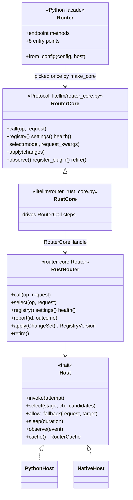

# Core, config and host interfaces

The interfaces between the Python facade, the Rust core and the process the core runs in. [The facade, the core and the hosts](../explanation/core-and-hosts.md) explains why they are shaped this way

## Python side

| Name | File | What it is |
| --- | --- | --- |
| `Router` | `litellm/router.py` | the facade. `Router(**arguments)` and `Router.from_config(config, host=python_host)` |
| `RouterCore` | `litellm/router_core.py` | the protocol the facade delegates to |
| `make_core(config, host)` | `litellm/router_core.py` | builds the core once, when the Router is built |
| `RouterConfig` | `litellm/router_config.py` | the constructor arguments, frozen, with plain containers copied (`build_router_config`) |
| `RouterDynamicConfig` | `litellm/router_config.py` | a versioned snapshot of the process settings the router reads per call (`current_dynamic_config()`) |
| `PythonHost` | `litellm/router_python_host.py` | `invoke(op)` returns the `litellm` endpoint function, plus `sleep`, `dynamic()`, the callback lists and the global cache |
| `RustCore` | `litellm/router_rust_core.py` | the driver that answers the Rust core's steps |
| `RouterHost` | `litellm/router_host.py` | what only the application can answer (vertex pass-through credentials, member auto-router authorization, prompt compression) |

`RouterDynamicConfig` fields are `num_retries`, `max_fallbacks`, `router_max_fallbacks`, `allowed_fails`, `request_timeout`, `fallbacks`, `default_fallbacks`, `context_window_fallbacks`, `content_policy_fallbacks`, `drop_params`, `provider_list`, `expose_router_debug_in_errors`, `redact_user_api_key_info`, `model_alias_map`, `model_cost`, `known_custom_logger_compatible_callbacks`, `exception_types`, `callbacks`, `success_callback`, `failure_callback`, `input_callback`, `callback_manager` and `cache`, plus its `version`

## The step protocol

`RouterCoreHandle(config, dynamic)` in `litellm.rust_bridge._native` wraps one Rust `Router`. `start(op, request)` and `select(model, request)` return a `RouterCall`. The driver calls `RouterCall.next(answer)` until it gets `done` or `failed`. Every step carries the routing events since the last step

| Step | The core needs | The driver answers with |
| --- | --- | --- |
| `attempt` | one attempt run on the named deployment | the response and its total tokens, or the typed failure |
| `sleep` | a backoff of `seconds` | nothing, after sleeping through the host |
| `allow_fallback` | whether a cross-group fallback `target` is allowed | a bool from `fallback_access_check` and `fallback_budget_check` |
| `select` | a plugin or strategy stage run on `candidates` | the remaining candidates, the pick first for a strategy |
| `cache` | a routing cache read or write | the values read, or an acknowledgement |
| `done` | nothing more | the result goes back to the caller, with routing headers |
| `failed` | nothing more | the error goes back to the caller |

`apply(changes)` returns the new registry version, `registry_version()` reads it, and `retire()` retires the router

## Rust side

All in `litellm-rust/crates/router-core/src/`

| Type | Module | What it is |
| --- | --- | --- |
| `Router`, `RouterBuilder` | `lib.rs` | `Router::new(config, dynamic, host)`, or the builder with `native_route`, `randomness` and `clock` for tests |
| `RouterConfig`, `RouterDynamicConfig`, `Op`, `RoutingStrategy` | `config.rs` | static and dynamic config, the operations, the strategies (`is_native` is true for `simple-shuffle`) |
| `Registry`, `Deployment`, `ChangeSet`, `RegistryVersion`, `deployment_id` | `registry.rs` | the immutable, indexed deployments |
| `Settings` | `settings.rs` | the frozen settings view |
| `Health`, `Outcome`, `Clock` | `health.rs` | cooldowns, allowed fails, usage and the outcome counters |
| `RouterCache`, `InMemoryRouterCache` | `cache.rs` | the routing state store |
| `Randomness`, `SeededRandomness` | `select.rs` | selection and `simple-shuffle` |
| `RouterResponse` | `call.rs` | the call loop's result with the deployment, group, retries and fallbacks used |
| `Executor`, `Executors`, `NativeRoute`, `NATIVE_RULES` | `executor.rs` | where an attempt runs |
| `Host`, `Attempt`, `RouterRequest`, `Output`, `RouterEvent`, `RoutingContext`, `SelectStage` | `host.rs` | the host seam |
| `Error`, `ConfigError`, `Unsupported`, `AttemptError`, `FailureKind` | `error.rs` | errors at build time, at call time, and per attempt |

`Op` covers `acompletion`, `atext_completion`, `aembedding`, `aresponses`, `aanthropic_messages`, `aimage_generation`, `atranscription`, `aspeech`, `aocr`, and `Other(name)` for the rest

### `RouterRequest`

| Field | Meaning |
| --- | --- |
| `model` | the requested name, a model group, alias, routing group, deployment id or wildcard match |
| `body` | the request params, for native executors and plugins |
| `team_id` | the caller's `user_api_key_team_id` |
| `specific_deployment` | the caller named a deployment's `litellm_params.model` |
| `num_retries` | a per-request retry count, which wins over the router's |
| `disable_fallbacks` | no fallbacks for this request |
| `router_weights` | per-team weights, model group to deployment id to weight |
| `payload` | what the host needs to run the call itself, such as the Python kwargs |

### `Attempt`

`op`, `request`, `deployment`, `name` (the requested name or the fallback target), `model_group` (the group served, after fallbacks), `target_order` (the order level an order fallback targets), `candidate_ids`, `retry` (0 for the first attempt in this group), `fallback_depth`, `fallback_level` (0 for the requested name) and `timeout`

### `RouterEvent`

| Event | Fields |
| --- | --- |
| `Selected` | `model_group`, `deployment_id` |
| `Succeeded` | `deployment_id` |
| `AttemptFailed` | `deployment_id`, `kind`, `status` |
| `CooldownSet` | `deployment_id`, `cooldown` |
| `Retry` | `model_group`, `retry`, `delay` |
| `Fallback` | `from`, `to`, `order`, `depth`, `level` |
| `RetriesExhausted` | `model_group`, `attempted`, `max` |

### Host capabilities

| Method | Default | `PythonHost` | `NativeHost` |
| --- | --- | --- | --- |
| `can_invoke()` | true | true | false, every served operation needs a native executor |
| `can_select()` | true | true | false, a strategy that is not native or any plugin fails the build |
| `records_outcomes()` | false | false | false |

When `records_outcomes()` is true the core leaves cooldowns and usage to the host for host-run attempts, so no failure is counted twice. With the Python core deleted, both hosts leave recording to the core

### Build-time validation

`Router::new` returns `ConfigError` when the registry cannot be built (a malformed deployment, a bad routing group) or when the host cannot serve the config. `Unsupported` names what is missing, a strategy, a plugin, or an operation and provider pair with no executor
