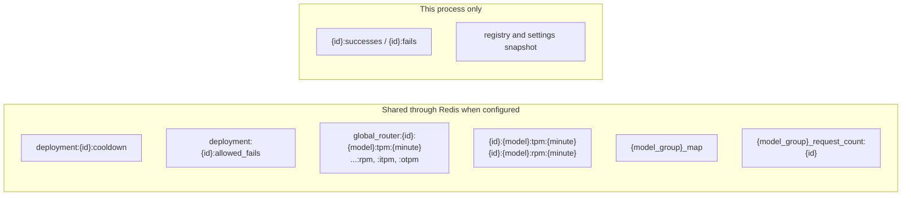

# Routing state and cache keys

Everything the router remembers between requests, where it lives, and how long it lasts. The core reads and writes these keys through `Host::cache()` with the same encodings and TTLs under both hosts, so Python proxies and Rust gateways can share one Redis. The key builders are in `litellm-rust/crates/router-core/src/health.rs`. `{id}` is the deployment's `model_info.id`, `{minute}` is the UTC time as `HH-MM`

| Key | Written by | Read by | Value | TTL | Tiers |
| --- | --- | --- | --- | --- | --- |
| `deployment:{id}:cooldown` | `Health::add_cooldown` | the cooldown filter, `health().cooldowns` | `{exception_received, status_code, timestamp, cooldown_time}` | the cooldown time | memory + Redis, memory re-checked against Redis every 1s |
| `deployment:{id}:allowed_fails` | `Health::record_failure` | the same | fail count | the cooldown time | memory + Redis |
| `deployment:{id}:allowed_fails:{suffix}` | the same, with a deployment-level policy | the same | fail count per error type | the cooldown time | memory + Redis |
| `{id}:successes`, `{id}:fails` | `Health::record_success`, `Health::record_failure` | the default error-rate cooldown rule, `health().failures_this_minute()` | count | 60s | memory only |
| `global_router:{id}:{model}:tpm:{minute}`, `:rpm:` | `Health::record_success` after each response | pre-call rate limit checks, `health().usage()` | count | 60s | Redis increment, memory |
| `global_router:{id}:{model}:itpm:{minute}`, `:otpm:` | the input and output token rate limit check (a host plugin) | the same check | input and output token counts | 60s | memory + Redis |
| `{id}:{model}:tpm:{minute}`, `{id}:{model}:rpm:{minute}` | the `usage-based-routing-v2` strategy | the same | count | 60s | memory, pushed to Redis every 1s |
| `{model_group}_map` | the `latency-based-routing` strategy | the same | latency and ttft samples per deployment | `routing_strategy_args.ttl`, 1 hour | memory + Redis |
| `{model_group}_request_count:{id}` | the `least-busy` strategy | the same | requests in flight | 1 hour | memory + Redis |

Strategies and plugins keep their own keys (the strategy counters above, the budget limiter, prompt cache pins, deployment and session affinity). A plugin ported to Rust keeps its keys, encodings and TTLs, which is what lets Python and Rust processes run side by side on one Redis while the port rolls out

## Process-local state

Some state is per router and is never shared. The registry with its indexes and `registry().version`, and the settings view, both held by the core as one snapshot that `apply()` swaps. Provider clients, cached by the host per deployment for `client_ttl` seconds. The background health check results in `health().health_checks`. These are rebuilt from config in every process, which is why deployment ids must be stable across processes
