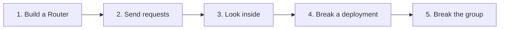
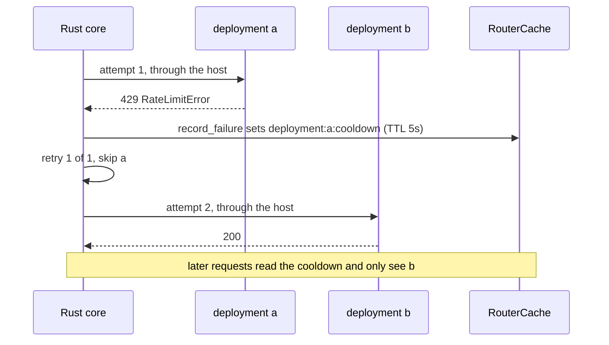
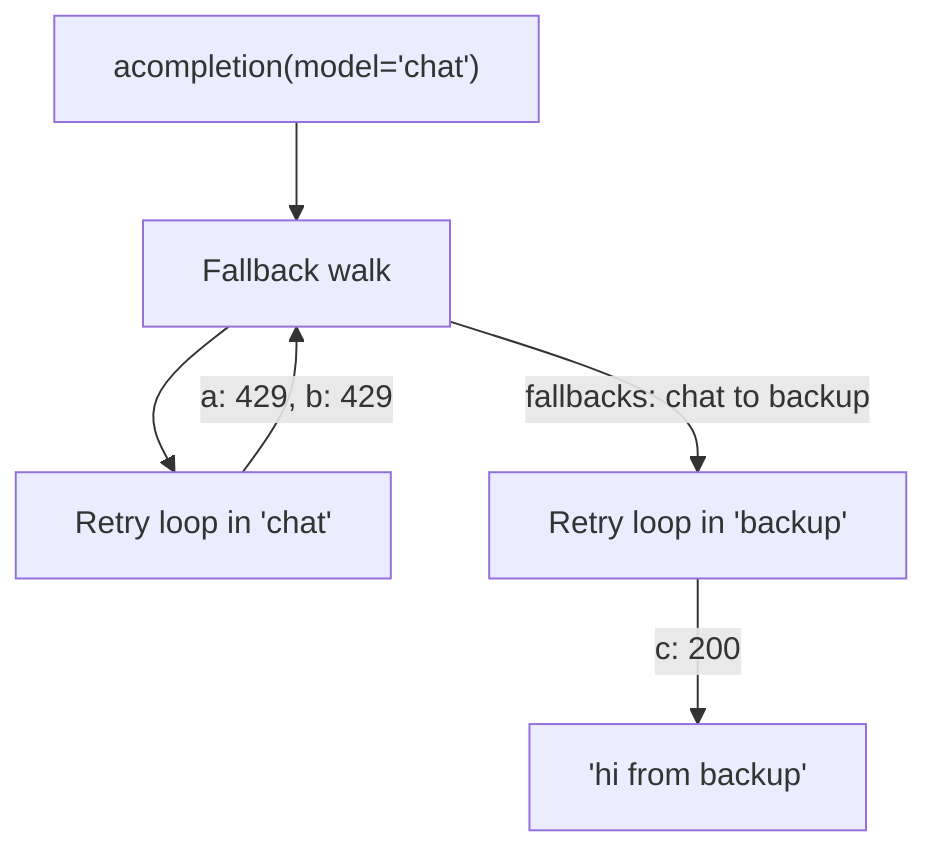

# Route your first requests

In this tutorial you build a Router with three mock deployments and watch it balance load, retry, cool a deployment down and fall back to another model group. Every deployment uses `mock_response`, so nothing leaves your machine and you need no API keys

You need a checkout of this repo with its environment installed (`uv sync`), which also builds the Rust extension the router core lives in. Run each step from the repo root with `uv run python`, or paste the steps one after another into a single file



## 1. Build a Router

Create `tutorial.py` with a model list. Two deployments, `a` and `b`, serve the model group `chat`. A third, `c`, serves the group `backup`. The router falls back from `chat` to `backup` and retries once inside a group before it does

```python
import asyncio
from collections import Counter

from litellm import Router
from litellm.router_api import ChangeSet
from litellm.types.router import Deployment


def mock(id: str, group: str, response: str) -> dict:
    return {
        "model_name": group,
        "litellm_params": {"model": "openai/gpt-4o-mini", "api_key": "sk-fake", "mock_response": response},
        "model_info": {"id": id},
    }


router = Router(
    model_list=[
        mock("a", "chat", "hi from a"),
        mock("b", "chat", "hi from b"),
        mock("c", "backup", "hi from backup"),
    ],
    fallbacks=[{"chat": ["backup"]}],
    num_retries=1,
)


async def ask() -> tuple[str, str]:
    response = await router.acompletion(model="chat", messages=[{"role": "user", "content": "hello"}])
    return response._hidden_params["model_id"], response.choices[0].message.content
```

`model_name` is the name callers send. `litellm_params` is what the router passes to `litellm.acompletion` once it picks the deployment. `model_info.id` names the deployment, and the router hashes the group and params into an id when you leave it out

`Router(...)` freezes these arguments into a `RouterConfig` and builds the Rust routing core from it. The `Router` object you hold is a thin Python facade over that core

## 2. Send requests

Add a `main` coroutine and send twenty requests

```python
async def main() -> None:
    print("picked:", Counter([(await ask())[0] for _ in range(20)]))


asyncio.run(main())
```

Run it. You see both deployments picked, in a split close to even

```
picked: Counter({'b': 12, 'a': 8})
```

No strategy was configured, so the core used `simple-shuffle`, which runs in Rust. Neither deployment sets `weight`, `rpm` or `tpm`, so each pick is a uniform random choice between the healthy deployments of the group. Each attempt still went through `litellm.acompletion`, which the core called through its Python host, so `mock_response` worked as it does without a router

## 3. Look inside

The router answers questions about itself through its entry points. Add these lines to `main`

```python
    registry = router.registry()
    print("groups:", sorted(registry.names(kind="group_set")))
    print("chat deployments:", [d["model_info"]["id"] for d in registry.deployments("chat")])
    print("strategy:", router.settings().routing_strategy)
    picked = await router.select("chat")
    print("select picked:", picked["model_info"]["id"])
```

```
groups: ['backup', 'chat']
chat deployments: ['a', 'b']
strategy: simple-shuffle
select picked: a
```

`registry()` holds the configured deployments, `settings()` is a frozen view of the configuration, and `select()` runs the same selection a real request runs without calling the provider. All three are answered by the core. [Entry points](../reference/entry-points.md) lists everything they offer

## 4. Break a deployment

Replace deployment `a` with one that always answers 429. Router settings are static after construction, so changes go through `apply()` with a `ChangeSet`. The core swaps in a new registry and bumps its version. The exact number depends on how many deployments were added before, what matters is that it goes up

```python
    broken_a = Deployment(**mock("a", "chat", "litellm.RateLimitError"))
    print("version after apply:", router.apply(ChangeSet(upsert=[broken_a])).version)
    print("picked:", Counter([(await ask())[0] for _ in range(10)]))
    print("cooldowns:", await router.health().cooldowns.async_get_active_cooldowns(
        model_ids=["a", "b", "c"], parent_otel_span=None
    ))
```

```
version after apply: 8
picked: Counter({'b': 10})
cooldowns: [('a', {'exception_received': 'litellm.RateLimitError: ...', 'status_code': '429', 'timestamp': ..., 'cooldown_time': 5})]
```

Every request succeeded. The first one that landed on `a` failed with a 429, and two things happened



The core retried in the same group and skipped `a`, so the caller got `b`'s answer. It also recorded the failure and put `a` into cooldown, because a 429 in a group with more than one deployment cools that deployment at once. For the next five seconds, the default cooldown time, selection filters `a` out before the strategy ever sees it. [Retries, fallbacks and cooldowns](../explanation/reliability.md) explains the rules

## 5. Break the group

Break `b` too and send one more request

```python
    broken_b = Deployment(**mock("b", "chat", "litellm.RateLimitError"))
    router.apply(ChangeSet(upsert=[broken_b]))
    print("answer:", await ask())
```

```
answer: ('c', 'hi from backup')
```

With both `chat` deployments failing, the retry has nowhere left to go in the group. Once retries are spent, the core's fallback walk looks up `chat` in `fallbacks`, finds `backup`, and runs the whole retry loop again against that group



## What you saw

A Router owns a list of deployments grouped by `model_name`. Each request is resolved to a group, the group's deployments are filtered, and a strategy picks one. Failures feed back into shared state (the cooldown you saw) and into the retry and fallback loop around the attempt. All of that runs in the Rust core, which calls back into Python only for the provider call itself. Code outside the router reads and changes all of this through a handful of entry points

Next, read [The facade, the core and the hosts](../explanation/core-and-hosts.md) for how the pieces fit, [The life of a request](../explanation/request-lifecycle.md) for the full path, or [Configuration and defaults](../reference/configuration.md) for the knobs you skipped here
