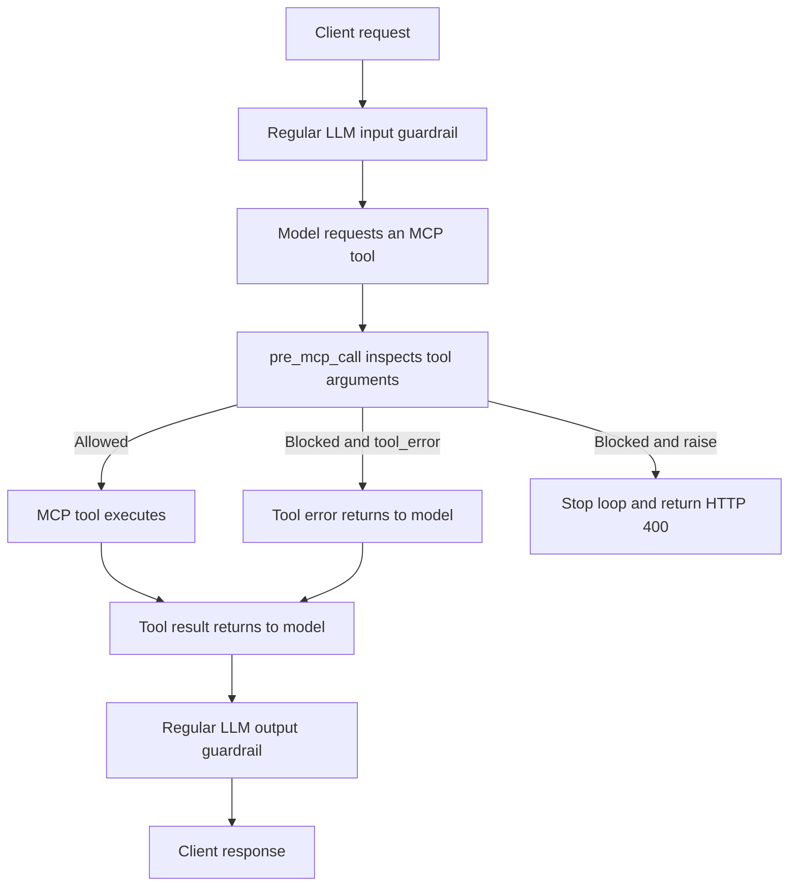

# Gateway catalog pagination

Tools, prompts, resources, and resource templates retain upstream page boundaries. Follow the gateway's opaque `nextCursor` until it is absent. Each request checks the caller's current access and tool permissions. A cursor can be replayed and can be sent to another replica serving the same configuration

Set the same nonempty `LITELLM_SALT_KEY` on every replica. Pagination state uses authenticated encryption with purpose-separated HKDF keys derived only from this value. The master key is never a fallback. Complete single-page lists and direct tool calls work without a salt key; a listing that needs continuation returns an actionable configuration error instead of truncated results. Some SDKs automatically list tools when validating a tool-call response, so those SDK calls also require a salt when that listing is paginated

Cursors expire ten minutes after the first page. Continuations do not extend that deadline. Rotating the salt invalidates all outstanding cursors; clients must start a new listing. During a rolling key change, replicas with different keys cannot accept each other's cursors. Coordinate the change across the fleet

A changed registry, caller scope, or available upstream revision requires a fresh listing. When an upstream exposes a string or integer `_meta.revision`, subsequent pages must retain it. Otherwise consistency follows that upstream's own cursor guarantees. Repeated upstream cursors and the existing upstream page limit stop traversal with an explicit error

Listing failures retain per-server outcome metadata. An incomplete upstream catalog cannot establish a bare tool-name route. Complete initial pages retain legacy bare-name routing. Use the server-prefixed names returned by the gateway for paginated catalogs

For a scoped rollout, keep the previous source build serving the control pool and send only selected clients to a separate candidate pool. All candidate replicas must share configuration and salt. Verify page one on one candidate replica and continuation on another, plus a fresh listing and tool call on the control pool. Do not mirror tool calls between pools

For rollback, stop sending new requests to the candidate pool, drain its in-flight operations, and return selected clients to the control pool. Clients must discard candidate cursors and start a fresh listing when crossing versions; older gateways do not validate these cursors. Keep the registry-revision migration installed when rolling back pagination. Verify a fresh listing and a tool call after switching pools

## Elicitation

Elicitation is disabled by default. Enable it per upstream in `config.yaml`; `allow_elicitation` is currently YAML-only and is not editable through the Admin UI or database-backed server API

```yaml
mcp_servers:
  interactive:
    url: https://mcp.example.com/mcp
    transport: http
    allow_elicitation: true
    timeout: 60
```

The downstream MCP client must advertise the requested form or URL capability during initialization. Use the gateway's legacy SSE endpoint (`/mcp/sse`) for the verified interactive form and URL relay path. The current Streamable HTTP endpoint (`/mcp`) can lose initialization state before a tool call, so even a client that advertised support receives an explicit elicitation error instead of an input request. Successful interactive relay over Streamable HTTP is not currently verified. Stateless calls and LLM tool bridges with no downstream MCP client also receive explicit errors

The relay wait uses the upstream server's existing `timeout` setting, or `LITELLM_MCP_CLIENT_TIMEOUT` (60 seconds by default). The enclosing tool call also retains its existing timeout. Unsupported modes, disconnects and relay failures return errors, never a fabricated user decline. Actual user accept, decline and cancel responses are preserved; cancellation stops the relay

## Choosing how an MCP guardrail block reaches the caller

Set `on_mcp_block` on the guardrail's shared `litellm_params`, beside `mode`. This is an execution policy for every guardrail provider, rather than a model parameter or an MCP server setting

```yaml
guardrails:
  - guardrail_name: tool-policy
    litellm_params:
      guardrail: litellm_content_filter
      mode: pre_mcp_call
      on_mcp_block: raise
      default_on: true
      blocked_words:
        - keyword: forbidden-tool-argument
          action: BLOCK
```

The default, `tool_error`, preserves the existing flow. LiteLLM turns a blocked tool call into a tool error and lets the model continue. With `raise`, an explicit policy refusal in `pre_mcp_call` or `during_mcp_call` stops a non-streaming LiteLLM-managed Chat Completions or Responses tool loop and returns HTTP 400. LiteLLM does not execute subsequent tools in that loop or send the refusal back to the model for a follow-up completion. An ordinary guardrail backend failure retains its existing error handling

A regular LLM guardrail inspects the model request or response. An MCP guardrail inspects a tool invocation. The same guardrail provider can serve either role, selected by `mode`



`during_mcp_call` runs concurrently with tool execution. A refusal stops further orchestration but cannot undo a tool that has already executed. `post_mcp_call` is outside this option's scope. Ordinary LLM hooks on the same guardrail keep their existing behavior

An active `raise` policy is rejected before tool execution on native MCP, where errors use MCP protocol semantics. Streaming managed loops reject the policy before the first model completion because HTTP status cannot change after streaming begins. Use `tool_error` for those surfaces. The existing `/mcp-rest/tools/call` error contract remains unchanged

The dashboard exposes this setting as **When an MCP tool is blocked** when the configured modes include `pre_mcp_call` or `during_mcp_call`, including tag-selected modes. An unrelated PATCH preserves the saved value. Removing all supported MCP modes requires resetting the policy to `tool_error`, which the dashboard does automatically. No database migration is needed because guardrail parameters are stored as JSON
