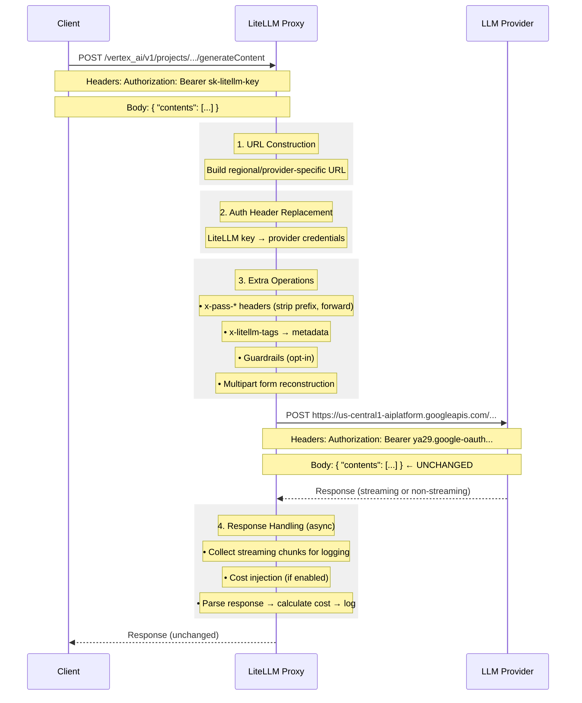

# Pass-Through Endpoints Architecture

## Why Pass-Through Endpoints Transform Requests

Even "pass-through" endpoints must perform essential transformations. The request **body** passes through unchanged, but:

## Essential Transformations

- **URL Construction** - Build correct provider URL (e.g., regional endpoints for Vertex AI, Bedrock)
- **Auth Header Replacement** - Swap LiteLLM virtual key for actual provider credentials

## Extra Operations

| Operation | Description |
|-----------|-------------|
| `x-pass-*` headers | Strip prefix and forward (e.g., `x-pass-anthropic-beta` → `anthropic-beta`) |
| `x-litellm-tags` header | Extract tags and add to request metadata for logging |
| Streaming chunk collection | Collect chunks async for logging after stream completes |
| Multipart form handling | Reconstruct multipart/form-data requests for file uploads |
| Guardrails (opt-in) | Run content filtering when explicitly configured |
| Cost injection | Inject cost into streaming chunks when `include_cost_in_streaming_usage` enabled |

## What Does NOT Change

- Request body
- Response body
- Provider-specific parameters

## Anthropic stream diagnostics

Set `LITELLM_ANTHROPIC_STREAM_DIAGNOSTICS=slow` to collect an end-of-stream
summary for incomplete or failed native Anthropic streams, content gaps of at
least 30 seconds, or ASGI sends taking at least one second. `errors` omits slow
completed streams. `all` includes every observed stream. The default is `off`.
Remove the variable or set it to `off`
and restart the workers to disable the additional summaries. This does not
disable normal success/failure callbacks or change billing

Each native HTTP attempt can emit one `provider_read` summary. A routed stream
can also emit one `router_emit` summary and one `http_send` summary. Retries have
their own attempt summaries. Each stage emits at most once, with no per-token
or periodic logs. At one million single-attempt routed requests, `all` can emit
approximately three million summary lines. Use `slow` for routine troubleshooting
and `all` for a bounded investigation that needs a complete comparison of stages.
Stage filtering is independent, so the absence of a summary in `slow` or `errors`
mode does not establish that a stage received no content
Keep the proxy logger at INFO rather than enabling detailed DEBUG logging

Correlate summaries by `call_id`, the provider's `message_id` and, when supplied,
an allowlisted `upstream_request_id` response header. The summaries
contain byte and event counts, text character counts, first-byte and first-text timings, thinking and
tool-delta counts, terminal-event counts and the end reason. Tencent's
`x-tc-requestid` and its spelling variants are accepted case-insensitively,
including the proxy's `llm_provider-` prefix. If the provider supplies no ID,
`upstream_request_id` stays null. No synthetic provider ID is substituted

Times are relative to the observation stage starting. Add `started_at_unix_ms`
to an event's elapsed milliseconds to compare wall-clock arrival times.
`started_monotonic_ms` allows comparisons within the same worker without wall-clock
adjustments. A provider observer starts after HTTP headers are available, while
the HTTP-send observer starts after the proxy's first-chunk inspection.
These values are not total request latency or model execution time.
`first_content_ms` includes nonempty text, thinking and tool-argument deltas;
`first_text_ms` includes only nonempty answer text

`provider_read.text_chars > 0` with no corresponding `router_emit.text_chars`
shows that LiteLLM received text before its router emitted it. Zero text characters
at `provider_read` means no nonempty text delta was observed there, not proof
that the provider never generated text. Thinking and ping counts help distinguish
reasoning from an entirely silent stream. `router_emit` means yielded to the
next consumer. `http_send` counts a body chunk only after the ASGI `send` call
returns. `first_send_attempt_ms`, `last_send_completed_ms`, `max_send_ms` and
unfinished or failed send counters distinguish yielding from a blocked send.
ASGI acceptance still does not prove that downstream proxies or clients received those bytes.
Compare ingress and client logs for failures beyond that boundary

These summaries never include prompts, generated text, tool arguments, keys,
raw headers or raw exception messages. The diagnostic parser retains at most
64 KiB of an unfinished event. Oversized or malformed events increase
`unparsed_frames`, making content counts inconclusive for those events without
changing the forwarded bytes. Empty data-bearing events increase
`empty_data_frames` and make the summary incomplete, while comment heartbeats
are ignored. A worker killed before teardown cannot emit its
final summary. A process that stays stuck without teardown also has no final
summary yet. This logging does not add a timeout, retry or cancellation policy

An HTTP 200 with no complete `message_stop`, or an SSE provider error, is logged
as a failed stream. Partial token usage and its cost still reach the failure
callbacks. Initial `message_start.usage.output_tokens` alone does not establish
a successful response. A consumer closing an unfinished stream is recorded as
499 rather than a provider 5xx. A premature upstream EOF is recorded as 502.
These are logging outcomes, not replacements for HTTP headers already sent
