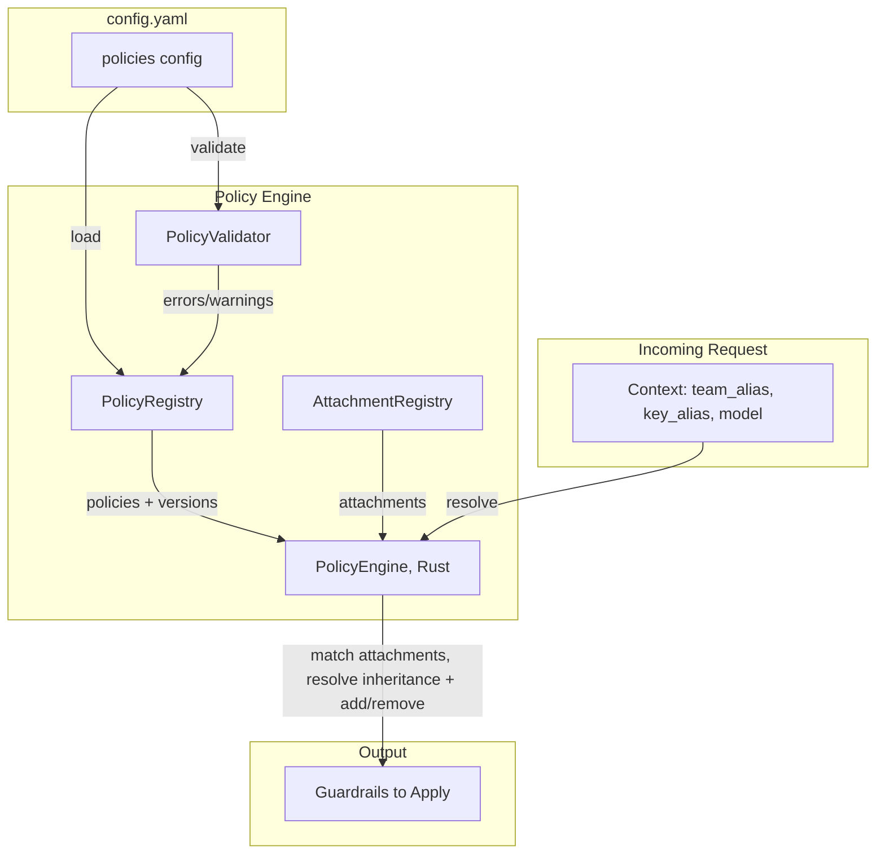

# Policy Engine Architecture

## Overview

The Policy Engine allows administrators to define policies that combine guardrails with scoping rules. Policies can target specific teams, API keys, and models using wildcard patterns, and support inheritance from base policies.

## Architecture Diagram

## Components

| Component | File | Description |
|-----------|------|-------------|
| **PolicyRegistry** | `policy_registry.py` | In-memory singleton store for parsed policies |
| **PolicyValidator** | `policy_validator.py` | Validates configs (guardrails, inheritance, teams/keys/models) |
| **AttachmentRegistry** | `attachment_registry.py` | In-memory store for policy attachments (where policies apply) |
| **PolicyEngine** | `litellm/rust_bridge/policy_engine.py`, crate `litellm-policy-engine` | Matches attachments, evaluates conditions and resolves inheritance in Rust over a snapshot of both registries |

## Flow

1. **Startup**: `init_policies()` loads policies from config, validates, and populates `PolicyRegistry`
2. **Request**: `current_policy_engine().resolve(context)` finds the attachments matching the request's team/key/model/tags
3. **Resolution**: the same call traverses inheritance, applies add/remove and returns the final guardrails and pipelines. The engine is rebuilt only when a registry replaces its policies or attachments
